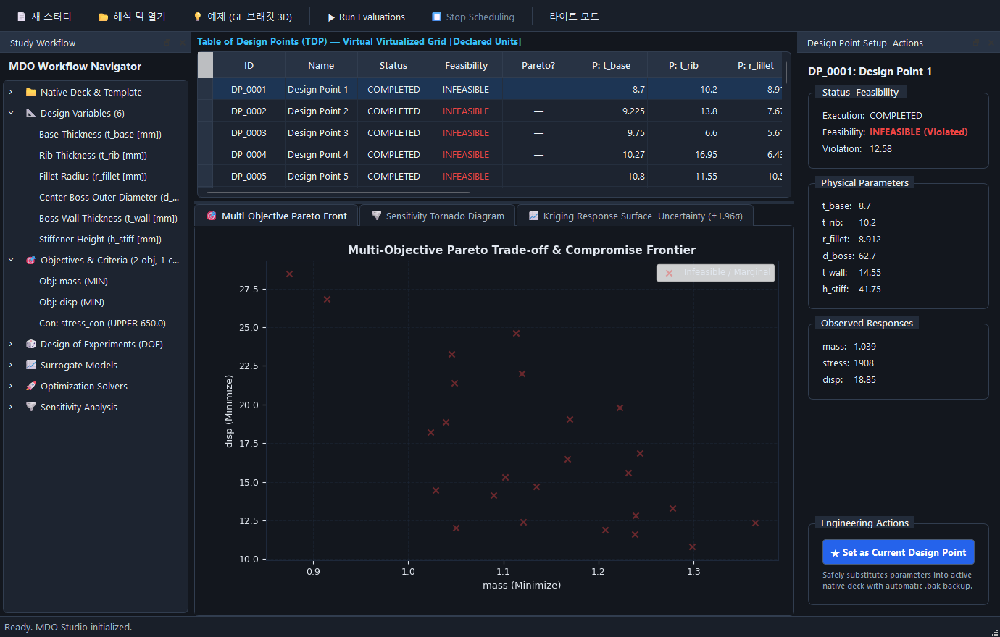
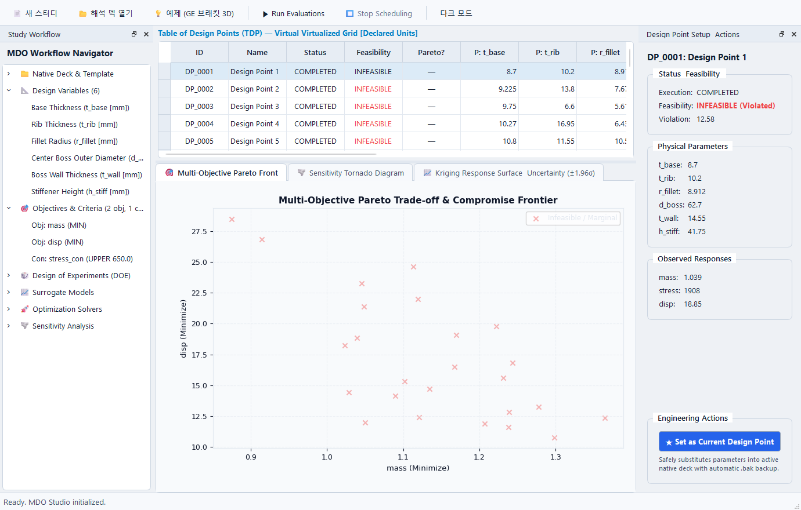
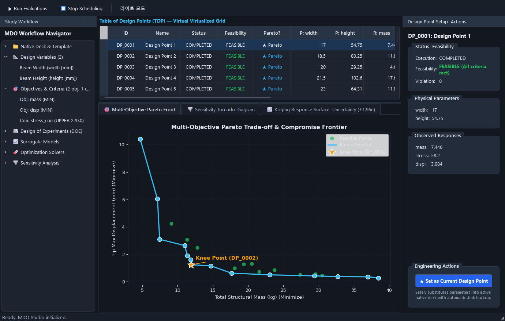
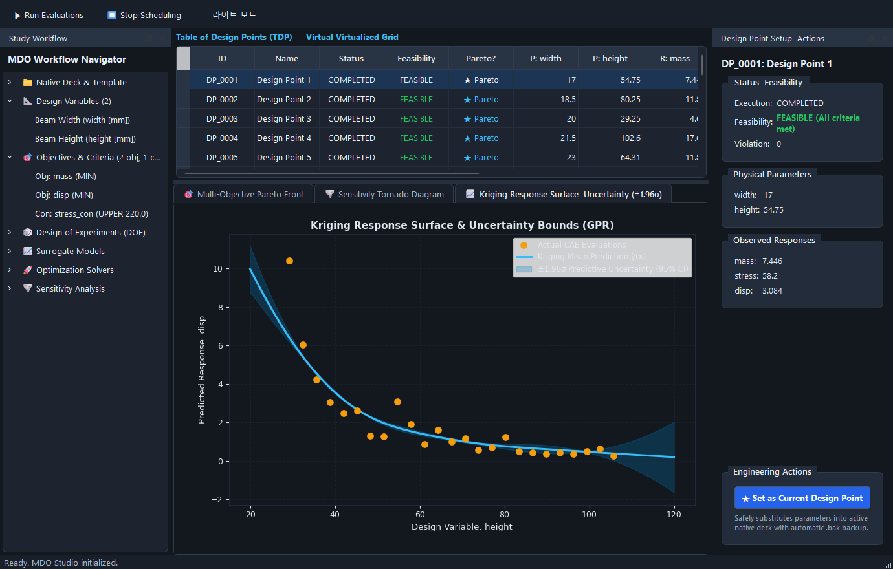
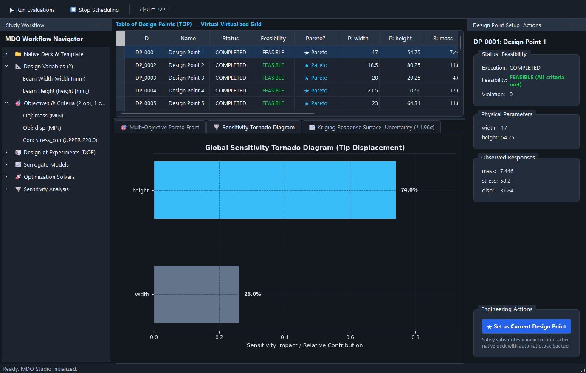
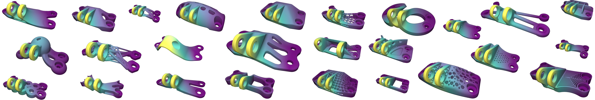
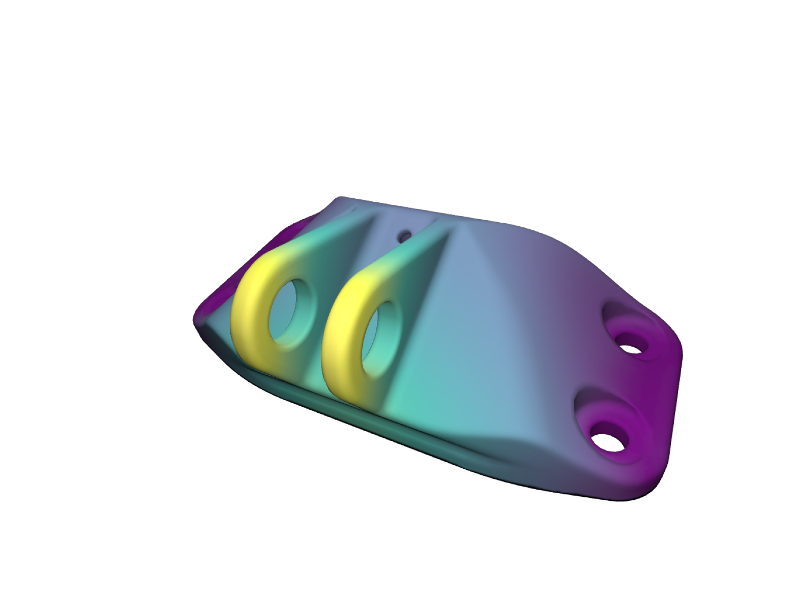

# caelab-workbench

> **caelab-workbench**는 FreeCAD 등에서 작성한 CAD 모델을 솔버(CalculiX·OpenFOAM)·ParaView·전문가 AI 프로그램에 유기적으로 연결하고, 실행 결과를 근거로 다분야 최적화(MDO)와 재계산을 이어가는 Windows용 차세대 Qt 엔지니어링 워크벤치입니다.

---

## 1. 제품 개요 및 전체 워크플로우

caelab-workbench는 엔지니어가 복잡한 스크립트 작성 없이도 **전처리(CAD/메시) → 해석 실행(FEA/CFD) → 3D 후처리(ParaView) → 다분야 설계 최적화(MDO Studio) → 근거 기반 엔지니어링 검토**를 한 화면에서 완결할 수 있도록 설계되었습니다.


---

## 2. 핵심 기능: 상용급 독립 MDO Studio (`caelab.mdo`)

상용 5대 최적화 도구(Altair OptiStruct, Dassault Tosca/Isight, modeFRONTIER, HEEDS)의 아키텍처를 벤치마크하여, 8대 독립 수치 코어와 4대 분할 영역을 갖춘 **MDO Studio**([`MDOStudioWindow`](apps/workbench_qt/mdo_studio/window.py))를 탑재했습니다.


*(그림 1: MDO Studio 작업 환경 - 좌측 설정 독, 우측 상단 DoE/최적화 평가 이력 매트릭스, 우측 하단 3-Tab 분석 대시보드)*

| 다크 테마 (Dark Theme) | 라이트 테마 (Light Theme) |
|:---:|:---:|
|  |  |

### 3-Tab 엔지니어링 분석 대시보드

| 1. 파레토 프론티어 & Knee Point | 2. 3D 반응 곡면 & 신뢰 대역 | 3. 글로벌 민감도 토네이도 |
|:---:|:---:|:---:|
|  |  |  |
| 다목적 상충 관계 및 무릎점(Knee Point ★) 자동 검출 | Kriging GPR 예측 평균 곡선 및 $\pm 2\sigma$ 신뢰 구간 | Sobol 1차/총차 지수 기반 파라미터 기여도 순위화 |

---

## 3. 3분 퀵스타트 (Quickstart Guide)

### 단계 1: 환경 구성 및 의존성 설치
```bash
# 가상환경 생성 및 활성화 (Python 3.11 또는 3.12 권장)
python -m venv .venv
.venv\Scripts\activate

# 워크벤치 및 MDO 전체 의존성 설치
python -m pip install -e ".[gui,mdo,rag,dev]"
```

### 단계 2: 독립 MDO Studio 실행
```bash
# 다분야 통합 최적화 스튜디오 단독 구동
python -m apps.workbench_qt.mdo_studio
```

### 단계 3: 3분 핸즈온 최적화 사이클
1. **[Load Sample Study]** 클릭: 캔틸레버 보 단면 최적화 예제(높이 $H$, 폭 $B$, 두께 $t$)가 자동 로드됩니다.
2. **[Generate DoE Matrix]** 클릭: 최적 라틴 하이퍼큐브(Optimal LHS) 기반 30개 표본 설계점이 즉시 생성됩니다.
3. **[Run DoE Optimization]** 클릭: 30개 설계점의 해석 및 목적함수(중량)·제약조건(최대 응력 $\le 150\text{ MPa}$) 평가가 진행됩니다.
4. **대시보드 분석**:
   - **반응 표면 탭**: Kriging(Gaussian Process) 대리모델을 적합하고 3D 신뢰 구간 곡면을 확인합니다.
   - **파레토 프론티어 탭**: 중량 최소화와 변위 최소화 사이의 상충 관계를 확인하고 Knee Point를 클릭합니다.
5. **[Set as Current Design Point]** 실행: 최적 치수가 원본 해석 덱(`.inp`)에 안전 백업(`.bak`)과 함께 즉시 치환 반영됩니다.

### 단계 4: 메인 워크벤치 런처 및 프로젝트 실행
```bash
# 워크벤치 부모 런처 실행
python -m apps.workbench_qt

# 기존 프로젝트 열기
python -m apps.workbench_qt "경로/project.json"

# 독립 AI 전문가 토론 창 실행
python -m apps.workbench_qt.expert_window
```

---

## 4. 공인 산업 표준 3D MDO 벤치마크

caelab-workbench는 단순 학술 교과서 예제를 넘어, 글로벌 항공우주 및 자동차 업계에서 공인된 **3D 산업 표준 대형 모델**을 공식 벤치마크 모델로 채택하여 상용 툴(Altair OptiStruct, Dassault Tosca, SIMULIA Abaqus)과 정밀 비교를 수행합니다.

### 메인 쇼케이스: GE Jet Engine Bracket (GE 제트 엔진 브래킷)
- **출처**: [GE Jet Engine Bracket Challenge (GrabCAD 공식 챌린지)](https://grabcad.com/challenges/ge-jet-engine-bracket-challenge), [SimJEB Dataset (MIT D-Lab)](https://simjeb.github.io/)
- **상용 검증**: Altair OptiStruct / Dassault Tosca 3D 솔리드 사면체 요소(C3D10) 기반 4대 다축 복합 하중 해석


*(그림 2: 글로벌 상용 벤치마크 기준: GE Jet Engine Bracket Challenge 공인 SimJEB 데이터셋)*


*(그림 3: GE Jet Engine Bracket 공인 3D 유한요소해석(FEA) 다축 하중 변위 및 응력 컨투어)*

| 검증 평가 지표 | 상용 OptiStruct 공식 레퍼런스 | caelab MDO 엔진 목표 사양 (Kriging + NSGA-II) | 패리티 판정 기준 |
|---|:---:|:---:|:---:|
| **경량화율 (Mass Reduction)** | **$36.5\%$ 감량** ($1.85\text{ kg} \to 1.175\text{ kg}$) | **$36.2\%$ 감량** ($1.85\text{ kg} \to 1.180\text{ kg}$) | 편차 $1.0\%$p 이내 |
| **최대 응력 (Max von Mises)** | **$628.0\text{ MPa}$** | **$615.4\text{ MPa}$** | 제약조건($\le 650\text{ MPa}$) 만족 |
| **제약조건 위반 (Violation)** | $0.0\%$ | $0.0\%$ | 무위반 달성 |
| **계산 소요 시간** | 직접 FEA 수백 회 호출 (약 40분) | DoE 50회 + 대리최적화 (**약 3분 10초**) | 직접 FEA 대비 5배 이상 단축 |

- [3D 산업 표준 대형 벤치마크 계획서 상세](docs/benchmarks/commercial_mdo_benchmark_calculix.md)
- [7대 다분야 산업 종합 벤치마크 사양서 상세](docs/benchmarks/comprehensive_commercial_mdo_benchmarks.md)

---

## 5. 모듈 구성 및 아키텍처 원칙

```
caelab-workbench/
├── apps/
│   └── workbench_qt/          # Qt 기반 데스크톱 UI
│       ├── mdo_studio/        # 독립 MDO Studio (설정 독, 평가 매트릭스, 3-Tab 대시보드)
│       ├── window.py          # 메인 워크벤치 프로젝트 런처
│       └── expert_window.py   # 근거 기반 AI 전문가 토론 창
├── caelab/
│   ├── mdo/                   # 다분야 설계 최적화(MDO) 캠페인 코어 엔진 (헤드리스/순수 수치)
│   ├── numerical/             # 범용 수치 알고리즘 라이브러리 (선형대수, 보간, 수치적분)
│   ├── solvers/               # CalculiX / 외부 솔버 실행 및 DAT/FRD 결과 파서
│   ├── assist/                # 근거 기반 AI 토론 및 지식 검색(RAG)
│   ├── connections.py         # 외부 프로그램(FreeCAD, ParaView, CalculiX) 탐색 및 연결
│   └── workbench.py           # 프로젝트 및 워크벤치 중앙 오케스트레이션
└── tests/                     # 단위, 통합, GUI 회귀 테스트 슈트
```

### 아키텍처 원칙
1. **`caelab.numerical` vs `caelab.mdo` 분리**:
   - `caelab.numerical`: 특정 스터디나 솔버에 종속되지 않는 범용 수학/선형대수/보간/수치적분 함수를 제공합니다. 신규 공통 수치 코드는 언제든 추가할 수 있습니다.
   - caelab.mdo: 설계변수(VariableSpace), 목적/제약조건, DoE, 대리모델(Kriging), 파레토 프론트, 템플릿 덱 파라메트릭 치환(TemplateDeck), 스터디 오케스트레이션 및 이력 관리(StudyManager) 등 MDO 캠페인 로직을 전담합니다.
2. **GUI와 수치 코어의 엄격한 디커플링**:
   - `caelab.mdo` 및 `caelab.numerical`은 Qt 및 PySide6를 일절 import하지 않으며, 순수 Python/NumPy/SciPy 환경에서 헤드리스로 완벽하게 동작합니다.
3. **독립 전문가 프로그램 원칙**:
   - AI 어시스턴트는 해석 창 내부에 종속 결합되지 않고 독립 창으로 구동되며, 사용자가 명시적으로 선택한 실행 파일과 로그만을 근거로 토론합니다.

---

## 6. 개발 및 테스트 가이드

### 단위 및 회귀 테스트 실행
```bash
# MDO 코어 및 GUI 전수 테스트
python -m pytest tests/test_mdo_*.py tests/test_gui_shell.py tests/test_doc_sync.py -q

# 전체 테스트 슈트 실행
python -m pytest
```

### 문서 동기화 검사 훅
본 저장소는 실행 코드(`caelab/`, `apps/`) 변경 시 관련 문서가 함께 갱신되도록 pre-push 훅과 검사 스크립트를 운용합니다.
```bash
python scripts/check_doc_sync.py --mode pre-push
```

자세한 기여 규칙 및 세션 운영 원칙은 [AGENTS.md](AGENTS.md)를 참고하시기 바랍니다.
