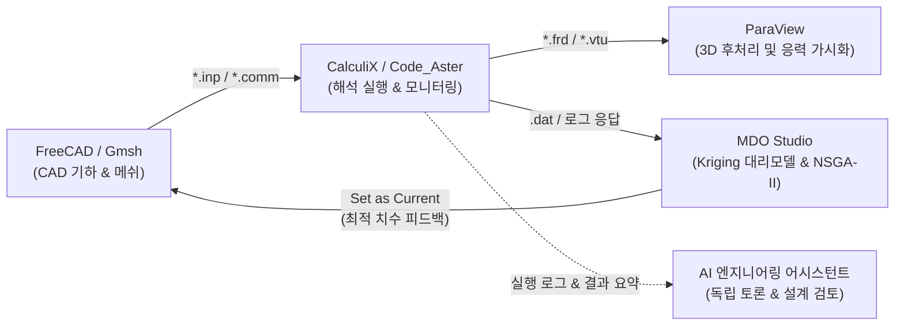
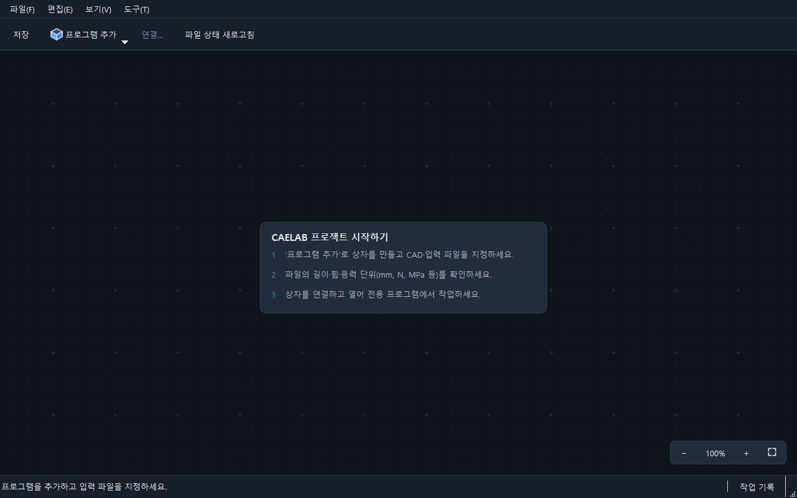
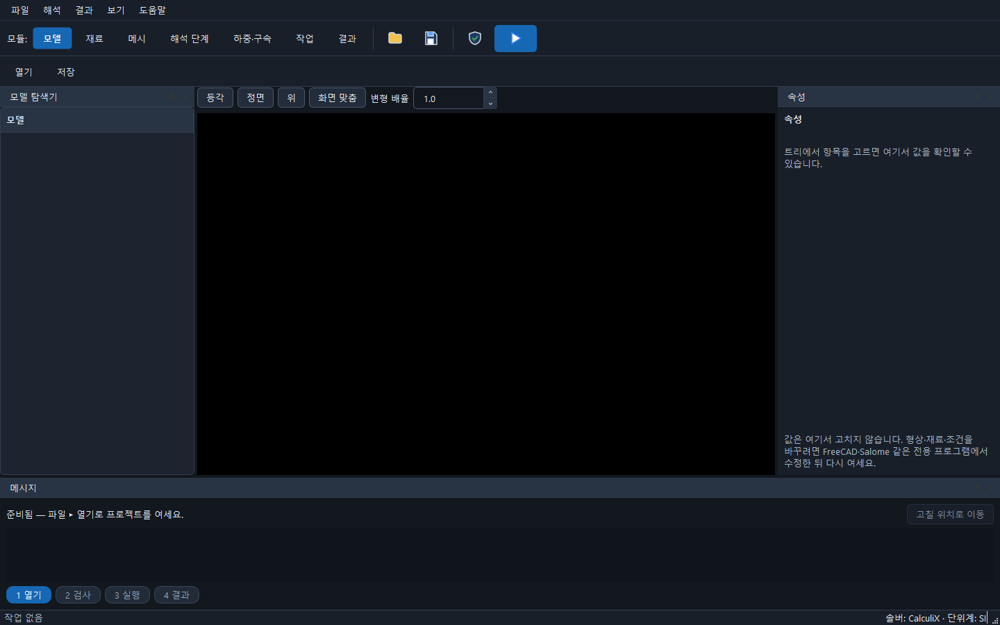
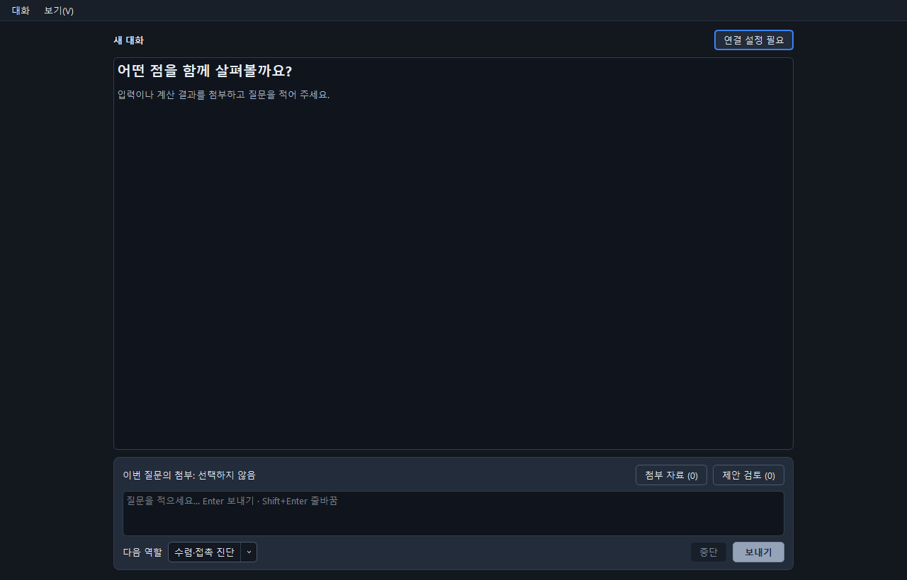

# caelab-workbench

> **caelab-workbench**는 FreeCAD 등에서 작성한 CAD 모델을 솔버(CalculiX·Code_Aster)·ParaView·전문가 AI 프로그램에 유기적으로 연결하고, 실행 결과를 근거로 다분야 최적화(MDO)와 재계산을 이어가는 Windows용 차세대 Qt 엔지니어링 워크벤치입니다.

---

## 1. 제품 개요 및 전체 워크플로우

caelab-workbench는 엔지니어가 복잡한 스크립트 작성 없이도 **전처리(CAD/메시) → 해석 실행(FEA) → 3D 후처리(ParaView) → 다분야 설계 최적화(MDO Studio) → 근거 기반 엔지니어링 검토**를 유기적으로 완결할 수 있도록 설계되었습니다.



---

## 2. caelab-workbench 5대 핵심 기둥 (Core Pillars)

caelab-workbench는 [DESIGN.md](DESIGN.md)의 제품 정의에 따라 5대 핵심 기둥으로 구성되어 상호 독립적이면서도 유기적으로 연결됩니다.

### 기둥 1: 중앙 프로젝트 런처 & 스키매틱 연결 ([`ProjectWindow`](apps/workbench_qt/project_window.py))
외부 프로그램(FreeCAD, CalculiX, ParaView)의 설치 및 연결 상태를 실시간 진단하고, 해석 파일 및 프로젝트 스냅샷의 생명주기를 중앙에서 관리합니다.


*(그림 1: 중앙 프로젝트 런처 - 외부 CAE 프로그램 연결 상태 진단 및 프로젝트 관리)*

### 기둥 2: FreeCAD 3D CAD 모델링 & FEM 전처리
FreeCAD FEM 워크벤치를 통해 3D 기하 모델링, 재료 물성 정의, 하중/경계조건 부여 및 사면체(C3D10/C3D4)·육면체(C3D8)·셸(S8/S4) 메쉬를 생성하고 표준 해석 덱(`.inp`)을 출력합니다.


*(그림 2: CAE 메인 작업 화면 - 기하 형상, 유한요소 메시, 하중 경계조건 전처리)*

### 기둥 3: CalculiX 네이티브 솔버 실행 및 실시간 모니터링 ([`NativeAnalysisWindow`](apps/workbench_qt/native_analysis.py))
Windows 네이티브 환경에서 `ccx` 백그라운드 프로세스를 직접 구동하며, 실시간 수렴 잔차(Residual) 및 로그를 모니터링하고 원자적 프로세스 트리 제어로 좀비 프로세스를 방지합니다.

### 기둥 4: ParaView 3D 필드 사후 가시화
해석 완료 후 생성된 대용량 3D 필드(`.frd`, `.vtu`)를 ParaView로 즉시 전송하여 절점 변위, 폰 미세스 등가응력, 주응력 컨투어를 3D 인터랙티브로 가시화합니다.

### 기둥 5: 독립 엔지니어링 프로그램군 (AI Expert & MDO Studio)
- **근거 기반 독립 AI 전문가 토론 창 ([`ExpertWindow`](apps/workbench_qt/expert_window.py))**:
  해석 창 내부에 종속 결합되지 않고 독립 프로세스/창으로 구동되며, 사용자가 명시적으로 선택한 실행 파일과 솔버 로그만을 근거로 공학적 진단과 토론을 수행합니다.
- **상용급 독립 다분야 최적화 스튜디오 ([`MDOStudioWindow`](apps/workbench_qt/mdo_studio/window.py))**:
  8대 독립 수치 코어와 4대 분할 영역을 갖추고, 실제 CalculiX 해석 결과를 직접 파싱하여 DoE 표본 생성, Kriging(GPR) 대리모델 적합, 파레토 프론트 도출, 민감도 분석 및 덱 기반 파라메트릭 치환을 완결합니다.


*(그림 3: 독립 AI 전문가 토론 창 - 솔버 로그 및 실행 결과 근거 기반 토론)*

| MDO Studio 다크 모드 (Dark Mode) | MDO Studio 라이트 모드 (Light Mode) |
|:---:|:---:|
|  |  |

#### MDO Studio 3-Tab 엔지니어링 분석 대시보드
| 1. 파레토 프론티어 & Knee Point | 2. 3D 반응 곡면 & 신뢰 대역 | 3. 글로벌 민감도 토네이도 |
|:---:|:---:|:---:|
|  |  |  |
| 다목적 상충 관계 및 무릎점(Knee Point ★) 자동 검출 | Kriging GPR 예측 평균 곡선 및 $\pm 2\sigma$ 신뢰 구간 | Sobol 1차/총차 지수 기반 파라미터 기여도 순위화 |

---

## 3. 3분 퀵스타트 (Quickstart Guide)

### 단계 1: 환경 구성 및 의존성 설치
```bash
# 가상환경 생성 및 활성화 (Python 3.11 또는 3.12 권장)
python -m venv .venv
.venv\Scripts\activate

# 워크벤치 전체 의존성 설치
python -m pip install -e ".[gui,mdo,rag,dev]"
```

### 단계 2: 중앙 워크벤치 런처 및 프로젝트 실행
```bash
# 워크벤치 부모 런처 실행
python -m apps.workbench_qt

# 기존 프로젝트 열기
python -m apps.workbench_qt "경로/project.json"
```

### 단계 3: 독립 프로그램 단독 구동
```bash
# 다분야 통합 최적화 스튜디오 단독 구동
python -m apps.workbench_qt.mdo_studio

# 독립 AI 전문가 토론 창 단독 구동
python -m apps.workbench_qt.expert_window
```

### 단계 4: MDO Studio 3분 핸즈온 최적화 사이클
1. **[Load Sample Study]** 클릭: 캔틸레버 보 단면 최적화 예제(높이 $H$, 폭 $B$, 두께 $t$) 또는 GE 항공 제트엔진 브래킷 예제가 자동 로드됩니다.
2. **[Generate DoE Matrix]** 클릭: 최적 라틴 하이퍼큐브(Optimal LHS) 기반 표본 설계점이 즉시 생성됩니다.
3. **[Run DoE Optimization]** 클릭: 비동기 배치 해석이 구동되며, 실제 CalculiX 솔버의 절점 변위, 폰 미세스 응력, 지점 반력, 질량 응답이 실시간 수집·평가됩니다.
4. **대시보드 분석**: 반응 표면 탭(Kriging 3D 신뢰 구간), 파레토 프론티어 탭(Knee Point 선정), 민감도 탭(Spearman 순위)을 확인합니다.
5. **[Set as Current Design Point]** 실행: 최적 치수가 원본 해석 덱(`.inp`)에 안전 백업(`.bak`)과 함께 즉시 치환 반영됩니다.

---

## 4. 공인 산업 표준 3D MDO 벤치마크

caelab-workbench는 단순 학술 교과서 예제를 넘어, 글로벌 항공우주 및 자동차 업계에서 공인된 **3D 산업 표준 대형 모델**을 공식 벤치마크 모델로 채택하여 상용 툴(Altair OptiStruct, Dassault Tosca)과 정밀 비교 검증을 수행합니다.

- **메인 쇼케이스 모델**: GE Jet Engine Bracket (항공 제트 엔진 브래킷, Ti-6Al-4V, C3D10 다축 복합 하중 해석)
- **검증 사양 상세 문서**:
  - [3D 산업 표준 대형 벤치마크 계획서 상세](docs/benchmarks/commercial_mdo_benchmark_calculix.md)
  - [7대 다분야 산업 종합 벤치마크 사양서 상세](docs/benchmarks/comprehensive_commercial_mdo_benchmarks.md)

---

## 5. 모듈 구성 및 아키텍처 원칙

```
caelab-workbench/
├── apps/
│   └── workbench_qt/          # Qt 기반 데스크톱 UI
│       ├── mdo_studio/        # 독립 MDO Studio (설정 독, 평가 매트릭스, 3-Tab 대시보드)
│       ├── window.py          # 메인 워크벤치 프로젝트 런처
│       ├── expert_window.py   # 근거 기반 AI 전문가 토론 창
│       └── native_analysis.py # CalculiX 네이티브 해석 실행 및 모니터링 창
├── caelab/
│   ├── mdo/                   # 다분야 설계 최적화(MDO) 캠페인 코어 엔진 (헤드리스/순수 수치)
│   ├── numerical/             # 범용 수치 알고리즘 라이브러리 (선형대수, 보간, 수치적분)
│   ├── solvers/               # CalculiX / 외부 솔버 실행 및 DAT/FRD 결과 파서
│   ├── native/                # 다중 솔버 어댑터 디스패치 (CalculiX, Code_Aster, Radioss)
│   ├── assist/                # 근거 기반 AI 토론 및 지식 검색(RAG)
│   ├── connections.py         # 외부 프로그램(FreeCAD, ParaView, CalculiX) 탐색 및 연결
│   └── workbench.py           # 프로젝트 및 워크벤치 중앙 오케스트레이션
└── tests/                     # 단위, 통합, GUI 회귀 테스트 슈트
```

### 아키텍처 원칙
1. **`caelab.numerical` vs `caelab.mdo` 분리**:
   - `caelab.numerical`: 특정 스터디나 솔버에 종속되지 않는 범용 수학/선형대수/보간/수치적분 함수를 제공합니다. 신규 공통 수치 코드는 언제든 추가할 수 있습니다.
   - `caelab.mdo`: 설계변수(VariableSpace), 목적/제약조건, DoE, 대리모델(Kriging), 파레토 프론트, 템플릿 덱 파라메트릭 치환(TemplateDeck), 스터디 오케스트레이션 및 이력 관리(StudyManager) 등 MDO 캠페인 로직을 전담합니다.
2. **GUI와 수치 코어의 엄격한 디커플링**:
   - `caelab.mdo` 및 `caelab.numerical`은 Qt 및 PySide6를 일절 import하지 않으며, 순수 Python/NumPy/SciPy 환경에서 헤드리스로 완벽하게 동작합니다.
3. **독립 전문가 프로그램 원칙**:
   - AI 어시스턴트는 해석 창 내부에 종속 결합되지 않고 독립 창으로 구동되며, 사용자가 명시적으로 선택한 실행 파일과 로그만을 근거로 토론합니다.
4. **다중 솔버 어댑터 추상화**:
   - `caelab.native.adapter.SolverAdapter`를 통해 솔버별 실행·로그 파싱·결과 변환 인터페이스를 표준화하여 향후 솔버 확장에 대비합니다.

---

## 6. 개발 및 테스트 가이드

### 단위 및 회귀 테스트 실행
```bash
# MDO 코어 및 GUI 전수 테스트
python -m pytest tests/test_mdo_*.py tests/test_gui_shell.py tests/test_doc_sync.py -q

# 전체 테스트 슈트 실행
python -m pytest
```

### 문서 동기화 검사 훅
본 저장소는 실행 코드(`caelab/`, `apps/`) 변경 시 관련 문서가 함께 갱신되도록 pre-push 훅과 검사 스크립트를 운용합니다.
```bash
python scripts/check_doc_sync.py --mode pre-push
```

자세한 기여 규칙 및 세션 운영 원칙은 [AGENTS.md](AGENTS.md)를 참고하시기 바랍니다.
