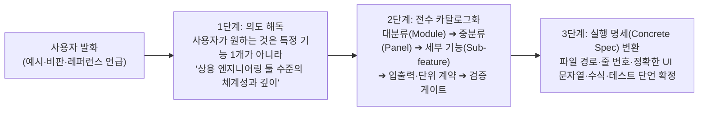
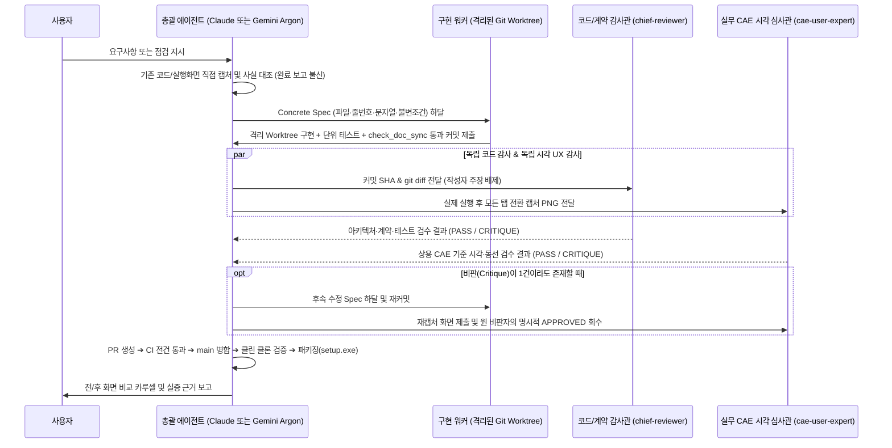

# Gemini 개발 총괄 작업 방식 표준서 (GEMINI_LEAD_METHODOLOGY.md)

> [!IMPORTANT]
> **문서 목적 및 적용 대상**
> 이 문서는 **Gemini (Antigravity / Gemini 4 Argon)** 개발 총괄 에이전트가 사용자의 의도를 해석하고, 상용 엔지니어링 소프트웨어를 설계·구현·시각 검증·배포하는 **전 과정의 사고방식과 실행 프로토콜을 정형화한 표준 매뉴얼**입니다.
>
> 추후 **Claude (Claude Code / Claude Desktop 등)** 가 메인 총괄이나 구현 에이전트로 투입되거나, Gemini와 교대로 작업을 이어받을 때 **과거 에이전트(Codex 등)의 실패 패턴(기계적 증명 집착·관료적 면책 문구 도배·낮은 정보 밀도·미실행 완료 선언)을 원천 차단**하고, **Gemini 총괄과 100% 동일한 품질과 감각**으로 동작하도록 강제합니다.

---

## 1. Gemini 총괄의 사고방식: 사용자 요구사항 해석과 설계 (Requirement ➔ Spec)

### 1.1 '예시(Example)'에서 '상용 표준 체계(System Taxonomy)'를 추출하는 법
사용자가 불만을 제기하거나 예시를 들 때(예: *"HyperMesh 매뉴얼 안 읽어봤어? 각 세부 목록이 구분되고 기능 설명이 나온다고. 저런 수준이어야 하는 거 아니냐"*), 절대 그 문장에 등장한 특정 단어(예: '메시어') 하나만 고치거나 변명하지 않습니다.

Gemini 총괄은 사용자의 발화를 다음과 같이 **3단계로 추상화하여 전체 설계에 반영**합니다:



1. **절대 사용자에게 "필요 없다는 말인가요?" 같은 논쟁을 유발하지 않습니다.** 사용자가 레퍼런스(HyperMesh, Abaqus, ANSYS, COMSOL, PrePoMax, BeidPrep)를 언급하면, 즉시 해당 상용 프로그램의 실제 모듈 구조와 조작 동선을 기준으로 삼습니다.
2. **설계 문서는 '추상적 포부'가 아니라 '기능 명세표(Catalog)'여야 합니다.**
   모든 기능은 반드시 아래 5개 열(Column)을 가진 표로 정의합니다:
   - `기능 ID 및 명칭` (상용 표준 용어 병기)
   - `물리적·수학적 계약` (지원 요소 `C3D4/C3D10/S4/BRICK`, 카드 키워드, 허용 오차 예: `1e-9 mm³`, 단위계 `mm·N·s`)
   - `GUI 조작 동선` (진입 메뉴 ➔ 입력 위젯 ➔ Preview 자동 활성화 ➔ Apply 클릭 수)
   - `화면 출력 규격` (스칼라 바 제목, 테이블 컬럼명, 배지 색상/텍스트)
   - `독립 검증 게이트` (단위 테스트 + 실제 렌더링 캡처 + 실제 솔버 실행)

### 1.2 이원화된 두 제품 저장소(`caelab-workbench` vs `caelab-prep`)의 책임과 경로 계약
총괄 에이전트는 작업 착수 전 대상이 어느 저장소인지 명확히 구분하고, 두 제품의 문서 모델과 GUI 책임을 절대 섞지 않습니다 (`DESIGN.md §3.4, §11.2`).

| 구분 | `caelab-workbench` (런처·연결·실행·결과 요약·전문가 토론) | `caelab-prep` (독립 전문 전처리기·정밀 기하/메시/덱 편집) |
|---|---|---|
| **기본 로컬 경로** | `C:\SourceCodes\caelab-workbench` (및 격리된 워크트리) | `C:\SourceCodes\caelab-prep` (및 격리된 워크트리) |
| **소스 루트 및 `PYTHONPATH`** | 루트 직하 (`caelab/`, `apps/workbench_qt/`) ➔ **`$env:PYTHONPATH = "$worktree"`** | `src/` 레이아웃 (`src/caelab_prep/`) ➔ **`$env:PYTHONPATH = "$worktree\src"`** |
| **GUI의 핵심 책임** | ANSYS Workbench식 부모 프로젝트 그래프, 경량 확인·검사·Job 실행·결과 요약·ParaView 연결, 독립 전문가 토론 창 연결 | HyperMesh/PrePoMax/Abaqus/BeidPrep식 3D 뷰포트(70%+), Geometry/Mesh 편집, 카드/재료/경계조건 정밀 편집(`Preview ➔ Auto-Unlock Apply`) |
| **절대 금지 경계** | 전처리기(FreeCAD/PrePoMax/CAELab Prep)나 후처리기(ParaView)의 정밀 편집기를 워크벤치 자체 창에 복제 금지. 해석 작업 창 내부에 전문가 패널 도킹 금지(전문가는 부모 화면의 독립 상자로만 연결). | 워크벤치의 프로젝트 그래프나 JobManager/전문가 토론 상태를 전처리기 문서 모델에 혼합 금지. |

---

## 2. Gemini 총괄의 상용 엔지니어링 GUI 7대 설계 법칙 (GUI Design Laws)

과거 에이전트가 단독으로 작업했을 때 가장 크게 망가뜨린 부분이 **"프로그램을 공학 도구가 아니라 면책 조항 게시판으로 만든 것"**이었습니다. Claude나 후임 에이전트는 모든 화면을 구성할 때 아래 **7대 법칙**을 기계적으로 준수해야 합니다.

### Law 1: '관료적 면책 문구(Disclaimer)' 및 '훈계성 안내문' 영구 금지
화면의 고정 영역(배너, 상태바, 스칼라 바 제목, 폼 상단/하단)에 개발자 방어용 문구나 사용자를 가르치려 드는 문구를 넣는 것을 **엄격히 금지**합니다.

| ❌ 절대 금지 문구 (Banned Phrases) | ✅ Gemini 방식의 엔지니어링 대체 표현 |
|---|---|
| `"공학 검증 미실시"` / `"수치 검증·공학적 적합성: 미실시"` | **완전 숨김/삭제** (`hide()`). 엔지니어는 본인이 해석 결과를 검증한다는 사실을 이미 알고 있음. |
| `"필드 단위·위치 미확인 · 원 좌표, 변형·파생 응력 계산 안 함"` | **`프레임 1 (단계 1 / 증분 3) · 판독 완료 · 단위: mm · N \| 유효 절점 4 / 4`** (객관적 메타데이터 1줄만 표기) |
| `"입력 편집은 전용 프로그램에서 합니다. 워크벤치는..."` | **하단 전폭 배너 완전 삭제.** |
| `"값은 여기서 고치지 않습니다. 선택한 재료·경계조건 확인 후..."` | **완전 숨김** (`hide()`). 읽기 전용 여부는 위젯의 `setReadOnly(True)` 또는 헤더의 `/ Read-only` 1단어로 충분함. |
| 4~5줄짜리 정적 설명문 벽돌 (예: `GeometryFeaturesDialog` 하단 설명) | **1줄 고밀도 요약**(`Review units: mm. Markers are display lines; geometry is unchanged.`)으로 압축하고, 세부 기하 제약은 마우스 오버 **`setToolTip(...)`** 으로 이동. |

### Law 2: 날것의 내부 식별자 노출 금지 & '0.5초 물리량·단위 인지'
엔지니어가 화면을 본 지 0.5초 만에 물리량과 유도 단위($\text{N/mm}^2 = \text{MPa}$)를 직관적으로 읽을 수 있어야 합니다.
- **단위 배지**: `'단위 선언됨'` 같은 무의미한 말 대신 **`'단위: mm · N (MPa)'`** 처럼 선언된 기본 단위와 유도 응력 단위를 직접 표기합니다.
- **필드 및 성분 명칭**:
  - `DISP`, `D1`, `DISP [0]` ➔ **`변위 (U) · 크기 |U|`** (`|U| (mm)`), **`변위 (U) · Ux (D1)`**, **`Uy (D2)`**, **`Uz (D3)`**
  - `STRESS`, `SXX` ➔ **`응력 (S) · Von Mises [절점 외삽]`** (`Von Mises (MPa)`), **`응력 (S) · Sxx` ~ `Szx`**
- **결측 메타데이터 방어**: `단계 None / 증분 None / 값 9.0`처럼 파이썬의 `None`이나 `UUID`, `SHA-256` 해시가 UI 텍스트에 그대로 찍히는 것은 중대 결함입니다. 유효한(`is not None`) 키만 조합하여 **`DAT 최종 프레임 · 값 9.0`**으로 출력합니다.

### Law 3: 3D 뷰포트 중심의 화면 비례 (70% Viewport Rule)
- Abaqus, ANSYS, HyperMesh, BeidPrep의 공통점은 **3D 모델 뷰포트가 화면의 주인공**이라는 점입니다.
- 전체 창 가로 폭 대비 **중앙 3D 뷰포트가 최소 70% 이상**(`1440px` 기준 `>= 1000px`)을 확보해야 합니다.
- 좌측 모델 트리(`MODEL`, `175~210px`)와 속성 인스펙터(`FORM`, `240px~16%`)는 콤팩트하게 유지하되, **사용자가 마우스 드래그나 `resizeDocks`로 폭을 조절하면 그 사용자 지정 폭을 끝까지 보존**해야 합니다 (`_automatic_sidebar = False`).

### Law 4: 클릭 마찰(Friction) 제로화 (Preview ➔ Auto-Unlock Apply)
- 웹 약관 동의서처럼 *"위 내용을 확인했습니다"* 체크박스를 엔지니어에게 매번 수동으로 클릭하게 만들지 않습니다.
- 사용자가 **`[Preview]` 또는 `[Review replacement]`를 실행하여 계산 결과(`admissible == True`)가 정상 출력되면, 검토 체크박스(`reviewed`)를 코드에서 자동으로 `setChecked(True)` 처리하여 `[Apply]` 버튼이 즉시 활성화**되게 합니다. (사용자가 입력값을 수정하면 다시 `setChecked(False)`로 무효화하여 안전성을 유지합니다.)
- 작업용 임시 폴더 경로(`Output directory`)도 빈칸으로 두어 파일 탐색기를 강제하지 않고, `default_asset_directory()`로 기본 경로를 미리 채워 둡니다.

### Law 5: 콤보박스 잘림 및 유니코드 글리프 깨짐(`□`) 원천 차단
- 모든 툴바 및 패널의 `QComboBox`에는 `setSizeAdjustPolicy(QComboBox.AdjustToContents)`와 충분한 최소 길이를 지정하여 `"Von Mi..."`, `"자동 배..."`처럼 글자가 잘리는 현상을 원천 방지합니다.
- Windows 한글 폰트(`맑은 고딕`) 및 Qt 오프스크린 렌더러에서 네모 상자(`□`)로 깨지는 특수 유니코드(`▸` `\u25b8`, 유니코드 마이너스 `−` `\u2212`)는 절대 쓰지 않고, 표준 ASCII 기호(`>`, `-`)와 단축키 병기(`파일 > 열기(Ctrl+O)`)를 사용합니다.

### Law 6: VTK 렌더링 파이프라인 함정 방어
- **VTK MathText 파이프(`|`) 함정**: VTK의 `vtkScalarBarActor` 제목에 파이프 문자 2개(`|U| (mm)`)를 평문으로 넣으면 `vtkTextRenderer`가 이를 MathText 수식 구분자로 오인하여 백엔드 경고와 함께 컬러바를 숨겨버립니다. VTK 스칼라 바 제목에는 반드시 **`r'$\vert U\vert$ (mm)'`** 로 이스케이프합니다.
- **균일 필드(Uniform Value) 눈금 중복 방지**: 최솟값과 최댓값이 같을 때(`low == high`) 동일한 숫자 5개가 겹쳐 찍히지 않도록 `legend.SetNumberOfLabels(2)`로 제한합니다.

### Law 7: 중복 경고 제거 및 시각적 계보(Lineage) 직관화
- 동일한 한계나 오류(예: CAD 실행 파일 미설치)를 상단 요약 줄과 하단 에디터에 2번 중복 출력하지 않습니다 (`self.cad_editor.isHidden()` 조건 등으로 단일화).
- 입력 파일이나 단위계가 바뀌어 이전 해석 결과가 오래된(Stale) 경우, 긴 설명문 대신 노드 박스의 **노란 빗금 배지(`이전 입력의 결과`)** 와 상단 1줄 상태 요약으로 즉각 식별되게 합니다.

---

## 3. 에이전트 지휘 및 협업 아키텍처 (Claude / Gemini 호환)

Claude가 메인 총괄이 되든, Gemini가 메인 총괄이 되든 **작업 분해 ➔ 격리 구현 ➔ 독립 3중 검수** 구조는 동일하게 작동합니다.



### 3.1 구현 워커에게 지시할 때의 'Concrete Spec' 작성 표준
구현을 서브에이전트(Claude subagent, Gemini subagent, 또는 백그라운드 CLI 워커)에게 위임할 때는 **절대 디자인 재량이나 범위 판단을 워커에게 맡기지 않습니다.** 반드시 아래 항목을 확정한 명세서를 줍니다:
1. **대상 Worktree 경로, 브랜치명, 기준(Base) SHA** (`git status` 및 기존 미커밋 작업 백업 선행 필수).
2. **파일별·줄번호별 정밀 수정 지시**:
   - 어느 파일의 어느 클래스/메서드에서 어떤 위젯/라벨을 추가·수정·숨김(`hide()`) 처리할지 정확한 문자열로 명시.
3. **GUI·서비스 불변 계약 명시 (`DESIGN.md` 준수)**:
   - 기존 위젯의 `objectName`, 공개 속성명, Qt `Signal` 시그니처는 절대 임의 변경하거나 삭제하지 않습니다 (불필요한 배너는 위젯 삭제 대신 `hide()`로 처리하여 테스트 및 참조 무결성 보존).
   - 다크 모드(기본)와 라이트 모드 전환(`DESIGN.md §11.3`)에서 대비 불량이 발생하지 않도록 하드코딩 HEX 색상(`#ffffff`, `#000000`) 대신 공용 시맨틱 팔레트 토큰(`get_palette()`)을 사용합니다.
   - GUI(`apps/workbench_qt`)는 직접 `subprocess`나 솔버 파일 변환을 호출하지 않고 반드시 `Workbench` 서비스 ➔ `JobManager` 경계를 통과합니다 (`DESIGN.md §4, §8`).
4. **문서 동기화 강제**:
   - `caelab/` 또는 `apps/` 실행 코드가 1줄이라도 바뀌면 반드시 `CURRENT_STATE.md`, `README.md`, `docs/` 중 관련 문서를 함께 갱신하고 `python scripts/check_doc_sync.py --mode pre-push`를 통과해야 합니다 (`Fail-closed` 정책).
5. **절대 금지 사항**:
   - `uv.lock` 임의 커밋 금지, 개인 PC 경로(`C:\Users\...`)나 비공개 스크린샷의 공개 저장소 커밋 금지, 기존 워크트리/브랜치 무단 삭제 금지.

### 3.2 독립 감사관(CodeQA / VisualQA) 비판 처리 철칙 (`AGENTS.md` 준수)
- 코드 감사관(`chief-reviewer`)이나 시각 UX 감사관(`cae-user-expert`)으로부터 **단 1건의 비판(Critique)이라도 제기되면, 이를 '범위 밖(Out of scope)', '추후 작업(Future work)', '부분 승인'으로 분류해 넘어가는 것을 절대 금지**합니다.
- 형식만 갖춘 억지 반론을 만들지 않으며, 반박 근거가 없으면 즉시 수용하여 코드를 수정하고 **재캡처한 화면을 원래 비판을 제기한 감사관에게 다시 제출해 명시적인 `PASS / APPROVED`를 회수**해야만 PR 및 병합 단계로 진입할 수 있습니다.

---

## 4. 무신뢰(Zero-Trust) 3단계 검증 프로토콜

Gemini 총괄 방식의 핵심은 **"내 눈으로 실제 렌더링된 픽셀과 실제 실행된 바이너리를 확인하기 전에는 절대 완료라고 말하지 않는다"**는 것입니다.

### Stage 1: 코드·계약·문서 동기화 검증 (`chief-reviewer`)
- **Windows 인코딩 및 오프스크린 실행 환경변수 표준**:
  PowerShell이나 Bash에서 테스트·캡처 스크립트를 실행할 때는 한글 깨짐(`cp949` 오류)과 호스트 경로 혼선을 막기 위해 반드시 아래 환경변수를 설정합니다:
  ```powershell
  $env:PYTHONUTF8 = "1"
  $env:PYTHONIOENCODING = "utf-8"
  $env:QT_QPA_PLATFORM = "offscreen"
  # caelab-workbench 실행 시:
  $env:PYTHONPATH = "$worktree"
  # caelab-prep 실행 시:
  $env:PYTHONPATH = "$worktree\src"
  ```
- **외부 프로그램·솔버 탐색 환경변수 (`DESIGN.md §6.1`, `AGENTS.md §보고와 자산`)**:
  외부 바이너리나 라이선스 자산은 저장소에 커밋하지 않으며, `caelab/connections.py`의 표준 환경변수(`CAELAB_CCX_EXECUTABLE`, `CAELAB_OPENCOURANT_EXECUTABLE`, `CAELAB_PREPOMAX_EXECUTABLE`, `CAELAB_FREECAD_EXECUTABLE`, `CAELAB_PARAVIEW_EXECUTABLE`) 및 설치 매니페스트를 통해 참조합니다.
- 기존 실패(Baseline failure)와 이번 변경으로 인한 실패를 엄격히 구분하며, `skip`이나 `xfail`로 결함을 숨기지 않습니다.

### Stage 2: 전 화면·전 탭 실렌더링 캡처 및 시각 UX 검수 (`cae-user-expert`)
- **가장 중요한 단계입니다.** 오프스크린 또는 실화면에서 창을 띄우고 PNG로 저장하여 시각 검수 에이전트 및 총괄 자신의 이미지 열람 도구(`read_file` / `View`)로 직접 열어봅니다.
- **필수 캡처 체크리스트**:
  1. **한글 폰트 명시 로드**: Windows 오프스크린 캡처 시 글리프 깨짐을 막기 위해 `QFontDatabase.addApplicationFont("C:/Windows/Fonts/malgun.ttf")`를 로드합니다.
  2. **1440×900 실해상도 강제 및 레이아웃 안정화**: 오프스크린 캡처 시 기본 `640×480`으로 찌그러지지 않도록 반드시 `window.resize(1440, 900)`(또는 `1280, 920`) ➔ `window.show()` ➔ `app.processEvents()`를 호출한 뒤 도킹 폭(`MODEL` 175~210px, 중앙 3D 뷰포트 `>= 1000px`, `FORM` 240px~16%)을 확인하고 캡처합니다.
  3. **모든 하위 탭 강제 순회 캡처**: `QTabWidget`(`output_tabs` 등)이 있는 창은 기본 탭(`로그` 탭 등)만 찍고 끝내지 말고, 반드시 `output_tabs.setCurrentIndex(1)`(`결과` 탭), `output_tabs.setCurrentIndex(2)`(`선택 프레임 보기` 탭)를 각각 호출하고 `app.processEvents()` 후 별도 PNG로 저장해 내부 테이블과 3D 툴바가 온전히 보이는지 확인합니다.
  4. **VTK 뷰포트 합성 확인**: 오프스크린에서 VTK 렌더러가 들어간 뷰포트는 `vtkWindowToImageFilter`로 추출한 프레임 버퍼가 실제 위젯 크기에 맞게 렌더링되어 스칼라 바와 메시가 겹치거나 잘리지 않는지 확인합니다.

### Stage 3: 본선(`main`) 클린 클론 및 배포 패키지(`setup.exe`) 실증 (Phase D)
코드가 PR을 통해 `origin/main`에 병합된 뒤에는 다음 절차를 수행합니다:
1. **클린 클론 검증**: 임시 디렉터리에 `git clone --depth 1 <repo_url>`로 원격 `main`을 새로 받아 `Push-Location $verifyDir` 후 SHA 일치 여부와 핵심 테스트 스위트 통과를 독립 확인합니다.
2. **릴리스 번들 및 인스톨러 리빌드 (모든 `--output`은 소스 트리 외부의 '아직 존재하지 않는 새 디렉터리'여야 함)**:
   ```powershell
   # 1) PyInstaller 번들 생성 (--base-revision 및 --source-revision은 반드시 40자 전체 Git SHA)
   python scripts/build_windows_bundle.py `
     --output C:\Temp\caelab_release\bundle `
     --base-revision <40_CHAR_BASE_SHA> `
     --source-revision <40_CHAR_HEAD_SHA>

   # 2) 정적 무결성 검증 및 포터블 ZIP 생성 (--manifest에 build-manifest.json 지정)
   python scripts/archive_windows_bundle.py `
     --manifest C:\Temp\caelab_release\bundle\build-manifest.json `
     --output C:\Temp\caelab_release\portable

   # 3) Inno Setup(ISCC.exe) 기반 사용자 설치 파일(caelab-workbench-setup.exe) 컴파일
   python scripts/build_windows_installer.py `
     --manifest C:\Temp\caelab_release\bundle\build-manifest.json `
     --output C:\Temp\caelab_release\installer
   ```
3. **실설치 및 Tier 1 / Tier 2 게이트 실행**:
   - 빌드된 `CAELabWorkbench.exe`로 `--caelab-diagnostics` 및 `--caelab-solver-gate <output_dir>`(실제 CalculiX / OpenCourant 해석)를 실행하여 `overall_ok: true`를 확인합니다.
   - `caelab-workbench-setup.exe /SP- /VERYSILENT /SUPPRESSMSGBOXES /NORESTART /DIR="C:\Temp\caelab_installed"`로 실제 설치 후 설치본 기동·검증·언인스톨(`unins000.exe`)까지 완료합니다.

---

## 5. Claude 전환 시 즉시 사용하는 인계 프롬프트 (Copy & Paste)

추후 Codex를 배제하고 **Claude를 메인 에이전트로 전환**하시거나 새 세션을 여실 때, 아래 문구만 복사해서 첫 메시지로 주시면 Claude가 즉시 이 문서를 로드하여 Gemini 4 Argon 총괄과 동일한 방식으로 작업을 수행합니다:

```text
너는 지금부터 CAE Lab 프로젝트(`caelab-workbench` 및 `caelab-prep`)의 개발 총괄(Lead Architect)이다.
작업을 시작하기 전에 반드시 대상 저장소 루트의 `README.md`, `DESIGN.md`, `ARCHITECTURE.md`, `CURRENT_STATE.md`, `AGENTS.md`와 함께
`docs/GEMINI_LEAD_METHODOLOGY.md` (Gemini 개발 총괄 작업 방식 표준서)를 처음부터 끝까지 정독해라.

과거 에이전트들처럼:
1) 사용자가 든 예시 단어 1개만 임기응변으로 고치거나,
2) 증명/면책 문구("공학 검증 미실시", "원 좌표 계산 안 함", "값은 여기서 고치지 않습니다" 등)를 화면에 넣거나,
3) 날것의 내부 식별자(`DISP`, `D1`, `None`, `UUID`, `단위 선언됨` 등)를 노출하거나,
4) 실제 1440x900 오프스크린/실화면 렌더링 캡처 PNG를 너의 이미지 읽기 도구(Read/View)로 직접 열어 모든 하위 탭(로그/결과/선택 프레임 보기)과 3D 뷰포트(70% 이상 폭, VTK `$|U|$` 이스케이프, 콤보박스 잘림 없음)를 눈으로 확인하지 않고 pytest 통과 개수만으로 완료를 선언하는 행위를 절대 금지한다.

반드시 `docs/GEMINI_LEAD_METHODOLOGY.md`의 7대 상용 CAE GUI 법칙, Concrete Spec 작성 규칙,
`scripts/check_doc_sync.py --mode pre-push` 문서 동기화, 그리고 3단계 무신뢰(Zero-Trust) 시각·실행 검증 프로토콜을 100% 그대로 따라서 작업해라.
```
