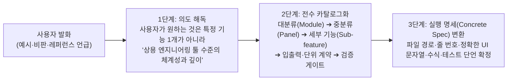
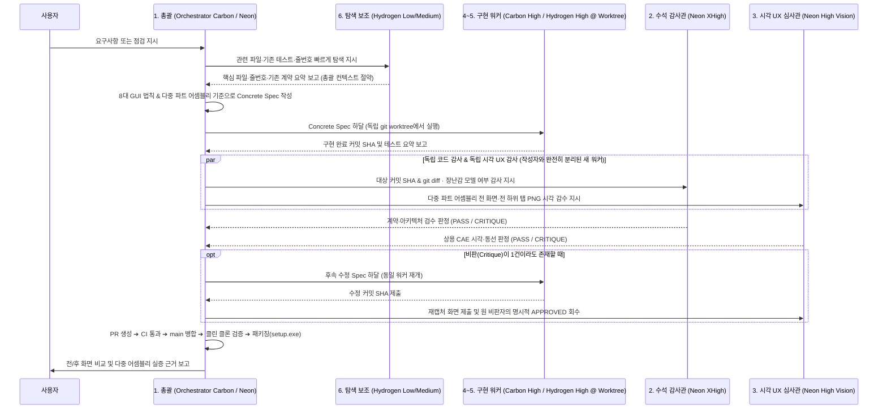

# Gemini 개발 총괄 작업 방식 표준서 (GEMINI_LEAD_METHODOLOGY.md)

> [!IMPORTANT]
> **문서 목적 및 적용 대상**
> 이 문서는 **Gemini (Antigravity / Orchestrator (Carbon·Neon) × Gemini 4 Neon · Carbon · Hydrogen 3원 체제)** 개발 총괄 에이전트가 사용자의 의도를 해석하고, 상용 엔지니어링 소프트웨어를 설계·구현·시각 검증·배포하는 **전 과정의 사고방식과 팀 오케스트레이션 원리를 정형화한 표준 매뉴얼**입니다.
>
> 특정 벤더나 CLI 도구에 종속되지 않도록 **모델 등급(Tier)과 추론 강도(Reasoning Effort)를 조합한 보편적 팀 운영 원리**를 본문에 정의하고, 현재 Antigravity 환경의 **Gemini 4 (`Neon · Carbon · Hydrogen`) 3개 모델군 구성**과 필요 시 선택하는 하이브리드 보조 구성을 **구체적 적용 예시(Reference Example)** 로 수록했습니다. 따라서 실행 모델이 갱신되더라도 본문의 역할 계층과 검증 게이트를 그대로 유지해 동일한 품질로 동작할 수 있습니다.

---

## 1. Gemini 총괄의 사고방식: 사용자 요구사항 해석과 설계 (Requirement ➔ Spec)

### 1.1 '예시(Example)'에서 '상용 표준 체계(System Taxonomy)'를 추출하는 법
사용자가 불만을 제기하거나 예시를 들 때(예: *"HyperMesh 매뉴얼 안 읽어봤어? 각 세부 목록이 구분되고 기능 설명이 나온다고. 저런 수준이어야 하는 거 아니냐"*), 절대 그 문장에 등장한 특정 단어(예: '메시어') 하나만 고치거나 변명하지 않습니다.

총괄 에이전트는 사용자의 발화를 다음과 같이 **3단계로 추상화하여 전체 설계에 반영**합니다:



1. **절대 사용자에게 "필요 없다는 말인가요?" 같은 논쟁을 유발하지 않습니다.** 사용자가 레퍼런스(HyperMesh, Abaqus, ANSYS, COMSOL, PrePoMax, BeidPrep)를 언급하면, 즉시 해당 상용 프로그램의 실제 모듈 구조와 조작 동선을 기준으로 삼습니다.
2. **설계 문서는 '추상적 포부'가 아니라 '기능 명세표(Catalog)'여야 합니다.**
   모든 기능은 반드시 아래 5개 열(Column)을 가진 표로 정의합니다:
   - `기능 ID 및 명칭` (상용 표준 용어 병기)
   - `물리적·수학적 계약` (지원 요소 `C3D4/C3D10/S4/BRICK`, 카드 키워드, 허용 오차 예: `1e-9 mm³`, 단위계 `mm·N·s`)
   - `GUI 조작 동선` (진입 메뉴 ➔ 입력 위젯 ➔ Preview 자동 활성화 ➔ Apply 클릭 수)
   - `화면 출력 규격` (스칼라 바 제목, 테이블 컬럼명, 배지 색상/텍스트)
   - `독립 검증 게이트` (단위 테스트 + 실제 렌더링 캡처 + 실제 솔버 실행)

### 1.2 이원화된 두 제품 저장소(`caelab-workbench` vs `caelab-prep`)의 책임과 경로 계약
총괄 에이전트는 작업 착수 전 대상이 어느 저장소인지 명확히 구분하고, 두 제품의 문서 모델과 GUI 책임을 절대 섞지 않습니다 (`DESIGN.md §3.4, §11.2`).

| 구분 | `caelab-workbench` (런처·연결·실행·결과 요약·전문가 토론) | `caelab-prep` (독립 전문 전처리기·정밀 기하/메시/덱 편집) |
|---|---|---|
| **기본 로컬 경로** | `C:\SourceCodes\caelab-workbench` (및 격리된 워크트리) | `C:\SourceCodes\caelab-prep` (및 격리된 워크트리) |
| **소스 루트 및 `PYTHONPATH`** | 루트 직하 (`caelab/`, `apps/workbench_qt/`) ➔ **`$env:PYTHONPATH = "$worktree"`** | `src/` 레이아웃 (`src/caelab_prep/`) ➔ **`$env:PYTHONPATH = "$worktree\src"`** |
| **GUI의 핵심 책임** | ANSYS Workbench식 부모 프로젝트 그래프, 경량 확인·검사·Job 실행·결과 요약·ParaView 연결, 독립 전문가 토론 창 연결 | HyperMesh/PrePoMax/Abaqus/BeidPrep식 3D 뷰포트(70%+), Geometry/Mesh 편집, 카드/재료/경계조건 정밀 편집(`Preview ➔ Auto-Unlock Apply`) |
| **절대 금지 경계** | 전처리기(FreeCAD/PrePoMax/CAELab Prep)나 후처리기(ParaView)의 정밀 편집기를 워크벤치 자체 창에 복제 금지. 해석 작업 창 내부에 전문가 패널 도킹 금지(전문가는 부모 화면의 독립 상자로만 연결). | 워크벤치의 프로젝트 그래프나 JobManager/전문가 토론 상태를 전처리기 문서 모델에 혼합 금지. |

---

## 2. Gemini 총괄의 상용 엔지니어링 GUI 8대 설계 법칙 (GUI Design Laws)

과거 에이전트가 단독으로 작업했을 때 가장 크게 망가뜨린 부분이 **"프로그램을 공학 도구가 아니라 면책 조항 게시판으로 만든 것"**과 **"장난감 예제 + 파서 개발자 용어/중복 표 노출"**이었습니다. 모든 에이전트는 화면을 구성할 때 아래 **8대 법칙**을 기계적으로 준수해야 합니다.

### Law 1: '관료적 면책 문구(Disclaimer)' 및 '훈계성 안내문' 영구 금지
화면의 고정 영역(배너, 상태바, 스칼라 바 제목, 폼 상단/하단)에 개발자 방어용 문구나 사용자를 가르치려 드는 문구를 넣는 것을 **엄격히 금지**합니다.

| ❌ 절대 금지 문구 (Banned Phrases) | ✅ Gemini 방식의 엔지니어링 대체 표현 |
|---|---|
| `"공학 검증 미실시"` / `"수치 검증·공학적 적합성: 미실시"` | **완전 숨김/삭제** (`hide()`). 엔지니어는 본인이 해석 결과를 검증한다는 사실을 이미 알고 있음. |
| `"필드 단위·위치 미확인 · 원 좌표, 변형·파생 응력 계산 안 함"` | **`프레임 1 (단계 1 / 증분 3) · 판독 완료 · 단위: mm · N \| 유효 절점 4 / 4`** (객관적 메타데이터 1줄만 표기) |
| `"입력 편집은 전용 프로그램에서 합니다. 워크벤치는..."` | **하단 전폭 배너 완전 삭제.** |
| `"값은 여기서 고치지 않습니다. 선택한 재료·경계조건 확인 후..."` | **완전 숨김** (`hide()`). 읽기 전용 여부는 위젯의 `setReadOnly(True)` 또는 헤더의 `/ Read-only` 1단어로 충분함. |
| 4~5줄짜리 정적 설명문 벽돌 (예: `GeometryFeaturesDialog` 하단 설명) | **1줄 고밀도 요약**(`Review units: mm. Markers are display lines; geometry is unchanged.`)으로 압축하고, 세부 기하 제약은 마우스 오버 **`setToolTip(...)`** 으로 이동. |

### Law 2: 날것의 내부 식별자 노출 금지 & '0.5초 물리량·단위 인지'
엔지니어가 화면을 본 지 0.5초 만에 물리량과 유도 단위($\text{N/mm}^2 = \text{MPa}$)를 직관적으로 읽을 수 있어야 합니다.
- **단위 배지**: `'단위 선언됨'` 같은 무의미한 말 대신 **`'단위: mm · N (MPa)'`** 처럼 선언된 기본 단위와 유도 응력 단위를 직접 표기합니다.
- **필드 및 성분 명칭**:
  - `DISP`, `D1`, `DISP [0]` ➔ **`변위 (U) · 크기 |U|`** (`|U| (mm)`), **`변위 (U) · Ux (D1)`**, **`Uy (D2)`**, **`Uz (D3)`**
  - `STRESS`, `SXX` ➔ **`응력 (S) · Von Mises [절점 외삽]`** (`Von Mises (MPa)`), **`응력 (S) · Sxx` ~ `Szx`**
- **결측 메타데이터 방어**: `단계 None / 증분 None / 값 9.0`처럼 파이썬의 `None`이나 `UUID`, `SHA-256` 해시가 UI 텍스트에 그대로 찍히는 것은 중대 결함입니다. 유효한(`is not None`) 키만 조합하여 **`DAT 최종 프레임 · 값 9.0`**으로 출력합니다.

### Law 3: 3D 뷰포트 중심의 화면 비례 (70% Viewport Rule)
- Abaqus, ANSYS, HyperMesh, BeidPrep의 공통점은 **3D 모델 뷰포트가 화면의 주인공**이라는 점입니다.
- 전체 창 가로 폭 대비 **중앙 3D 뷰포트가 최소 70% 이상**(`1440px` 기준 `>= 1000px`)을 확보해야 합니다.
- 좌측 모델 트리(`MODEL`, `175~210px`)와 속성 인스펙터(`FORM`, `240px~16%`)는 콤팩트하게 유지하되, **사용자가 마우스 드래그나 `resizeDocks`로 폭을 조절하면 그 사용자 지정 폭을 끝까지 보존**해야 합니다 (`_automatic_sidebar = False`).

### Law 4: 클릭 마찰(Friction) 제로화 (Preview ➔ Auto-Unlock Apply)
- 웹 약관 동의서처럼 *"위 내용을 확인했습니다"* 체크박스를 엔지니어에게 매번 수동으로 클릭하게 만들지 않습니다.
- 사용자가 **`[Preview]` 또는 `[Review replacement]`를 실행하여 계산 결과(`admissible == True`)가 정상 출력되면, 검토 체크박스(`reviewed`)를 코드에서 자동으로 `setChecked(True)` 처리하여 `[Apply]` 버튼이 즉시 활성화**되게 합니다. (사용자가 입력값을 수정하면 다시 `setChecked(False)`로 무효화하여 안전성을 유지합니다.)
- 작업용 임시 폴더 경로(`Output directory`)도 빈칸으로 두어 파일 탐색기를 강제하지 않고, `default_asset_directory()`로 기본 경로를 미리 채워 둡니다.

### Law 5: 콤보박스 잘림 및 유니코드 글리프 깨짐(`□`) 원천 차단
- 모든 툴바 및 패널의 `QComboBox`에는 `setSizeAdjustPolicy(QComboBox.AdjustToContents)`와 충분한 최소 길이를 지정하여 `"Von Mi..."`, `"자동 배..."`처럼 글자가 잘리는 현상을 원천 방지합니다.
- Windows 한글 폰트(`맑은 고딕`) 및 Qt 오프스크린 렌더러에서 네모 상자(`□`)로 깨지는 특수 유니코드(`▸` `\u25b8`, 유니코드 마이너스 `−` `\u2212`)는 절대 쓰지 않고, 표준 ASCII 기호(`>`, `-`)와 단축키 병기(`파일 > 열기(Ctrl+O)`)를 사용합니다.

### Law 6: VTK 렌더링 파이프라인 함정 방어
- **VTK MathText 파이프(`|`) 함정**: VTK의 `vtkScalarBarActor` 제목에 파이프 문자 2개(`|U| (mm)`)를 평문으로 넣으면 `vtkTextRenderer`가 이를 MathText 수식 구분자로 오인하여 백엔드 경고와 함께 컬러바를 숨겨버립니다. VTK 스칼라 바 제목에는 반드시 **`r'$\vert U\vert$ (mm)'`** 로 이스케이프합니다.
- **균일 필드(Uniform Value) 눈금 중복 방지**: 최솟값과 최댓값이 같을 때(`low == high`) 동일한 숫자 5개가 겹쳐 찍히지 않도록 `legend.SetNumberOfLabels(2)`로 제한합니다.

### Law 7: 중복 경고 제거 및 시각적 계보(Lineage) 직관화
- 동일한 한계나 오류(예: CAD 실행 파일 미설치)를 상단 요약 줄과 하단 에디터에 2번 중복 출력하지 않습니다 (`self.cad_editor.isHidden()` 조건 등으로 단일화).
- 입력 파일이나 단위계가 바뀌어 이전 해석 결과가 오래된(Stale) 경우, 긴 설명문 대신 노드 박스의 **노란 빗금 배지(`이전 입력의 결과`)** 와 상단 1줄 상태 요약으로 즉각 식별되게 합니다.

### 2.8 `docs/specs/cae-research/` (D01~D39 및 `MaterialStudyWindow` C9) 구현 시 필수 GUI 가드레일
`docs/specs/cae-research/core-implementation.md` (§C9) 및 `IMPLEMENTATION_TASKS_ko.md` (`D01`, `D06`, `D07`, `D18`)의 새 화면 구현은 반드시 위 **GUI 8대 법칙**을 최우선 가드레일로 적용해야 합니다:
1. **내부 열거형·해시 UI 노출 금지**: `adequacy_status=not_assessed`, `source_unavailable`, `holdout_exposed`, raw `SHA-256` 해시/UUID를 라벨이나 테이블 셀에 그대로 렌더링하지 않고 간결한 한국어 공학 배지(`실측 대조 전`, `원문 미연결`, `보류 시험 포함`)로 변환하며 해시·진단값은 메타데이터/`setToolTip(...)`에만 둡니다.
2. **관료적 면책 문구 금지**: `MaterialStudyWindow` 상단·하단 고정 배너에 `"실물 재료 적합성 미검증"`, `"공학 검증 미실시"`, `"값은 여기서 고치지 않습니다"` 같은 정적 방어 문구를 추가하지 않습니다.
3. **70% 뷰포트 비례·클릭 마찰 제로화·직접 시각 검수**: `1440×900` 기준 중앙 곡선/잔차 플롯 및 비교 테이블 영역을 **70%(`>= 1000px`) 이상** 확보하고, Prep 카드 적용(`C10`)은 `Preview/Prepare 통과 ➔ Apply 즉시 활성화` 흐름을 따르며, 병합 전 반드시 `cae-user-expert` (`Gemini 4 Neon`)가 모든 도크/탭(Model·Experiments·Parameters·Comparisons·Evaluations·Exports)의 `1440×900` PNG 실렌더링 캡처를 육안 검증합니다.

### 2.9 Law 8: 장난감 픽스처(Toy Fixture) 검수 금지 & 다중 파트 복잡 어셈블리 공학 검산 UX 법칙
1. **장난감 모델 완료 승인 영구 금지**: 단순 외팔보(cantilever), 4절점 사면체, 쉘 요소 몇 개짜리 미니 예제만으로 GUI 가독성·해석 결과 요약·전후처리 연결이 완료되었다고 선언하지 않습니다. 반드시 **다중 파트(멀티 바디), 볼트 예압·스폿용접·접합 체결, 마찰 접촉, 다중 경계조건 집합 반력, 다중 스텝/프레임**이 포함된 실제 공학 어셈블리 유즈케이스를 기준으로 화면을 설계하고 실증합니다.
2. **파서 개발자 용어 및 3중 중복 표시 차단**:
   - ❌ 금지: `판독/메시 절점`, `집합 출력 상태 (DAT): 일부 판독`, `DAT 마지막 판독 프레임의 집합 원값 (별도 파일)`, `원 합계 성분 (1, 2, 3)` 및 동일한 변위 수치를 상단 KPI 카드 + 중간 필드 표 + 하단 텍스트 박스(`result_text`)에 3번 반복 출력.
   - ✅ 표준(NAFEMS 공학 검산 위계): 결과 확인 창에서는 입력 원문 절반 분할을 강제하지 않고 상단 탭으로 분리하며, **좌측 3D 변형/응력 뷰포트(1:1 실제 변형 vs 배율 전환)** + **우측 핵심 공학 검산 카드(외력 vs 지지부 반력 평형 $\sum F = 0$, 최대 변위/응력, 동해석 아워글래스/내부 에너지 비)** 로 1회만 간결하게 요약합니다.

---

## 3. 모델 등급(Tier)과 추론 강도(Reasoning Effort)를 조절하는 보편적 팀 오케스트레이션 원리

단일 에이전트(Single Session)가 설계, 수천 줄의 코드 탐색, 구현, 수백 개의 테스트 로그 읽기, 시각 검수를 혼자 다 처리하면 **① 최상위 모델 토큰/쿼터가 순식간에 고갈**되고, **② 컨텍스트 창이 로그로 오염되어 판단력이 흐려지며**, **③ 자기가 짠 코드의 결함을 스스로 합리화(Confirmation Bias)** 하게 됩니다.

따라서 반드시 **역할별로 모델 등급(Tier)과 추론 강도(Reasoning Effort)를 분리하여 오케스트레이션**합니다. **GUI 설계·한국어/영어 사용자 문구·시각 UX는 100% Gemini가 직접 담당**하며 백엔드 구현 워커에게 임의로 위임하지 않습니다.

### 3.1 역할별 Gemini 4 3원 모델 (`Neon · Carbon · Hydrogen`) 배분 매트릭스

| 역할 (Role) | 요구 지능 특성 | 추론 강도 (Reasoning Effort) | **Gemini 4 배정 모델 (`swarm` PIN / 오케스트레이터)** | 핵심 임무 및 토큰 절약 규칙 |
|---|---|---|---|---|
| **1. 총괄 아키텍트**<br>(`Team Lead`) | 최상위 추상화, 아키텍처·공유 계약 설계, UX/문구 확정, 사용자 소통, 최종 결정 | **High ~ Max**<br>(Plan Mode에서 극대화, 실행 조율 시 효율화) | **`Orchestrator (Carbon)`** (`gemini-pro-orchestrator`) 또는 **`Orchestrator (Neon)`** (`gemini-pro-orchestrator-neon`) | **직접 대량 코딩이나 긴 테스트 로그 읽기를 하지 않음.** `Concrete Spec`과 정확한 UI 문구를 확정 ➔ 워커 지시 ➔ 검수 보고 수렴 ➔ 최종 통합만 수행 (**Argon 제외**). |
| **2. 독립 코드 감사관 & UX 설계**<br>(`chief-reviewer`) | 깐깐한 규칙 대조, 엣지 케이스·회귀 결함 적발, 상용 CAE 설계 깊이 확보 | **XHigh**<br>(비판적·적대적 검토를 위해 최고 추론 예산 부여) | **`Gemini 4 Neon (XHigh)`** (`gemini-4-neon-xhigh`) | 구현 워커의 완료 주장을 배제하고 `git diff <base>..<head>`, `DESIGN.md`, `AGENTS.md`, **장난감 모델 사용 여부**, UI 문구/중복 위젯을 적대적으로 감사함. |
| **3. 실무 CAE 시각·UX 심사관**<br>(`cae-user-expert` / `domain-ux-reviewer`) | 멀티모달(Vision) 픽셀 판독, 상용 CAE 다중 어셈블리 감각 | **High + Vision 필수** | **`Gemini 4 Neon (High)`** (`gemini-4-neon-high`) | 다중 파트 어셈블리 실제 실행 후 캡처된 모든 창·모든 하위 탭의 `1440×900` PNG를 직접 열어 파서 용어, 중복 표, 뷰포트 비율(70%), 콤보박스 잘림, 글리프 깨짐(`□`)을 감수함. |
| **4. 격리 구현 워커 A·B**<br>(`Impl Worker`: GUI · Workbench · Prep) | 정확한 코드 편집, UI 구현, 단위 테스트 실행, 빠른 반복 수정 | **Medium ~ High** | **`Gemini 4 Carbon (High / Medium)`** (`gemini-4-carbon-high`, `gemini-4-carbon-medium`) | 격리된 `git worktree` (또는 `swarm workspace:"share"`)에서 총괄이 확정한 `Concrete Spec`의 파일·줄번호·한국어 UI 문자열 지시를 정확히 코드로 옮기고 커밋함. |
| **5. 수식·솔버·메셔 워커 및 수학 검증**<br>(`Math / Solver / Mesher`) | 구성방정식, 덱 생성·판독기, 메셔 알고리즘, MDO 수치 폐루프 | **High ~ XHigh** | **`Gemini 4 Hydrogen (XHigh / High)`** (`gemini-4-hydrogen-xhigh`, `gemini-4-hydrogen-high`) | 다중 파트 솔버 덱(CalculiX·OpenCourant), 재료 동정 수식(Prony·Ogden·LAW33), 메셔(`D24~D30`) 구현 및 독립 수치 검산을 전담함. |
| **6. 탐색·로그·실행 보조**<br>(`Research / Aux`) | 빠른 파일 검색, 대량 CI/pytest 로그 요약, 정적 점검 | **Low ~ Medium** | **`Gemini 4 Hydrogen (Low / Medium)`** (`gemini-4-hydrogen-low`, `gemini-4-hydrogen-medium`) | 수만 줄의 로그에서 에러 트레이스백만 발췌하거나 심볼·호출부 위치를 빠르게 조사해 총괄에게 10줄 이내로 요약 보고함 (**`Gemini 3.8 Flash` 대체**). |

> [!NOTE]
> **`swarm` vs `invoke_subagent` 호출 규칙**: 모델 ID(`gemini-4-neon-xhigh`, `gemini-4-carbon-high`, `gemini-4-hydrogen-high` 등)를 정확히 핀하려면 **`swarm(action="add", model=...)`** 을 우선 사용합니다. `invoke_subagent` 슬롯을 쓸 때는 `"inherit"` 또는 `"pro"`만 사용하며, **`"flash"`(`Gemini 3.8 Flash`) 및 `Argon` 모델군은 사용하지 않습니다.**

### 3.2 보편적 지휘 흐름 (`Orchestrator Carbon/Neon × Neon · Carbon · Hydrogen`)



### 3.3 구현 워커를 통제하는 'Concrete Spec' 작성 표준
총괄 에이전트가 구현 워커(`Gemini 4 Carbon` / `Gemini 4 Hydrogen` 워커 등)에게 일을 시킬 때는 **절대 디자인 재량이나 범위 판단을 워커에게 맡기지 않습니다.** 반드시 아래 5가지를 확정한 명세서를 내려줍니다:
1. **대상 Worktree 경로, 브랜치명, 기준(Base) SHA** (`git status` 및 기존 미커밋 작업 백업 선행 필수).
2. **파일별·줄번호별 정밀 수정 지시**:
   - 어느 파일의 어느 클래스/메서드에서 어떤 위젯/라벨을 추가·수정·숨김(`hide()`) 처리할지 **정확한 한국어/영어 문자열**로 명시합니다.
3. **GUI·서비스 불변 계약 명시 (`DESIGN.md` 준수)**:
   - 기존 위젯의 `objectName`, 공개 속성명, Qt `Signal` 시그니처는 절대 임의 변경하거나 삭제하지 않습니다 (불필요한 배너는 위젯 삭제 대신 `hide()`로 처리하여 테스트 및 참조 무결성 보존).
   - 다크 모드(기본)와 라이트 모드 전환(`DESIGN.md §11.3`)에서 대비 불량이 발생하지 않도록 하드코딩 HEX 색상(`#ffffff`, `#000000`) 대신 공용 시맨틱 팔레트 토큰(`get_palette()`)을 사용합니다.
   - GUI(`apps/workbench_qt`)는 직접 `subprocess`나 솔버 파일 변환을 호출하지 않고 반드시 `Workbench` 서비스 ➔ `JobManager` 경계를 통과합니다 (`DESIGN.md §4, §8`).
4. **문서 동기화 강제**:
   - `caelab/` 또는 `apps/` 실행 코드가 1줄이라도 바뀌면 반드시 `CURRENT_STATE.md`, `README.md`, `docs/` 중 관련 문서를 함께 갱신하고 `python scripts/check_doc_sync.py --mode pre-push`를 통과해야 합니다 (`Fail-closed` 정책).
5. **절대 금지 사항**:
   - `uv.lock` 임의 커밋 금지, 개인 PC 경로(`C:\Users\...`)나 비공개 스크린샷의 공개 저장소 커밋 금지, 기존 워크트리/브랜치 무단 삭제 금지.

### 3.4 독립 감사관(CodeQA / VisualQA) 비판 처리 철칙 (`AGENTS.md` 준수)
- 코드 감사관이나 시각 UX 감사관으로부터 **단 1건의 비판(Critique)이라도 제기되면, 이를 '범위 밖(Out of scope)', '추후 작업(Future work)', '부분 승인'으로 분류해 넘어가는 것을 절대 금지**합니다.
- 형식만 갖춘 억지 반론을 만들지 않으며, 반박 근거가 없으면 즉시 수용하여 코드를 수정하고 **재캡처한 화면을 원래 비판을 제기한 감사관에게 다시 제출해 명시적인 `PASS / APPROVED`를 회수**해야만 PR 및 병합 단계로 진입할 수 있습니다.

---

### 3.5 [참고 예시] 환경별 오케스트레이션 실제 적용 사례

위 3.1~3.4의 원리를 현재 Antigravity 활성 모델과 선택적 보조 CLI에 적용하는 표준 사례입니다.

#### 예시 A: Antigravity Gemini 4 순정 3원 체제 (기본 표준 — `caelab-team-native`)
- **총괄 (`Team Lead`)**: **`Orchestrator (Carbon)`** (`gemini-pro-orchestrator`) 또는 **`Orchestrator (Neon)`** (`gemini-pro-orchestrator-neon`). `Concrete Spec`·UI 문구 확정, 공통 계약 소유, 통합·PR 관리 전담.
- **독립 감사 & 시각 UX (`chief-reviewer` / `cae-user-expert`)**: **`Gemini 4 Neon (XHigh)`** (`gemini-4-neon-xhigh`, 코드/계약 감사) 및 **`Gemini 4 Neon (High)`** (`gemini-4-neon-high`, `1440×900` 전 화면·전 탭 시각 심사).
- **병렬 구현 워커 (`Impl Worker`)**: **`Gemini 4 Carbon (High / Medium)`** (`gemini-4-carbon-high`/`medium`)이 격리 `git worktree` / `swarm share`에서 GUI·서비스·워크플로 구현, **`Gemini 4 Hydrogen (XHigh / High)`** (`gemini-4-hydrogen-xhigh`/`high`)이 재료 수식·솔버 덱·메셔 구현 및 수치 검산 수행.
- **경량 탐색·로그 보조 (`Research / Aux`)**: **`Gemini 4 Hydrogen (Low / Medium)`** (`gemini-4-hydrogen-low`/`medium`)이 파일 검색과 CI 로그 발췌를 수행 (`Gemini 3.8 Flash` 대체).

#### 예시 B: Gemini 4 중심 × 선택적 로컬 Codex CLI 하이브리드 체제 (`caelab-team-hybrid-codex`)

- **총괄**은 `Orchestrator (Carbon / Neon)`으로 사용자 진입점·UI 문구·완료 조건을 확정하고 통합을 책임집니다.
- **GUI 레이아웃·사용자 문구·UX 동선**은 반드시 Gemini(`Carbon` + `Neon`)가 직접 작성·검수하며 **Codex CLI에 위임하지 않습니다.**
- **순수 백엔드·수치·대용량 테스트 배치**에 한해 사용자가 별도 요청한 경우 로컬 Codex CLI(`gpt-6.2-sol/high` 또는 `gpt-6.2-astra/xhigh`)를 보조 워커로 투입하며, JSONL 대화 ID로 재개(`resume`)합니다.

| 역할 (Role) | 주력 Gemini 4 핀 모델 (`swarm`) | 선택적 CLI 보조 (명시 요청 시 비-GUI 한정) | 핵심 책임 및 운용 규격 |
|---|---|---|---|
| **총괄 아키텍트** (`Team Lead`) | **`Orchestrator (Carbon)`** / **`Orchestrator (Neon)`** | — (직접 책임) | 2-Phase 코디네이터: Plan Mode에서 아키텍처·UI 문구·`Concrete Spec` 확정 및 게이트 판정, 실행 턴에서 워커 관제·통합 (**Argon 제외**). |
| **수석 감사 · UX 설계** (`chief-reviewer` · `Sub-Lead`) | **`Gemini 4 Neon (XHigh)`** (`gemini-4-neon-xhigh`) / **`Gemini 4 Hydrogen (XHigh)`** (`gemini-4-hydrogen-xhigh`) | `gpt-6.2-astra` (`xhigh`) 보조 가능 | 작성자와 분리된 적대적 코드·계약 감사, 장난감 모델 승인 차단, 재료 구성방정식·수치 검증. |
| **GUI·서비스 구현 / 시각 UX QA** (`Impl Worker` / `cae-user-expert`) | 구현: **`Gemini 4 Carbon (High / Medium)`**<br>수치·솔버: **`Gemini 4 Hydrogen (High)`**<br>시각 QA: **`Gemini 4 Neon (High, Vision)`** | GUI/문구 위임 **금지**<br>(비-GUI 배치만 `gpt-6.2-sol/high`) | 격리된 `git worktree` / `swarm share`에서 구현·테스트. 시각 심사관은 `1440×900` 전 탭 PNG를 직접 판독해 파서 용어·중복 위젯·뷰포트 비율 검수. |
| **경량 탐색·로그 보조** (`Aux / Explorer`) | **`Gemini 4 Hydrogen (Low / Medium)`** (`gemini-4-hydrogen-low`/`medium`) | — | 파일 검색, CI/pytest 대용량 로그 요약, 정적 점검 (**`Gemini 3.8 Flash` 대체**). |

#### 문서 과잉·토론 루프 방지 철칙 (Anti-Paperwork Drift Rule)
- **코드 없는 문서 PR 누적 금지**: 하위 구현 워커(Gemini 4 또는 선택적 Codex CLI)에게 작업을 배정할 때, 실제 제품 코드(`caelab/`, `apps/`, `src/`) 변경 없이 수만 줄의 마크다운 명세서, 자체 토론 로그(`*.jsonl`), 검토 영수증(`review-*.md`), 외부 업스트림 원본 소스 덤프를 Git 저장소에 커밋하고 끝내는 행위를 엄격히 금지합니다.
- 회의 안건·비판·재검토 로그는 `AGENTS.md` 규칙대로 Git 추적 밖(`scratch/` 등)에 유지하고, PR은 반드시 **동작하는 제품 코드 + 단위/회귀 테스트 + 핵심 동기화 문서(`CURRENT_STATE.md`, `README.md`)**로만 제출합니다.
- `check_handoff.py` 등 정적 검증기가 `CURRENT_STATE.md`/`README.md` 같은 살아있는 문서를 영구 해시로 잠가 후속 코드 PR의 `check_doc_sync.py`를 막지 않도록 유지합니다.

### 3.6 QA 최대 3회 상한(Hard Cap) 및 실제 호출자·진입점 스코프 고정 규칙

- 항목마다 검토 SHA, 실제 사용자 진입점, 생산 코드 호출자와 인수 시나리오를 고정합니다. 각 회차는 해당 시나리오에서 재현한 결함, 수정 확인, 미해결 이유를 기록합니다.
- 독립 QA는 최초 검토와 재검토를 합쳐 최대 3회입니다. 실제 호출자에서 재현할 수 없는 합성 입력의 반복 퍼징으로 회차를 늘리지 않습니다.
- 세 번째 검토에서 실제 경로의 결함이 남으면 미완료로 기록하고 게시·병합을 보류합니다. 새 요구로 범위가 달라지면 AGENTS의 아이템 회의에서 인수 조건을 다시 확인합니다.

---

## 4. 사용자 진입점부터 시작하는 검증 프로토콜

총괄 방식의 핵심은 **"내 눈으로 실제 렌더링된 픽셀과 실제 실행된 바이너리를 확인하기 전에는 절대 완료라고 말하지 않는다"**는 것입니다.

### Stage 0: 실사용자 진입점과 마스터 로드맵 체크리스트

- [ ] Windows 탐색기에서 `CAELab_Install_And_Run.bat`을 더블클릭해 새 실행 환경을 준비하고 부모 창이 열리는지 확인합니다. 재실행과 손상 환경 복구도 확인합니다.
- [ ] 부모 창 메뉴와 프로그램 도크로 작업을 시작합니다. CAELab Prep·OpenCourant 추가, 재료 연구실 열기, 외부 프로그램 저장 후 상태 갱신을 확인합니다.
- [ ] 실제 지원 RAD 입력을 실행합니다. 솔버 결과가 D11 판독, 저장한 프레임, 프로젝트 재열기, 선택 프레임 뷰어까지 이어지는지 확인합니다. 변환 실패 때 보존되는 원본과 표시 상태를 확인합니다.
- [ ] 기존 `CAELAB_MASTER_ROADMAP.md`에 확인한 범위와 증거를 반영합니다. 로컬 후보, main 반영, 설치·실화면 결과를 구분합니다.

### Stage 1: 코드·계약·문서 동기화 검증 (`chief-reviewer`)
- **Windows 인코딩 및 오프스크린 실행 환경변수 표준**:
  PowerShell이나 Bash에서 테스트·캡처 스크립트를 실행할 때는 한글 깨짐(`cp949` 오류)과 호스트 경로 혼선을 막기 위해 반드시 아래 환경변수를 설정합니다:
  ```powershell
  $env:PYTHONUTF8 = "1"
  $env:PYTHONIOENCODING = "utf-8"
  $env:QT_QPA_PLATFORM = "offscreen"
  # caelab-workbench 실행 시:
  $env:PYTHONPATH = "$worktree"
  # caelab-prep 실행 시:
  $env:PYTHONPATH = "$worktree\src"
  ```
- **외부 프로그램·솔버 탐색 환경변수 (`DESIGN.md §6.1`, `AGENTS.md §보고와 자산`)**:
  외부 바이너리나 라이선스 자산은 저장소에 커밋하지 않으며, `caelab/connections.py`의 표준 환경변수(`CAELAB_CCX_EXECUTABLE`, `CAELAB_OPENCOURANT_EXECUTABLE`, `CAELAB_PREPOMAX_EXECUTABLE`, `CAELAB_FREECAD_EXECUTABLE`, `CAELAB_PARAVIEW_EXECUTABLE`) 및 설치 매니페스트를 통해 참조합니다.
- 기존 실패(Baseline failure)와 이번 변경으로 인한 실패를 엄격히 구분하며, `skip`이나 `xfail`로 결함을 숨기지 않습니다.

### Stage 2: 전 화면·전 탭 실렌더링 캡처 및 시각 UX 검수 (`cae-user-expert`)
- **가장 중요한 단계입니다.** 오프스크린 또는 실화면에서 창을 띄우고 PNG로 저장하여 시각 검수 에이전트 및 총괄 자신의 이미지 열람 도구(`Read` / `View` / `read_file`)로 직접 열어봅니다.
- **필수 캡처 체크리스트**:
  1. **한글 폰트 명시 로드**: Windows 오프스크린 캡처 시 글리프 깨짐을 막기 위해 `QFontDatabase.addApplicationFont("C:/Windows/Fonts/malgun.ttf")`를 로드합니다.
  2. **1440×900 실해상도 강제 및 레이아웃 안정화**: 오프스크린 캡처 시 기본 `640×480`으로 찌그러지지 않도록 반드시 `window.resize(1440, 900)`(또는 `1280, 920`) ➔ `window.show()` ➔ `app.processEvents()`를 호출한 뒤 도킹 폭(`MODEL` 175~210px, 중앙 3D 뷰포트 `>= 1000px`, `FORM` 240px~16%)을 확인하고 캡처합니다.
  3. **모든 하위 탭 강제 순회 캡처**: `QTabWidget`(`output_tabs` 등)이 있는 창은 기본 탭(`로그` 탭 등)만 찍고 끝내지 말고, 반드시 `output_tabs.setCurrentIndex(1)`(`결과` 탭), `output_tabs.setCurrentIndex(2)`(`선택 프레임 보기` 탭)를 각각 호출하고 `app.processEvents()` 후 별도 PNG로 저장해 내부 테이블과 3D 툴바가 온전히 보이는지 확인합니다.
  4. **VTK 뷰포트 합성 확인**: 오프스크린에서 VTK 렌더러가 들어간 뷰포트는 `vtkWindowToImageFilter`로 추출한 프레임 버퍼가 실제 위젯 크기에 맞게 렌더링되어 스칼라 바와 메시가 겹치거나 잘리지 않는지 확인합니다.

### Stage 3: 본선(`main`) 클린 클론 및 배포 패키지(`setup.exe`) 실증 (Phase D)
코드가 PR을 통해 `origin/main`에 병합된 뒤에는 다음 절차를 수행합니다:
1. **클린 클론 검증**: 임시 디렉터리에 `git clone --depth 1 <repo_url>`로 원격 `main`을 새로 받아 `Push-Location $verifyDir` 후 SHA 일치 여부와 핵심 테스트 스위트 통과를 독립 확인합니다.
2. **릴리스 번들 및 인스톨러 리빌드 (모든 `--output`은 소스 트리 외부의 '아직 존재하지 않는 새 디렉터리'여야 함)**:
   ```powershell
   # 1) PyInstaller 번들 생성 (--base-revision 및 --source-revision은 반드시 40자 전체 Git SHA)
   python scripts/build_windows_bundle.py `
     --output C:\Temp\caelab_release\bundle `
     --base-revision <40_CHAR_BASE_SHA> `
     --source-revision <40_CHAR_HEAD_SHA>

   # 2) 정적 무결성 검증 및 포터블 ZIP 생성 (--manifest에 build-manifest.json 지정)
   python scripts/archive_windows_bundle.py `
     --manifest C:\Temp\caelab_release\bundle\build-manifest.json `
     --output C:\Temp\caelab_release\portable

   # 3) Inno Setup(ISCC.exe) 기반 사용자 설치 파일(caelab-workbench-setup.exe) 컴파일
   python scripts/build_windows_installer.py `
     --manifest C:\Temp\caelab_release\bundle\build-manifest.json `
     --output C:\Temp\caelab_release\installer
   ```
3. **실설치 및 Tier 1 / Tier 2 게이트 실행 (반드시 올바른 CLI 플래그 사용)**:
   - **진단 게이트 (`--caelab-diagnostics --output <new_abs_dir>`)**:
     ```powershell
     & "C:\Temp\caelab_release\bundle\dist\CAELabWorkbench\CAELabWorkbench.exe" --caelab-diagnostics --output "C:\Temp\caelab_release\diag_out"
     ```
     (최초 실행 시 Windows Defender 스캔으로 10초 예산을 넘기면 즉시 두 번째 warm 실행으로 `< 2초` 내 `status: passed` 여부를 확인합니다.)
   - **솔버 게이트 (`--caelab-solver-gate <gate_file_or_-> <json_cmd_array> <log_path> <receipt_json>`)**:
     4개의 위치 인자를 정확히 전달하여 `{"started": true}` 영수증과 종료 코드 `0`을 확인합니다.
   - **실설치 검증 (`caelab-workbench-setup.exe`)**:
     `/VERYSILENT /SUPPRESSMSGBOXES /NORESTART`로 설치 후 `installer-manifest.json`에 기록된 `bundle_id` 경로(`%LOCALAPPDATA%\Programs\CAELabWorkbench\payloads\<bundle_id>\CAELabWorkbench.exe`)가 생성되었는지 확인하고 설치본 진단을 실행합니다.

---

## 5. 새 세션 인계 시 즉시 사용하는 표준 프롬프트 (Copy & Paste)

새 세션을 여실 때 아래 문구만 복사해서 첫 메시지로 주시면 총괄 에이전트가 즉시 이 문서를 로드하여 **Gemini 4 (`Neon · Carbon · Hydrogen`) 3원 체제**로 동일한 방식으로 작업을 수행합니다:

```text
너는 지금부터 CAE Lab 프로젝트(`caelab-workbench` 및 `caelab-prep`)의 개발 총괄(Lead Architect)이다.
작업을 시작하기 전에 반드시 대상 저장소 루트의 `README.md`, `DESIGN.md`, `ARCHITECTURE.md`, `CURRENT_STATE.md`, `AGENTS.md`와 함께
`docs/GEMINI_LEAD_METHODOLOGY.md` (Gemini 개발 총괄 작업 방식 표준서)를 처음부터 끝까지 정독해라.

작업할 때는 `docs/GEMINI_LEAD_METHODOLOGY.md`의 3장(Gemini 4 Neon · Carbon · Hydrogen 3원 팀 오케스트레이션 원리)에 따라:
- 너(메인 세션 — Orchestrator Carbon 또는 Neon)는 아키텍처와 파일·줄번호·한국어 UI 문자열까지 확정한 Concrete Spec 작성 및 최종 결정에 집중하고,
- 단순 파일 탐색/로그 요약은 경량 모델(Gemini 4 Hydrogen Low/Medium)에게,
- 격리된 git worktree 구현은 GUI/서비스는 Gemini 4 Carbon (High/Medium), 수식·솔버·메셔는 Gemini 4 Hydrogen (High/XHigh)에게,
- 코드 감사(chief-reviewer)는 Gemini 4 Neon (XHigh), 실제 캡처 PNG 시각 UX 감사(cae-user-expert)는 Gemini 4 Neon (High, Vision)에게 배정하여 운영해라 (`Argon`과 `Gemini 3.8 Flash` 제외, GUI·문구 Codex 위임 금지).

과거 에이전트들처럼:
1) 단순 외팔보·4절점 사면체·쉘 요소 몇 개짜리 장난감 픽스처(Toy Fixture)만으로 검증 완료를 선언하지 말고 반드시 다중 파트·접촉·체결·반력 평형이 포함된 복잡 어셈블리 유즈케이스로 검증하고,
2) 면책 문구("공학 검증 미실시", "원 좌표 계산 안 함", "값은 여기서 고치지 않습니다" 등)나 백엔드 파서 용어("판독/메시 절점", "DAT 집합 원값", "일부 판독", "원 합계 성분")를 화면에 넣지 말며,
3) 동일 데이터를 카드+표+텍스트 박스에 3중 중복 출력하거나,
4) 실제 1440x900 오프스크린/실화면 렌더링 캡처 PNG를 이미지 읽기 도구(read_file)로 직접 열어 모든 하위 탭(로그/결과/3D 뷰어)을 눈으로 확인하지 않고 pytest 통과 개수만으로 완료를 선언하는 행위를 절대 금지한다.
```
