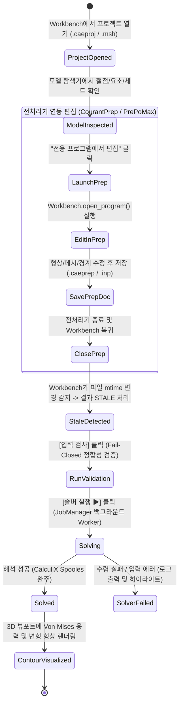

# 상용 CAE(HyperWorks / Abaqus / PrePoMax) 1:1 대조 CAELab 통합 GUI 상세 명세서

> **문서 상태**: 정본 초안 (Canonical Working Draft - PR 등록용)  
> **기준 커밋 (Base SHA)**: `09d2b56f259e57ef019ed9548b3f9a0e2e41cc92` (`main`)  
> **적용 범위**: `caelab-workbench` (통합 관리자 및 3D 결과 가시화) 및 `caelab-prep` (CourantPrep 전처리 연동)  
> **작성자**: Gemini (메인/통합 책임자)  
> **피어 리뷰 협의**: Codex (Prep/메싱 담당), 젠클스 (QA/전문가 대화 담당), 사용자(Product Owner)  
> **공개 기준 문서**:  
> - Abaqus/CAE 2022 User's Manual (Dassault Systèmes), Chapter 11(Mesh), 12(Step), 13(Load), 14(Visualization)  
> - PrePoMax v2.0 User Manual (§3 Geometry and Meshing, §4 Model, §5 Results)  
> - Altair HyperWorks 2023 User Guide (Part/Component Collectors, 2D BatchMesher, 3D Solid Sweep)  
> - CAELab Prep 8제품 벤치마크 (`docs/benchmarks/2026-10-30/`) 및 실행 계획 (`docs/execution-stages.md`)

---

## 1. 개요 및 설계 철학

CAELab은 독자적인 전용 포맷의 폐쇄적 도구가 아닌, 검증된 오픈소스 공학 솔버(CalculiX, OpenRadioss)와 전처리기(CourantPrep, Gmsh)를 결합하여 상용 CAE 수준의 통합 사용성을 제공하는 엔지니어링 워크벤치이다.

### 1.1 핵심 단일 책임 원칙 (Single Responsibility Principle)
1. **`caelab-prep` (CourantPrep)**:
   - 형상/CAD 임포트, 2D/3D 격자 생성(테트라/헥사 스윕), 솔버 원문 카드(`/PART`, `/MAT`, `*ELEMENT`) 및 경계조건/하중 전처리 단일 소유.
   - FORM(속성 인스펙터)과 TEXT(원문 카드 편집기)의 탭 전환 기반 무손실 편집 및 Undo/Redo 트랜잭션 보장.
2. **`caelab-workbench`**:
   - 프로젝트 오케스트레이션, 솔버 백그라운드 비동기 실행 제어(`JobManager`), 프로세스 라이프사이클 관리.
   - 전처리 문서의 변경 감지(`mtime`/해시) 및 하류 해석 결과의 만료(`STALE`) 상태 전파.
   - 솔버 해석 결과의 3D 뷰포트 내장 가시화(변위 및 Von Mises 응력 컨투어, 레전드, 실변형 배율).

---

## 2. 대표 사용자 과업 (End-to-End User Flow) 및 상태 전이

### 2.1 C3D10 솔리드 외팔보 벤치마크 과업 흐름


### 2.2 상세 사용자 상호작용 및 예외 복구 규격

#### 과업 1: "전용 프로그램에서 편집 (Edit in Native Preprocessor)"
- **진입점**: `MainWindow` 우측 속성 패널 하단의 `[전용 프로그램에서 편집]` 버튼.
- **실행 동작**:
  1. 현재 선택된 모델/파트의 원본 파일 경로(`doc_path`)를 조회.
  2. `Workbench.open_program(doc_path)`을 호출하여 해당 포맷의 등록된 실행기(`caelab-prep` 또는 `prepomax`)를 `JobManager.launch`로 비동기 실행.
- **예외 복구 (Error Recovery)**:
  - *프로그램 미등록 시*: "전처리기 실행 파일이 등록되지 않았습니다" 안내와 함께 [설정 다이얼로그]를 띄워 사용자가 직접 실행 파일 경로를 지정하도록 유도.
  - *문서 파일 부재 시*: "원본 모델 파일({path})을 찾을 수 없습니다" 경고 후 [파일 다시 연결 (Re-link)] 또는 [새 템플릿 생성] 선택창 제공.
- **상태 동기화 및 Stale 전파**:
  - 포커스가 Workbench로 복귀하거나 저장 이벤트 발생 시, 파일의 `st_mtime` 및 SHA256을 대조.
  - 원본이 수정된 경우, 기 보유 중인 해석 결과 및 파생 데이터의 상태를 즉시 `STALE (만료됨)` 아이콘 및 툴팁으로 표시.
  - 자동 재실행을 금지하며, 사용자가 명시적으로 `[솔버 실행]`을 누를 때만 파이프라인 가동.

---

## 3. 8대 기능 카탈로그 및 8개 상용 제품 상호작용 2차원 매트릭스

상용 매뉴얼의 공학 기능 분류(기능 축)와 Prep `DESIGN`의 8제품 상호작용 모델(표현 축)을 엄격히 구분하여 정의한다.

### 3.1 8대 기능 카탈로그 세부 스펙 (Functional Catalog)

#### Module 1: 형상 및 CAD 인터페이스 (Geometry & CAD Interface)
* **1.1 CAD 임포트**: STEP (.stp), IGES (.igs), BREP 지원. Bounding Box 크기 기반 단위계(mm vs m) 감지 및 사용자 확인 다이얼로그. (Abaqus 2022 Manual §10.3)
* **1.2 토폴로지 클린업**: Free Edge(자유 모서리: Red), Shared Edge(공유 모서리: Green), T-junction(T-접합: Yellow) 시각화 및 허용공차 기반 스티칭. (HyperWorks 2023 Topology Cleanup)
* **1.3 디피처링 (Defeaturing)**: 설정 반경 이하의 필렛, 소구경 홀 원클릭 억제/제거.
* **1.4 박판 중립면 추출**: 판재 부품 중립면(Mid-surface) 자동 추출 및 판 두께 자동 연동.

#### Module 2: 2D 쉘 격자 생성 (2D Surface Meshing)
* **2.1 표면 자동 메시어 (Auto-meshing / BatchMesher)**: 타깃 크기, 최소 크기, 곡률 적응 제어. Quad-dominant 및 All-Tri 지원.
* **2.2 법선 벡터 정렬 (Normal / Shell Winding)**: 인접 요소 간 법선 방향 일치 정렬 및 반전(Reverse).
* **2.3 품질 기준 (Quality Criteria)**: 종횡비(Aspect Ratio $\le 5.0$), 왜도(Skewness $\le 60^\circ$), 휨(Warpage $\le 15^\circ$), 자코비안(Jacobian $\ge 0.6$). 미달 요소 뷰포트 하이라이트.

#### Module 3: 3D 솔리드 격자 생성 (3D Solid Meshing)
* **3.1 6면체 스윕 메시어 (Hexahedral Sweep)**:
  - *기구현 범위(PR34, PR62, PR63)*: 단일 패치 코너/벡터 스윕, 레이어 분할 수, 레시피 보존 및 재생성.
  - *신규 추가 범위*: 양단 바이어스(Biasing ratio), 다중 공유 패치 스윕, 곡면 가이드 스윕.
* **3.2 4면체 테트라 메시어 (Gmsh C3D10 연동)**: Delaunay 3D 기반 Tet10 2차 요소 생성 및 형상 표면 곡률 투영.
* **3.3 품질 검사**: 음수 체적(Negative Volume) 및 네거티브 자코비안 요소 원천 차단.

#### Module 4: 모델 구성 및 엔티티 관리 (Model Organization & Collectors)
* **4.1 컴포넌트 컬렉터**: 파트 ID, 컴포넌트 이름, 색상(RGB), 재료 및 단면 1:1 바인딩.
* **4.2 재료 모델**: 선형 탄성(Linear Elastic), 탄소성(Johnson-Cook, Swift-Voce 경화).
* **4.3 엔티티 세트 (Sets)**: 절점 세트(NSET), 요소 세트(ELSET), 면 세트(SURF). 박스/면/루프 선택 필터.

#### Module 5: 하중 및 경계조건 (Boundary Conditions & Loading)
* **5.1 자유도 구속조건 (SPC)**:
  - **솔리드 요소(C3D10)의 엄밀한 자유도 정의**: 병진 자유도 $U_1, U_2, U_3$만 지원하며, 회전 자유도(4, 5, 6)를 무차별 적용하지 않음.
  - 뷰포트 기호: 구속된 축 방향으로 삼각 피라미드 기호 렌더링.
* **5.2 하중 조건**:
  - 집중 하중(Nodal Force): 단일 절점 하중 및 NSET 기반 총 하중(Total Load = $F_{\text{node}} \times N_{\text{nodes}}$) 구분.
  - 표면 압력(Pressure): 요소 면 법선 방향 작용. 뷰포트 화살표 렌더링.

#### Module 6: 솔버 덱 조립 및 정합성 검증 (Solver Deck Assembly & Validation)
* **6.1 다중 솔버 어댑터**: CalculiX (`.inp`) 및 OpenRadioss (`_0000.rad`, `_0001.rad`) 표준 덱 생성.
* **6.2 Fail-Closed 사전 정합성 검증**:
  - `parse_deck_boundary_dofs`: 모델의 `fixed_dofs`와 덱의 `*BOUNDARY` 구속 자유도 완전 일치 대조.
  - `parse_deck_cload_totals`: 모델의 `load_vector`와 덱의 `*CLOAD` 합계(NSET 크기 배수 반영) 수치 일치 대조.

#### Module 7: 다중 솔버 실행 및 작업 모니터링 (Multi-Solver Execution & Monitoring)
* **7.1 JobManager 비동기 파이프라인**: 백그라운드 Worker 스레드 기반 GUI 응답성 유지. 취소(Cancel/Kill) 보장.
* **7.2 실시간 수렴 모니터링**: CalculiX 비선형 잔차 곡선 및 OpenRadioss 에너지/질량 오차율 실시간 플롯.

#### Module 8: 3D 결과 가시화 및 분석 (Post-Processing & Visualization)
* **8.1 3D 컨투어 데이터 계약 (Data Contract)**:
  - 성분: Von Mises 등가응력($\sigma_{\text{vm}}$), 주응력($\sigma_1, \sigma_2, \sigma_3$), 변위($U_x, U_y, U_z, |U|$).
  - 데이터 위치: 적분점(Integration Points) 데이터와 절점 외삽(Extrapolated Nodal) 데이터를 명확히 메타데이터에 분리 표기.
  - 단위계: 입력 덱의 확정 단위계(`mm, N` $\rightarrow$ `MPa`, `m, N` $\rightarrow$ `Pa`)가 확인된 경우만 라벨 표기. 미확인 시 `[단위 미선언]` 표시.
  - 커버리지: 미계산/미지원 요소는 `NaN`으로 마스킹하여 뷰포트에서 회색(Uncovered) 처리.
* **8.2 변형 형상 및 배율 정의**:
  - 표시 좌표 계산 공식: $\mathbf{x}_{\text{display}} = \mathbf{x}_{\text{orig}} + S \cdot \mathbf{u}$.
  - 실변형 1배($S = 1.0$)와 화면 맞춤용 자동 배율($S = S_{\text{auto}}$)을 명시적 옵션으로 분리.
* **8.3 외부 뷰어 연동**: ParaView(`.vtu` / `.pvd`) 외부 열기 기능 영구 보존.

---

### 3.2 8대 기능 $\times$ 8제품 상호작용 매핑 매트릭스

| 8대 기능 분류 | BeidPrep (BE) | Naksha (NA) | PrePoMax (PP) | Abaqus/CAE (AB) | HyperWorks (HW) | Ansys WB (AN) | FreeCAD FEM (FC) | OpenCourant (OC) |
|---|---|---|---|---|---|---|---|---|
| **1. 형상/CAD** | 트리+FORM/TEXT | Outline/Details | Geometry 트리 | Part/Feature 모듈 | Geometry 리본 | SpaceClaim/DM | FreeCAD Part 트리 | CLI/스크립트 |
| **2. 2D 쉘 메시** | Mesh 메뉴+카드 | Mesh 패널 | Shell 단면 지정 | Mesh 모듈+컨트롤 | 2D BatchMesher | Meshing Applet | Netgen/Gmsh 파라미터 | Gmsh API |
| **3. 3D 솔리드** | PR34/62/63 스윕 | Solid 생성 다이얼로그 | Solid 3D 테트라 | Hex/Tet 선택 도구 | 3D Solid Map/Sweep | Method(Sweep/Patch) | Gmsh 3D 알고리즘 | msh_c3d10 어댑터 |
| **4. 엔티티/컬렉터**| PART/MAT 카드 | Component/Material | Material/Section 트리 | Property 모듈 | Model Browser 컬렉터 | Engineering Data | Material 객체 | Deck include |
| **5. 하중/구속** | /BCS, /CLOAD 카드 | Boundary 조건 탭 | Boundary/Load 트리 | Load 모듈 (SPC/Force) | Load Collector | Static Structural 트리 | FEM Constraint 객체 | Deck *BOUNDARY |
| **6. 덱 조립** | RAD 내보내기 | 내보내기 | .inp 작성 | Job 쓰기 | Solver Deck Export | Solver Deck 쓰기 | ccx .inp 작성 | msh_c3d10 조립 |
| **7. 실행/모니터** | 외부 솔버 호출 | 실행 다이얼로그 | Monitor 탭 (실시간) | Job Monitor/Log | Run Manager | Solution 모니터 | ccx 프로세스 실행 | JobManager Worker |
| **8. 3D 가시화** | VTK 뷰포트 | 3D View | 결과 컨투어/레전드 | Visualization 모듈 | HyperView 연동 | Mechanical Results | VTK Post 뷰어 | 내장 컨투어+ParaView |

---

## 4. UI 레이아웃 및 상용 CAE 위계 구조

### 4.1 Workbench 메인 윈도우 와이어프레임
```
+-----------------------------------------------------------------------------------------------------------------+
| 메뉴: 파일(F) | 편집(E) | 프로젝트(P) | 해석(A) | 결과(R) | 보기(V) | 도움말(H)                               |
+-----------------------------------------------------------------------------------------------------------------+
| 메인 툴바: [열기] [저장] | [전처리기 열기] | [입력 검사] [솔버 실행 ▶] [실행 취소 ⏹] | [단위: mm, N, MPa (확정)]      |
+------------------------------------------------------+----------------------------------------------------------+
| 모듈 탭: [ 1. 모델/트리 ] [ 2. 하중/조건 ] [ 3. 솔버 작업 ] [ ★ 4. 3D 결과 가시화 ]                                |
+--------------------------+---------------------------+----------------------------------------------------------+
| [좌측 독: 모델 탐색기]   | [중앙: 3D 그래픽스 뷰포트 (VTK)]                                                      |
| ├── 📦 부품 (Parts)      | 뷰 제어: [등각] [정면] [평면] [맞춤] | 모드: [요소] [절점] | 표시: [ 실변형 1x | 자동배율 ]  |
| │   └── 🔹 Beam (C3D10)  |                                                                                          |
| ├── 🧱 재료 (Materials)  |                                                                                          |
| │   └── 🏷️ Steel        |                       [ 3D CAE 메시 & Von Mises 응력 컨투어 ]                            |
| ├── 📌 구속 (BCs)        |                                                                                          |
| │   └── 🔒 Fix-Base      |                                                                                          |
| ├── ⬇️ 하중 (Loads)      |                                                               [ 컬러 레전드 (범례) ]     |
| │   └── 🎯 Force-Z(-100N)|                                                               Max: 215.4 MPa (Red)      |
| └── 📊 해석 결과         |                                                               ...                       |
|     ├── 📈 변위 (U)      |                                                               Min: 0.00 MPa (Blue)       |
|     └── 🌈 Von Mises 응력|                                                               [커버리지: 100% 정상]      |
+--------------------------+--------------------------------------------------------------------------------------+
| [우측/하단 독: 컨텍스트 패널 및 작업 모니터]                                                                    |
| [ 모델/조건 속성 ]                     [ 실행 로그 및 수렴 그래프 ]            [ 데이터 정합성 검증 ]            |
| 파트명: Beam_C3D10                     [11:20:01] CalculiX 2.21 solver start  *BOUNDARY DOFs: 1, 2, 3 (OK)       |
| 요소수: 142 (C3D10)                    [11:20:02] Factorization completed     *CLOAD Total: -100.0 N (OK)        |
| 절점수: 325                            [11:20:02] Solution converged in 1 iter 단위계: Length=mm, Force=N        |
| [전용 프로그램에서 편집] (CourantPrep)  결과 상태: 정상 완주 (Pass)             유도 응력 단위: MPa (정합성 확인)   |
+-----------------------------------------------------------------------------------------------------------------+
| 상태표시줄: 준비 완료 | 활성 문서: beam_study.caeproj | 솔버: CalculiX Spooles | 상태: 최신 결과 (Up-to-date)    |
+-----------------------------------------------------------------------------------------------------------------+
```

### 4.2 Windows 환경 및 고DPI 대응 규격
1. **DPI Scaling**:
   ```python
   os.environ["QT_ENABLE_HIGHDPI_SCALING"] = "1"
   QGuiApplication.setHighDpiScaleFactorRoundingPolicy(
       Qt.HighDpiScaleFactorRoundingPolicy.PassThrough
   )
   ```
2. **글꼴 위계**: 하드코딩 픽셀을 배제하고 Windows 시스템 폰트(Segoe UI / 맑은 고딕) 기반 `pt` 단위 적용.
3. **한국어 IME 입력 보호**: 포커스 이동 시 조합 중 텍스트 유실 방지 이벤트 필터 적용.

---

## 5. 수용 기준 (Acceptance Criteria)

1. **[AC-1: 단일 책임 및 왕복 무결성]**:
   - `MainWindow`에서 [전용 프로그램에서 편집] 클릭 시 `Workbench.open_program`을 통해 지정된 외부 프로그램이 실행되어야 한다.
   - 외부 프로그램에서 파일을 수정 후 저장하면, Workbench는 원본 변경을 감지하여 기존 해석 결과를 즉시 `STALE`로 전이시키고 재계산을 요구해야 한다.
2. **[AC-2: 솔리드 구속 자유도 엄밀성]**:
   - C3D10 3차원 솔리드 모델에 대해 회전 자유도(4, 5, 6)를 구속하거나 하중을 부여하는 오류를 원천 차단하고, 병진 자유도(1, 2, 3)만을 취급해야 한다.
3. **[AC-3: 3D 컨투어 데이터 계약 준수]**:
   - CalculiX 계산 결과의 Von Mises 응력을 뷰포트에 표시할 때, 원본 데이터 위치(적분점 vs 절점 외삽)와 확인된 단위(MPa/Pa)를 반드시 함께 표기해야 한다.
   - 단위가 불분명한 경우 단위를 임의 표기하지 않고 경고를 출력해야 하며, 미계산 요소는 `NaN` 마스킹으로 회색 렌더링되어야 한다.
4. **[AC-4: 변형 배율 수식 정합성]**:
   - 뷰포트의 변형 형상은 $\mathbf{x}_{\text{display}} = \mathbf{x}_{\text{orig}} + S \cdot \mathbf{u}$를 정확히 따라야 하며, $S=1.0$(실변형)과 $S=S_{\text{auto}}$(자동 배율)이 명확히 구별되어야 한다.
5. **[AC-5: 문서 및 코드 동기화]**:
   - `scripts/check_doc_sync.py --mode pre-commit`을 100% 통과해야 한다.
