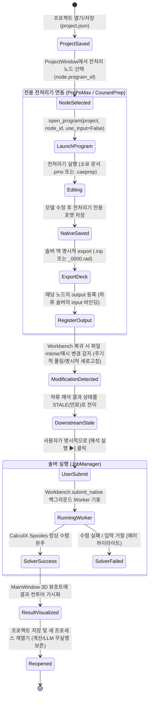

# 상용 CAE 1:1 대조 CAELab 통합 GUI 상세 명세서

> **문서 상태**: 4차 개정 정본 (Revision 4 - Codex 피어 리뷰 PR78-WB1~WB6 및 PREP78-R1~R7 잔여 세부 조건 100% 반영)  
> **기준 커밋 (Base SHA)**: `09d2b56f259e57ef019ed9548b3f9a0e2e41cc92` (`main`)  
> **직전 Head SHA**: `e7a8a4ff9c7b1e37dea56553a5aa1d689913e63d` (CI 4종 All Green 통과)  
> **적용 범위**: `caelab-workbench` (통합 관리자, 노드 오케스트레이션, 3D 결과 가시화) 및 `caelab-prep` (CourantPrep 전처리 연동)  
> **작성 및 검토 역할**:  
> - 작성/통합 책임: Gemini (메인/통합 책임자)  
> - 독립 피어 리뷰: Codex (Prep 및 CAE 비판 리뷰), 젠클스 (QA 및 전문가 대화 담당)  
> **공개 기준 문헌 및 벤치마크 (Pinned Primary References)**:  
> 1. [PrePoMax v2.0.0 Manual (2023-12-09)](https://prepomax.fs.um.si/wp-content/uploads/2023/12/PrePoMax-v2.0.0-manual.pdf): 목차 p.2, §4 Geometry and Mesh (p.14), §5 FE Model (p.18), §6 Results (p.49)  
> 2. [Altair HyperMesh 2025.1 Element Quality Calculations](https://2025.help.altair.com/2025/hwdesktop/hwx/topics/pre_processing/meshing/element_quality_calculations_hypermesh_r.htm): 2D 대변 중점 연결선 Skew 각도 및 Jacobian 최소/최대 행렬식 비율 공식  
> 3. [Abaqus 2025 Consistent Units Documentation](https://docs.software.vt.edu/abaqusv2025/English/SIMACAEGSARefMap/simagsa-c-absunits.htm): 단위 일관성 및 모델링 지침 (단위계 참조용)  
> 4. [Qt 6 High DPI Documentation](https://doc.qt.io/qt-6/highdpi.html): DPI 스케일링 정책 및 런타임 라운딩 가이드  
> 5. [CAELab Prep 공개 벤치마크](https://github.com/pikachu444/caelab-prep/blob/f18739cb5ff8e9b52c5a81e6ccd901d6aff82b3f/docs/benchmarks/2026-10-30/README.md) 및 [실행 계획](https://github.com/pikachu444/caelab-prep/blob/f18739cb5ff8e9b52c5a81e6ccd901d6aff82b3f/docs/execution-stages.md)

---

## 1. 아키텍처 원칙 및 전처리기 소유권 경계

CAELab은 다중 솔버와 전용 전처리기를 결합하는 유연한 아키텍처를 채택하며, 특정 프로그램이 모든 전처리를 독점하지 않는다.

### 1.1 솔버별 전처리기 소유권 및 포맷 경계 (DESIGN §2.1 준수)
* **CalculiX 전처리**: PrePoMax(`.pmx` $\rightarrow$ `.inp` 내보내기) 우선 및 FreeCAD FEM 호환 체계. Workbench는 독자적인 FE 모델 생성기가 아니며, 변환 어댑터(`msh_c3d10.py`)를 통해 메시를 C3D10 덱으로 조립하거나 PrePoMax가 생성한 `.inp`를 소비한다.
* **OpenRadioss 전처리**: `caelab-prep` (CourantPrep)이 소유. RAD 포맷(`/BEGIN`, `/PART`, `/MAT`, `/PROP`, `/BCS`) 세션 및 `.caeprep` 작업 문서를 단일 소유하며, 솔버 실행용 `_0000.rad`를 명시적으로 export한다.
  - **Prep FORM/TEXT 편집 범위 한정**: Prep의 FORM/TEXT는 지원된 선택 RAD 카드의 schema 필드만 typed command로 편집하며, 구조·미지원 필드 변경은 거부한다.
* **MSH 파일의 위상**: Gmsh MSH 4.1은 독립 교환 자산(Exchange Asset)이며, Prep에서는 `external_mesh.py`를 통해 명시적 프로파일/단위 검토 후 native 채택(`adopt`)되고, Workbench에서는 C3D10 변환 파이프라인의 입력으로 취급된다.

### 1.2 창(Window) 역할 및 상호작용 분리
* **`ProjectWindow` (부모 런처)**: 프로젝트 파일(JSON / `project.json`)을 관리하며, 계산 노드 파이프라인(`ProgramNode`), 입력/문서/출력 바인딩, 전용 프로그램 실행(`open_program`)을 총괄.
* **`Native Analysis Window`**: 개별 솔버/전처리기 프로세스의 실행, 로그 수집, 소유 프로세스 트리 취소(`Workbench.cancel_native_run` $\rightarrow$ `JobManager.cancel_native`)를 모니터링.
* **`MainWindow` (보조 모델 뷰어)**: 경량 `StructuralModel`의 절점/요소/세트 조회 및 3D 뷰포트를 통한 해석 결과(변위 및 Von Mises 응력) 컨투어 가시화 전담. 본 창에서 전처리 형상이나 카드를 직접 수정하지 않으며, 전처리 편집이 필요할 경우 상위 `ProjectWindow`의 선택된 전처리 노드 맥락을 통해 `Workbench.open_program`을 호출하거나 부모 런처로 복귀한다.

---

## 2. 대표 과업(User Flow) 및 전체 라이프사이클 명세

### 2.1 C3D10 솔리드 외팔보 벤치마크 및 전처리기 연동 흐름


### 2.2 상세 단계별 계약 및 예외 복구 규격

#### [과업 단계 1: 전용 프로그램 실행]
* **호출 API**: `Workbench.open_program(project, node_id, use_input=False)`
* **소유권 대조**: 선택된 전처리 노드의 `node.program_id`를 조회하여 등록된 `ProgramSpec` 확인.
  - 전처리 노드가 `caelab_prep`인 경우 $\rightarrow$ `caelab-prep.exe` 비동기 기동.
  - 전처리 노드가 `prepomax`인 경우 $\rightarrow$ `prepomax.exe` 비동기 기동.
  - *파일 바인딩 규칙*: `reference = (None if use_input else node.files.get("document")) or project.input_file(node_id)` 계약에 따라, 기본 `use_input=False` 상태에서는 `node.files["document"]`를 우선 열고, 없으면 연결된 입력 파일로 fallback함. 솔버 노드를 임의로 전처리기 실행으로 자동 치환하지 않음.
* **예외 복구 (제안/설계 규격)**:
  - *실행 파일 미등록*: "전처리기({program_id}) 경로가 설정되지 않았습니다" 안내 및 [환경설정 다이얼로그(제안)] 호출.
  - *소유 문서 부재*: "연결된 작업 문서({path})가 없습니다" 경고 후 [파일 다시 연결 (Re-link, 제안)] 대화상자 표시. 임의의 템플릿으로 원본을 자동 덮어쓰지 않음.

#### [과업 단계 2: 변경 감지, 등록 및 하류 Stale 전파]
* **내보내기 및 등록**: 외부 전처리기가 export한 `.inp` 또는 `_0000.rad`는 해당 노드의 `output`으로 등록되어 하류 솔버 노드의 `input`으로 바인딩됨.
* **감지 메커니즘**: 포커스 복귀 시점의 주기적 폴링(Polling) 또는 명시적 새로고침(`project.refresh()`) 시 대상 덱 파일의 `st_mtime` 및 SHA256 대조. (운영체제 파일시스템의 stat 타임스탬프 해상도 한계를 감안하여 해시 대조를 병행)
* **상태 전이**: 원본 덱이 갱신된 경우, 기존 계산 결과의 캐시 유효성을 즉시 무효화하고 UI에 `[STALE - 재실행 필요]` 배지 표기. 자동 재실행을 금지하며, 사용자가 명시적으로 `[해석 실행]`을 누를 때만 파이프라인 가동.
* **저장 취소 및 무실행 재열기**:
  - 프로젝트 저장 대화상자 취소 시 기존 파일, 이력, 선택 상태를 온전히 보존하며 불필요한 실행(0 run)을 유발하지 않음.
  - 프로젝트 저장 후 새 프로세스로 재열기 시 기존 입력/문서 참조 및 과거 실행 이력을 그대로 보존하며, 사용자 확인 없이 자동 계산이나 LLM 요청을 발생시키지 않음.

#### [과업 단계 3: 작업 취소 및 프로세스 격리]
* **취소 메커니즘**: `Workbench.cancel_native_run(run_id)` 호출 $\rightarrow$ `JobManager.cancel_native(run_id)`에 취소 요청(Cancel flag set). Worker 스레드가 종료되고 저장소 파일 lease가 안전하게 해제되었음을 확인(`RunActivity.active == False`)한 후 정리를 완결함. 외부 GUI 편집기나 별도 PID를 임의 강제 종료하지 않음.

---

## 3. 8대 기능 카탈로그 및 필수 8제품 상호작용 2차원 매트릭스

### 3.1 8대 기능 카탈로그 세부 공학 스펙

#### Module 1: 형상 및 CAD 인터페이스 (Geometry & CAD Interface)
* **1.1 CAD 임포트 및 단위계 원칙**:
  - **단위계 판정**: Bounding Box 크기만으로 단위를 자동 확정하는 것을 금지함. 파일 메타데이터 및 사용자의 명시적 선언(`units_declaration`)만을 정본으로 취급하며, Bounding Box는 비정상 스케일(예: $10^6$ 이상) 시 경고를 출력하는 용도로만 한정. ([Abaqus Consistent Units 원칙](https://docs.software.vt.edu/abaqusv2025/English/SIMACAEGSARefMap/simagsa-c-absunits.htm) 준수)
* **1.2 토폴로지 클린업 (Topology Cleanup)**: Free Edge(Red), Shared Edge(Green), T-junction(Yellow) 시각화 및 허용공차 기반 스티칭.
* **1.3 디피처링 (Defeaturing)**: 미세 필렛/홀 반경 임계값 기반 원클릭 억제/제거.
* **1.4 박판 중립면 추출**: 판재 중립면 추출 및 판 두께 자동 연동.

#### Module 2: 2D 쉘 격자 생성 (2D Surface Meshing)
* **2.1 표면 자동 메시어 (Auto-meshing / BatchMesher)**: 타깃 크기, 최소 크기 제어. Quad-dominant 및 All-Tri 지원.
* **2.2 법선 벡터 정렬 (Shell Winding)**: 인접 요소 간 법선 방향 일치 정렬 및 반전(Reverse).
* **2.3 요소 품질 기준 (Quality Criteria - Altair HyperMesh 공식 정의 인용)**:
  - **Aspect Ratio**: TRI3 및 QUAD4 공통, 최장 모서리 길이와 최단 모서리 길이의 비율 ($L_{\text{max}} / L_{\text{min}} \le 5.0$, 제안 목표치).
  - **Skewness (왜도)**:
    - TRI3: 구성 세 꼭짓점 내각 중 최소 내각($\theta_{\text{min}}$) 기반 $|90^\circ - \theta_{\text{min}}| \le 60^\circ$.
    - QUAD4: **대각선이 아닌 대변 중점들을 잇는 두 직선 사이의 사잇각 편차** $|90^\circ - \phi| \le 60^\circ$. (직사각형에서 왜도가 0이 되도록 대변 중점 연결선 공식 준수)
  - **Warpage (휨)**: QUAD4 요소를 대각선으로 분할하여 형성된 두 삼각 평면 사이의 이면각 편차 $\le 15^\circ$ (TRI3는 평면 불변으로 $0^\circ$).
  - **Jacobian**: 가우스 적분점에서 평가된 야코비안 행렬식의 최소값과 최대값의 비율 $\min(\det \mathbf{J}) / \max(\det \mathbf{J}) \ge 0.6$.
  - *비고*: 위 수치들은 공학적 목표치이며, 현재 `MeshingCriteria` 구현의 fail-closed 차단 기준이 아님을 명시.

#### Module 3: 3D 솔리드 격자 생성 (3D Solid Meshing)
* **3.1 6면체 스윕 메시어 (Hexahedral Sweep)**:
  - **기구현 실적 (PR34, PR62, PR63)**: 정확히 두 인접 평면 패치의 직선 스윕 및 공유 경계 정합(`structured_geometry.py`), divisions/global layers 분할 및 레시피 보존/재생성. (단일 패치 제한은 `mesh_workflow.py`의 코너/벡터 편집 UI에 한정)
  - **신규 제안 범위 (미구현)**: 양단 바이어스(Biasing ratio), 다중 3개 이상 패치 스윕, 곡면 가이드 스윕.
* **3.2 4면체 테트라 메시어 (Tetrahedral Meshing)**:
  - **기구현 직선 Tet10 (`msh_c3d10.py` 및 Prep worker)**: `SecondOrderLinear=1`, 직선 midside 8-ULP 예산, corner-scaled Jacobian $J \ge 0.5$, 6개 코너 모서리 비 $\le 4$, 및 **실제 10절점 좌표에 대한 전 참조요소 양의 Jacobian 인증(`certify_straight_tet10`)**.
  - **신규 곡면 Tet10 (미구현 제안)**: 곡면 형상 투영 midside는 형상 연계 및 고차 요소 전역 유효성 검증이 요구되는 별도 신규 범위로 분리.
* **3.3 품질 검사**: 음수 체적 요소 원천 차단.

#### Module 4: 모델 구성 및 엔티티 관리 (Model Organization & Collectors)
* **4.1 컴포넌트 컬렉터**: 파트 ID, 컴포넌트 명칭, 표시 색상, 재료/단면 바인딩.
* **4.2 재료 모델**: 선형 탄성, 소성 재료(Johnson-Cook 등).
* **4.3 엔티티 세트 (Sets)**: NSET, ELSET, SURF. 박스/면/루프 필터 지원.

#### Module 5: 하중 및 경계조건 (Boundary Conditions & Loading)
* **5.1 자유도 구속조건 (SPC)**:
  - **C3D10 솔리드 자유도 엄밀 한정**: 병진 자유도 $U_1, U_2, U_3$만 지원하며, 회전 자유도(4, 5, 6)를 무차별 적용하지 않음.
* **5.2 하중 조건**:
  - 집중 하중(Nodal Force): 단일 절점 하중과 NSET 기반 총 하중(Total Load = $F_{\text{node}} \times N_{\text{nodes}}$) 분리.

#### Module 6: 솔버 덱 조립 및 정합성 검증 (Solver Deck Assembly & Validation)
* **6.1 다중 솔버 어댑터**: CalculiX `.inp` 및 OpenRadioss `_0000.rad` 생성.
* **6.2 사전 정합성 검증 (PR77 제안 검증 범위)**:
  - `parse_deck_boundary_dofs`: 모델의 `fixed_dofs`와 덱 내 `*BOUNDARY` 구속 DOF 대조.
  - `parse_deck_cload_totals`: 모델의 `load_vector`와 덱 내 `*CLOAD` NSET 크기 배수 합계 대조.
  - *PR77 잔여 P2 과제 추적*: 단일축 잘못된 대상 식별, 구속 고정값 및 추가 구속 검증, 절점별 재분배 및 비유한 값 대조 등 원 비판자가 지적한 기본 결합 결함의 엄밀 검증을 PR77 후속으로 완료해야 함.

#### Module 7: 다중 솔버 실행 및 작업 모니터링 (Multi-Solver Execution & Monitoring)
* **7.1 JobManager 비동기 제어**: 백그라운드 Worker 스레드 실행, 프로세스 트리 취소.
* **7.2 수렴 모니터링**: CalculiX 비선형 잔차 및 OpenRadioss 에너지/질량 오차율 실시간 모니터링.

#### Module 8: 3D 결과 가시화 및 분석 (Post-Processing & Visualization)
* **8.1 3D 컨투어 데이터 계약 (Data Contract)**:
  - **성분**: Von Mises 등가응력($\sigma_{\text{vm}}$), 주응력($\sigma_1, \sigma_2, \sigma_3$), 변위($U_x, U_y, U_z, |U|$).
  - **데이터 위치 및 커버리지**: 적분점(Integration Points)과 절점 외삽(Extrapolated Nodal) 데이터 위치를 메타데이터로 분리. 선택된 run/frame, 원 절점 ID, 및 unknown/nonfinite ID를 보존하며, 미계산/미지원 요소는 `NaN`으로 마스킹하여 뷰포트에서 회색(Uncovered) 처리.
  - **과거 실행 검사 원칙**: 과거 run 선택 시 현재 모델이 아닌 해당 run 시점의 메시, 단위계, 프레임을 적용하여 표시함.
  - **단위계 원칙**: 입력 덱의 확정 단위계(`mm, N` $\rightarrow$ `MPa`, `m, N` $\rightarrow$ `Pa`)가 확인된 경우만 라벨 표기. 미확인 시 `[단위 미선언]` 표시. 성분 의미가 미확인된 경우 파생 응력 표시를 보류함.
* **8.2 변형 형상 배율 공식**:
  - 표시 좌표: $\mathbf{x}_{\text{display}} = \mathbf{x}_{\text{orig}} + S \cdot \mathbf{u}$ (단, $\mathbf{x}_{\text{orig}}$와 $\mathbf{u}$는 동일한 길이 단위계(호환성)를 전제로 함).
  - 실변형 1배($S = 1.0$)와 화면 맞춤용 자동 배율($S = S_{\text{auto}}$)을 명시적 옵션으로 분리.
* **8.3 외부 뷰어 연동**: ParaView(`.vtu` / `.pvd`) 외부 열기 기능 유지.

---

### 3.2 Prep DESIGN R2 필수 8제품 상호작용 매핑 매트릭스

> **작성 원칙**: Prep `DESIGN` R2에 명시된 필수 8제품을 원본 그대로 복원하며, 원제품 관측과 CAELab 구현/목표를 열 단위로 엄격히 분리한다.

| 제품명 (약칭) | 공개 원본 관측 (버전, URL/Locator, 관측 한계) | 현재 CAELab 코드 구현 상태 | 향후 목표 및 미확인 과제 |
|---|---|---|---|
| **1. HyperMesh** (HM) | 2025.1 Help, Part/Component 컬렉터, 2D BatchMesher, 3D Hexa Sweep (실제 GUI 조작 흐름은 미확인) | 형상 임포트 및 Gmsh 기반 격자 생성 연동 (`caelab_prep/adapters/gmsh_worker.py`) | HM 스타일 2D 배치메셔 룰 세부 설정 및 고급 스윕 가이드 |
| **2. PrePoMax** (PP) | v2.0.0 Manual (2023-12-09, 목차 p.2), §4 형상/메시(p.14), §5 FE모델(p.18), §6 결과(p.49) | Workbench에서 `open_program`을 통한 `.pmx` 실행 및 CalculiX `.inp` 소비 | PrePoMax 결과 파일 직접 파싱 연동 및 Windows 환경 E2E 검증 |
| **3. Naksha** (NA) | v0.5.07 공개 벤치마크, 선택 띠, Outline/Details 2열 배치 (실제 선택 변경·modifier 미확인) | 트리-인스펙터 구조 및 QSS 스타일 적용 | 세부 선택 마스크 및 속성 에디터 상호작용 일치 |
| **4. Abaqus/CAE** (AB) | 2025 Guide (단위 지침 참조용), 모듈 바(Module Bar) 기반 상호 전환 (GUI 실화면 미확인) | Workbench 메인 윈도우 모듈 탭 전환 (`apps/workbench_qt/main_window.py`) | 모델-결과 뷰포트 완전 통합 및 스텝별 출력 요청 세부 설정 |
| **5. COMSOL** (CM) | Model Builder 트리, 1열 계층 구조, 피처 기반 설정 (실제 과업 미확인) | Prep 모델 트리 계층 구조 (`caelab_prep/ui/widgets/tree.py`) | 다중 물리 필드 연계 인터페이스 및 복합 경계조건 트리 매핑 |
| **6. midas NFX** (MN) | 리본 메뉴, 작업 트리, 속성 그리드 3단 레이아웃 (실제 과업 미확인) | 리본형 툴바 및 독(Dock) 분할 배치 | NFX 스타일 고급 3D 메싱 마법사 인터페이스 |
| **7. MIDAS MeshFree** (MF) | 무격자/경계 격자 자동화, 3단계(CAD-조건-해석) 단순 흐름 (실제 과업 미확인) | 1클릭 파이프라인 지향 및 백그라운드 JobManager 자동화 | 복잡 형상 자동 해석 단순화 인터페이스 구축 |
| **8. BeidPrep** (BE) | v2.0 관측, 중앙 3D 뷰포트, 좌측 MODEL 트리, 우측 FORM/TEXT 탭 인스펙터 | CourantPrep 2026 레이아웃 (`caelab_prep/ui/prep_workspace.py` PR #40): FORM 선택 카드 단위 문맥(`units_note`), Elements/Nodes 콤보, 카메라 정면/평면 메뉴, 1440x900 초기값 및 유효 geometry 복원/최대화 | 대형 어셈블리 렌더링 성능 최적화 및 세부 카드 편집기 확장 |

*추가 비교군 (보조)*:
- **Ansys Workbench**: 프로젝트 스키매틱(Schematic) 노드 연결 모델 $\rightarrow$ CAELab `ProjectWindow`의 파이프라인 그래프 모델에 참고.
- **FreeCAD FEM**: 오픈소스 GUI FEM 워크벤치 $\rightarrow$ Gmsh 및 CalculiX 기본 연동 방식 참고.

---

## 4. UI 레이아웃 및 상용 CAE 위계 구조

### 4.1 Workbench 보조 모델 뷰어 (`MainWindow`) 와이어프레임

> [!NOTE]
> 본 와이어프레임은 경량 `StructuralModel` 및 해석 결과를 조회하는 **보조 `MainWindow`의 결과 가시화 화면**을 나타내며, 수치들은 이해를 돕기 위한 **가상 설명값(Placeholder Mock-up)**입니다.

```
+-----------------------------------------------------------------------------------------------------------------+
| 메뉴: 파일(F) | 해석(A) | 결과(R) | 보기(V) | 도움말(H)                                                         |
+-----------------------------------------------------------------------------------------------------------------+
| 메인 툴바: [열기] [저장] | [입력 검사] [솔버 실행 ▶] [취소 ⏹] | [단위: Length=mm, Force=N (입력 선언 확인)]            |
+-----------------------------------------------------------------------------------------------------------------+
| 모듈 탭: [ 1. 모델 검사 ] [ 2. 하중/구속 확인 ] [ ★ 3. 3D 결과 가시화 ]                                         |
+--------------------------+--------------------------------------------------------------------------------------+
| [좌측 독: 모델 탐색기]   | [중앙: 3D 그래픽스 뷰포트 (VTK)]                                                      |
| ├── 📦 부품 (Parts)      | 뷰 제어: [등각] [정면] [평면] [맞춤] | 모드: [요소] [절점] | 표시: (o) 실변형 1x  ( ) 자동배율|
| │   └── 🔹 Part-1 (C3D10)|                                                                                          |
| ├── 📌 구속 (BCs)        |                                                                                          |
| │   └── 🔒 Base (DOFs:123)|                     [ 3D 메시 & Von Mises 등가응력 컨투어 렌더링 ]                       |
| ├── ⬇️ 하중 (Loads)      |                                                                                          |
| │   └── 🎯 Tip (-100N)   |                                                               [ 컬러 레전드 (범례) ]     |
| └── 📊 해석 결과         |                                                               Max: {max_val} MPa (Red)   |
|     ├── 📈 변위 (|U|)    |                                                               ...                        |
|     └── 🌈 Von Mises 응력|                                                               Min: {min_val} MPa (Blue)  |
|                          |                                                               [커버리지: 정상 / 미계산 NaN] |
+--------------------------+--------------------------------------------------------------------------------------+
| [우측/하단 독: 컨텍스트 패널 및 작업 모니터]                                                                    |
| [ 선택 객체 정보 ]                     [ 솔버 실행 로그 ]                      [ 정합성 검증 상태 ]              |
| 파트: Part-1 (C3D10)                   [로그] ccx -i c3d10_beam ...            *BOUNDARY DOFs: 1, 2, 3 (확인)     |
| [전용 프로그램에서 편집] (CourantPrep)  [로그] Convergence achieved             *CLOAD Total: -100.0 N (확인)      |
| 상태: STALE (원본 덱 수정 감지됨)      결과: 정상 완주 (Pass)                  유도 응력 단위: MPa (선언 일치)    |
+-----------------------------------------------------------------------------------------------------------------+
| 상태표시줄: 준비 완료 | 활성 프로젝트: project.json | 솔버: CalculiX 2.21 | 결과 상태: STALE (재실행 필요)       |
+-----------------------------------------------------------------------------------------------------------------+
```

### 4.2 Windows 환경 및 고DPI / 폰트 / IME 대응 규격
1. **DPI Scaling**:
   - 하드코딩된 환경변수 상시 강제를 지양하고, [Qt 6 공식 High DPI 가이드](https://doc.qt.io/qt-6/highdpi.html)에 따라 `QGuiApplication`의 기본 DPI 스케일링 정책을 활용하며, 혼합 DPI 다중 모니터 이동 시 창 크기/폰트 왜곡 방지.
2. **글꼴 위계**: Windows 시스템 폰트(Segoe UI / 맑은 고딕) 기반의 상대적 `pt` 포인트 크기 적용.
3. **한국어 IME 입력 보호**: `caelab-prep/src/caelab_prep/ui/widgets/collections.py`의 `inputMethodEvent` 처리를 계승하여, preedit(조합 중 텍스트) 상태에서 Tab, Enter, 포커스 이동, Undo/Redo 시 글자가 유실되거나 중복 입력되지 않고 UTF-16 서러게이트 페어가 보존되도록 구현.

---

## 5. 관측 가능한 수용 기준 (Acceptance Criteria)

1. **[AC-1: 전처리기 연동 및 Stale 전파 라이프사이클]**:
   - `ProjectWindow`에서 [전용 프로그램에서 편집] 클릭 시 `Workbench.open_program(project, node_id, use_input=False)`이 호출되어 등록된 외부 프로그램이 비동기 실행되어야 한다.
   - 외부 프로그램에서 파일을 수정 후 덱을 export하면, Workbench는 파일의 `mtime`/해시 변경을 감지하여 기존 결과 배지가 즉시 `STALE`로 전이되고 자동 실행 없이 대기해야 한다.
   - 프로젝트 저장 후 새 프로세스로 재열기 시 기존 입력/문서 참조 및 과거 실행 이력이 손실 없이 보존되어야 한다.
2. **[AC-2: 솔리드 요소 구속 자유도 엄밀성]**:
   - C3D10 솔리드 모델에 대해 회전 자유도(4, 5, 6)를 구속하거나 하중을 부여하는 오류를 fail-closed로 차단하고, 병진 자유도(1, 2, 3)만을 허용해야 한다.
3. **[AC-3: 3D 컨투어 데이터 계약 준수]**:
   - 뷰포트에 Von Mises 응력을 표시할 때 데이터 위치(적분점 vs 절점 외삽)와 확정된 단위(MPa/Pa)를 반드시 함께 표기해야 한다.
   - 단위가 선언되지 않은 경우 단위를 임의 표기하지 않고 `[단위 미선언]` 경고를 출력해야 하며, 미계산 요소는 `NaN` 마스킹으로 회색 렌더링되어야 한다.
4. **[AC-4: 변형 배율 수식 정합성]**:
   - 뷰포트의 변형 형상은 $\mathbf{x}_{\text{display}} = \mathbf{x}_{\text{orig}} + S \cdot \mathbf{u}$를 정확히 따라야 하며, $S=1.0$(실변형)과 $S=S_{\text{auto}}$(자동 배율)이 명시적 라디오 버튼으로 분리되어야 한다. (단, $\mathbf{x}_{\text{orig}}$와 $\mathbf{u}$의 길이 단위가 일치해야 함)
5. **[AC-5: Prep 대표 과업 (DESIGN G1) 무손실 왕복]**:
   - `caelab-prep`에서 서로 다른 두 입력에 대해 재료/단면 각 2개 생성 $\rightarrow$ 2개 이상 파트 할당 $\rightarrow$ 한 파트 단면 교체/두께 수정 시 다른 파트 불변 확인 $\rightarrow$ invalid 입력 시 취소 및 오류 복구 $\rightarrow$ Undo/Redo $\rightarrow$ `.caeprep` 저장 $\rightarrow$ 새 프로세스 재열기 전 과정에서 데이터 손실이 없어야 한다.
6. **[AC-6: 문서 및 정적 검사 통과]**:
   - `scripts/check_doc_sync.py --mode pre-commit`을 100% 통과해야 한다.

---

## 6. 개발 WBS 및 단계별 협업 계획 (P1~P7 및 DESIGN G1 대응)

| WBS ID | 세부 과업 내용 | 기존 로드맵 대응 | 담당 세션 | 선행 조건 | 완료 산출물 및 수용 조건 |
|---|---|---|---|---|---|
| **WBS-1** | **PR #78 정본 명세 4차 개정 반영** | P1/문서 | Gemini | PR78-WB1~6 / PREP78-R1~7 피드백 | 본 문서 PR 승인 및 main 병합 |
| **WBS-2** | **PR #77 C3D10 계약 보강 최종 검증** | Phase 4-B Step 2 | Codex / Gemini | 커밋 `042e077` CI 통과 및 P2 잔여 검토 | PR #77 Squash Merge 및 main 동기화 |
| **WBS-3** | **Workbench 3D 응력 컨투어 내장 가시화** | P5/가시화 | Gemini | WBS-1, WBS-2 | CalculiX 결과 뷰포트 렌더링, AC-3, AC-4 충족 |
| **WBS-4** | **전문가 대화창 비동기 이벤트 격리 (Issue #45)** | Issue #45 | 젠클스 | 기준 SHA `09d2b56` | 첨부 파일 검증 백그라운드 Worker 분리 및 PR 개설 |
| **WBS-5** | **Prep 고급 스윕 파라미터 확장 (협의 제안)** | Phase 3.7 (DESIGN) | Codex (제안) | 기존 PR34/62/63 | 양단 바이어스 및 다중 패치 스윕 백엔드/UI 확장 (별도 승인 후 착수) |
