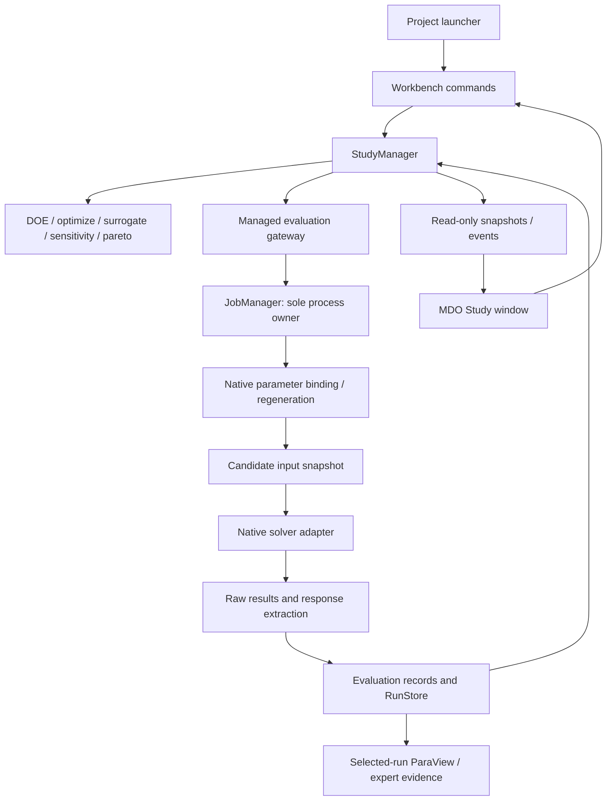

# Commercial CAE MDO benchmark and proposed optimization architecture

**Date:** 2026-10-26. **Repository baseline:** `472465045f28ca2494e38ad73ae60399fbf28caf`, matching remote `main` when this research began. **Deliverable:** engineering research and a proposed replacement architecture; no engine, GUI, dependency, or solver changes are implemented by this report.

## 1. Architectural conclusion and evidence boundary

Replan optimization around a persistent **study**, a typed **design space**, a reproducible **evaluation workflow**, and a queryable **design-point archive**. Numerical algorithms and charts consume those contracts. Adding algorithms to the existing panel without replacing its evaluation and persistence boundaries would not provide commercial CAE optimization behavior.

The recommended product is a dedicated Qt **MDO Study window**, opened from and linked to the launcher project. It combines native parameter binding with a study dashboard: these are complementary responsibilities, not competing product choices. FreeCAD FEM remains the CalculiX modeling authority; ParaView remains the detailed field postprocessor. Workbench commands and JobManager remain the execution boundary. An optimizer must never invoke an arbitrary solver process from a chart callback.

Commercial parity here means credible workflow behavior, numerical semantics, failure handling, and decision support. It does not mean reproducing proprietary algorithms, claiming vendor performance, or displaying every vendor's feature name. No licensed commercial installation was operated for this research. Vendor comparisons below are based on public first-party documentation; GUI behavior is documented behavior, not a hands-on usability benchmark. Public pages and rolling documentation were consulted on the report date; versioned documentation is identified where available. Absence from a cited page does not establish that a product lacks a capability.

Repository facts below come from source inspection at the baseline. Numerical recommendations are supported by method/library documentation and a bounded CAE advisory review. The proposed module/API names, layout dimensions, acceptance thresholds, and delivery sequence are design recommendations. They are not claims about current implementation.

### 1.1 Product constraints that the replan preserves

[DESIGN.md](../../DESIGN.md), especially its opening five decisions and §§8–12, governs program boundaries. Its 2026-10-26 decision already approves a five-stage left controller and right visualization dashboard, with evaluation through JobManager. This report expands the engineering definition of that approved dashboard. A separately executable Study application and the exact new persistence/API contracts are proposals to adopt during implementation; the report does not silently amend DESIGN.

The [existing improvement plan](2026-10-23-codex-improvement-plan.md) and [implementation review](2026-10-23-implementation-review.md) explain why native input preservation, honest failure propagation, and real entry-point verification matter. Historical failures in those documents are not automatically present-day defects. [CURRENT_STATE.md](../../CURRENT_STATE.md) contains both broad completion statements and narrower unfinished-work statements; this report does not adjudicate whole-product completion from them. The optimization assessment is grounded in the code below.

### 1.2 Current implementation: preserve, extend, replace

| Existing location and evidence | What actually exists | Architectural disposition |
|---|---|---|
| [`variables.py`](../../caelab/numerical/variables.py), `normalize_variables`, `encode`, `decode` | Continuous/integer variables, free/fixed modes, explicit units, linear/log sampling; discrete sets and categories rejected | Preserve validation; introduce typed discrete, categorical and derived-variable contracts |
| [`core.py`](../../caelab/numerical/core.py), `_Runner`, `run_doe`, `optimize` | Serial LHS or supplied candidates; single-objective DE; multiple `<=`/`>=` constraints; local memoization, budgets and cooperative cancellation | Extract pure samplers and optimizer adapters; add equality semantics and managed batch evaluation |
| [`fit.py`](../../caelab/numerical/fit.py), `fit_surrogate` | RBF **and quadratic PRS**, separate nonoverlapping training/holdout points, rank/conditioning and holdout error checks; predictions tagged separately | Reuse these safeguards; add GP, multi-response model collections, durable training provenance and validation lifecycle |
| [`analysis.py`](../../caelab/numerical/analysis.py), `_sensitivity`, `_pareto` | Standardized multivariate regression association and sample componentwise nondominance | Preserve as analysis utilities; neither is a global sensitivity guarantee nor a constrained MOO search engine |
| [`sensitivity.py`](../../caelab/numerical/sensitivity.py), [`uq.py`](../../caelab/numerical/uq.py) | SALib Sobol sample/analyzer matching; distribution-based UQ including correlated-normal sampling | Preserve sample identity and failure reporting; add Morris and explicit uncertainty/estimand semantics |
| [`model_binding.py`](../../caelab/numerical/model_binding.py), `ModelEvaluator` | Copy of auxiliary `StructuralModel`, numeric paths and caller-supplied `run_fn` | Keep as an auxiliary adapter; do not make it the native project contract |
| [`jobs.py`](../../caelab/jobs.py), `submit_native`; [`run_store.py`](../../caelab/native/run_store.py), `lease`, `recover_unlocked` | Owned asynchronous native execution, snapshots, results, cancellation and recovery; exclusive store lease held for an individual run | Reuse process ownership; redesign lease scope deliberately for study batches, not by adding a GUI thread pool |
| [`input_snapshot.py`](../../caelab/native/input_snapshot.py), [`results.py`](../../caelab/native/results.py) | Native/include snapshotting and FRD/DAT collection. `_summary` exposes displacement magnitude, empty unit mapping and `reaction_totals=None` | Add explicit parameter-edit and response-extraction adapters; generic mass, stress-limit and stiffness responses are not already wired |
| [`optimization_panel.py`](../../apps/workbench_qt/optimization_panel.py) | Five-stage splitter, convergence/regression/parity charts, programmatic evaluator configuration; `_poll_cancel` calls `QApplication.processEvents()` | Reuse relevant widgets, theme and chart assets; move execution/state ownership out of the widget |
| [`project_window.py`](../../apps/workbench_qt/project_window.py), `open_optimization_panel` | Tools action opens/raises an `OptimizationPanel`; it does not bind the selected native project into a complete optimization evaluator | Replace the empty entry path with explicit study creation/opening and validated binding |

The local DE cache is not durable, provenance-aware simulation caching. The existing Pareto analysis is not NSGA-II. The existing regression tornado is correctly labeled as sample association in code and must not be relabeled as Sobol sensitivity. Conversely, RBF/PRS and holdout validation must not be discarded or reported as absent.

## 2. Commercial optimization software taxonomy and architecture

| Product | Documented architectural center | What to transfer to caelab-workbench (inference) |
|---|---|---|
| ANSYS DesignXplorer | Exploration systems attached to the Workbench Parameter Set; separate direct and response-surface routes. [D1](https://ansyshelp.ansys.com/public/views/secured/corp/v252/en/wb2_help/wb2h_desexplore.html) | Bind studies to the real project parameter and response registry; make solver and surrogate evaluations distinguishable. |
| ANSYS optiSLang | Solver chains, algorithm systems, sensitivity/metamodel/optimization/robustness workflows and a dedicated postprocessor. [O1](https://ansyshelp.ansys.com/public/Views/Secured/corp/v242/en/opti_tut/opti_tut.html) | Treat the evaluation workflow and study strategy as separate persisted objects; assess predictive quality before exploitation. |
| SIMULIA Isight | Component process integration, Design Gateway/Runtime Gateway, optional distributed SIMULIA Execution Engine. [I1](https://www.3ds.com/products/simulia/isight), [I2](https://docs.software.vt.edu/abaqusv2025/English/IhrUserMap/ihr-c-Gateway-RuntimeLayout.htm) | Keep setup distinct from execution monitoring; adapters own application-specific integration while the execution layer owns jobs. |
| Siemens HEEDS | Native tool workflows, distributed execution and SHERPA-driven design exploration. [H1](https://www.siemens.com/en-us/products/simcenter/integration-solutions/heeds/) | Automate complete native regeneration/execution chains; offer sensible strategy presets and visible computational budgets. |
| ESTECO modeFRONTIER | Workflow integration plus Planner strategies and multidimensional analysis; optional VOLTA connection. [E1](https://engineering.esteco.com/modefrontier/modefrontier-capabilities/) | Reuse one workflow for baseline, DOE, surrogate, optimization and robustness studies, rather than reconstructing connections for each algorithm. |
| Altair HyperStudy | Self-contained study with models, variables, responses and multiple approaches; hierarchical Study Explorer. [A1](https://help.altair.com/hwdesktop/hst/topics/design_exploration/study_perform_t.htm), [A2](https://help.altair.com/hwdesktop/hst/topics/user_interface/explorer_overview_r.htm) | Give Study its own persistent document and focused window, with explicit prerequisite/state tracking and contextual analysis tabs. |

These are overlapping PIDO/MDO architectures, not six incompatible categories. MDO concerns engineering disciplines and their couplings; MOO concerns the number of objectives. A single structural solver can support MOO without making the study multidisciplinary. Conversely, several coupled disciplines can have one objective. This distinction is an architectural interpretation, not a vendor exclusivity claim.

### 2.1 ANSYS DesignXplorer

DesignXplorer is the clearest example of project-integrated parameter exploration. In the 2025 R2 Workbench documentation, exploration systems are added below the Parameter Set bar. Parameters can originate in supported analysis/CAD systems. Workbench exposes Direct Optimization, Parameters Correlation, Response Surface, Response Surface Optimization and 3D ROM systems. Thus the product's topology is not merely an optimizer dialog: the parameters, analysis-system update and exploration system have an explicit relationship. Installation and an appropriate DesignXplorer license are required. [D1](https://ansyshelp.ansys.com/public/views/secured/corp/v252/en/wb2_help/wb2h_desexplore.html)

The 2025 R2 DesignXplorer manual documents MOGA settings, initial sampling and candidate verification. Its documented MOGA convergence controls include a Pareto-percentage criterion as well as evaluation/iteration settings. These are product-specific stopping rules, not proof that the physical global Pareto frontier has been found. The useful architectural requirement is an explicit route from a surrogate candidate back to a solver evaluation. Do not equate an attractive response-surface point with a validated design. [D2](https://ansyshelp.ansys.com/public/Views/Secured/corp/v252/en/pdf/DesignXplorer_Users_Guide.pdf)

**Inference for caelab:** retain the launcher as owner of program/file relationships, but let a Study document refer to immutable revisions of its bound parameters. Use separate status labels for predicted, evaluated and revalidated points. A study that outlives a source edit must retain its old evidence and mark the new project relationship stale.

### 2.2 ANSYS optiSLang

The 2024 R2 tutorial structure explicitly distinguishes standalone solver-chain creation from Workbench-connected studies. Its sequence covers registering inputs and responses, defining criteria, running sensitivity analysis, inspecting MOP results, optimizing on MOP/AMOP, and robustness/reliability workflows. This supports a process-plus-strategy model rather than a fixed DOE → fit → optimize sequence for every task. [O1](https://ansyshelp.ansys.com/public/Views/Secured/corp/v242/en/opti_tut/opti_tut.html)

MOP is more than a selectable surrogate family. The 2025 R2 methods reference describes selecting an input-variable subset and approximation model using Coefficient of Prognosis, then examining residuals and sensitivity. It distinguishes fitting from cross-validation prediction residuals and explicitly calls for a solver evaluation to verify the final surrogate-study result. Local error indicators and support density help interpret where the approximation is supported. These diagnostics should be visible alongside a response-surface plot. [O2](https://ansyshelp.ansys.com/public/Views/Secured/corp/v252/en/opti_pdo/opti_pdo_mop_princip_and_competition.mop_subsection.html)

The release-specific `v2611` MOP help lists polynomial regression, MLS and ordinary Kriging among its model options, and explicitly states that nominal discrete parameters are unsupported in MOP calculations. Some model features require the optiSLang AI package. Therefore a comparison must not claim universal categorical-surrogate support merely because a product has discrete optimization variables. [O3](https://ansyshelp.ansys.com/public/Views/Secured/corp/v2611/en/opti_ug/opti_ug_mop.html)

**Inference for caelab:** validate the compatibility of variable encoding, surrogate family and optimizer before scheduling expensive solves. Keep cross-validation metrics distinct from training fit. Do not relabel a generic Gaussian-process implementation as MOP or CoP without implementing and defining the corresponding selection/validation mathematics.

### 2.3 SIMULIA Isight

Dassault describes Isight as a component-based integration environment for CAD/CAE programs, scripts and spreadsheets; its exploration techniques include DOE, optimization, approximations and Design for Six Sigma. The SIMULIA Execution Engine provides enterprise distribution/parallel execution and shared flows/results; it is a separate architectural capability, not a prerequisite to describing an ordinary standalone Isight process. [I1](https://www.3ds.com/products/simulia/isight)

The 2025 Runtime Gateway documentation is unusually useful for a concrete UI specification. It includes a Model Explorer, Sim-flow and Dataflow canvases, Parameters for the current execution, History across runs, Data Analysis, Visual Design approximations, Graphs, Summary and Logs. A Current Job selector and run-number controls bind those views to a specific execution. The GUI therefore makes process structure, design history and selected-run detail separate but coordinated concepts. [I2](https://docs.software.vt.edu/abaqusv2025/English/IhrUserMap/ihr-c-Gateway-RuntimeLayout.htm)

The official Pro component catalog lists LHS/optimal LHS, full/fractional factorial, Box–Behnken and CCD DOE plug-ins; Kriging, RBF/EBF, orthogonal polynomial and RSM approximation plug-ins; and separate optimization plug-ins including Miga, NSGA2, MISQP, NLPQL and multi-objective particle swarm. Package/platform/token distinctions in the catalog must not be flattened into a claim that every installed Isight seat includes every method. A catalog entry marked “License: None” is not evidence that the commercial product itself is free. [I3](https://www.3ds.com/products/simulia/isight/pro-components)

**MIGA correction:** the Isight reference defines a Multi-Island Genetic Algorithm as populations split into islands with periodic migration; fitness combines the objective and a constraint penalty. Island migration is a population architecture, not a synonym for nondominated Pareto selection. An implementation may combine islands and Pareto selection, but that is a separately specified algorithm. NSGA-II and MIGA must not share a misleading “multi-objective” label solely because both names start with “multi.” [I4](https://docs.software.vt.edu/abaqusv2025/English/IhrComponentMap/ihr-c-Reference-MultiIsland.htm)

**Inference for caelab:** a point inspector should select a specific design and attempt, not just “latest run.” A setup/run-analysis distinction can exist within one independent Study window; recreating Isight's entire UI is unnecessary.

### 2.4 Siemens HEEDS and SHERPA

Siemens describes HEEDS as combining process automation, distributed evaluation, search and design-tradeoff analysis. Its integration approach includes native model modification, remeshing/updating models, sequential workflows and co-simulation. SHERPA is documented as a proprietary search approach combining multiple global and local strategies and adapting as information is collected. Its full name is Simultaneous Hybrid Exploration that is Robust, Progressive, and Adaptive. Siemens states that baseline SHERPA does not require fitting a surrogate; the same current product page separately describes an AI Simulation Predictor accelerator. These are compatible statements: “does not require surrogates” is not equivalent to “the current product never uses predictions.” [H1](https://www.siemens.com/en-us/products/simcenter/integration-solutions/heeds/)

The Siemens training outline explicitly covers tagging, analysis portals and variable types, objectives/constraints/error designs, weighted-sum and Pareto optimization, and multiple-analysis workflow chains. This supports treating failed evaluations as operationally meaningful data, and distinguishing scalarization from Pareto search in the interface. [H2](https://training.plm.automation.siemens.com/mytraining/viewlibrary.cfm?language=en_US&lpgid=HEE-LP010&memID=LAAS80005&memTypeID=LAAS80005&product=XAPID809848105&track=&version=)

**Evidence limit:** the public pages do not disclose enough selection, adaptation, scheduling and constraint-handling detail to reproduce SHERPA. No claim should identify it as a particular open algorithm, promise equivalent performance or suggest implementation of a “SHERPA clone.” The applicable lesson is budget-aware hybrid search with recorded decisions, not copying a proprietary algorithm name.

### 2.5 ESTECO modeFRONTIER

ESTECO documents a simulation workflow integration layer and a Planner in which multiple exploration/optimization strategies can share one workflow and project. Its public capability page distinguishes single-run, DOE, optimization and robust/reliability strategies, allows multiple objectives and constraints, and describes parallel/distributed execution. It also advertises its proprietary self-adaptive pilOPT strategy and optional connection to VOLTA. None of these establish that a proposed open implementation is algorithmically equivalent to pilOPT or that a cloud platform must be introduced into caelab. [E1](https://engineering.esteco.com/modefrontier/modefrontier-capabilities/)

Its analytics documentation emphasizes a unified design space, multidimensional charts, sensitivity and analysis of response-surface quality. For competing objectives, it explicitly describes Pareto inspection, feasibility filtering, scatter plots and parallel coordinates to compare candidate solutions. The important GUI pattern is not a wall of unrelated charts: selected/filtered designs must remain the same engineering objects across views. [E2](https://engineering.esteco.com/technology/simulation-data-analytics/)

The DOE guidance describes a progression from problem definition to initial sampling, fit assessment/refinement, multi-objective exploration and actual-model validation of Pareto solutions. Its sensitivity-tool list includes availability qualifications; do not turn a generic website statement into a guarantee that every version/edition exposes every named sensitivity estimator. [E3](https://engineering.esteco.com/technology/design-of-experiments/)

**Inference for caelab:** a Study should contain reusable strategy runs with explicit training-data lineage. Brushing a parallel-coordinates axis should filter the same design-point collection shown by the Pareto plot and table. Candidate selection remains a human tradeoff decision.

### 2.6 Altair HyperStudy

HyperStudy's study file is a self-contained definition of models, input variables, output responses and approaches. The documented `.hstudy` format is XML. This is evidence for the document concept, not a reason for caelab to copy its proprietary file schema. [A1](https://help.altair.com/hwdesktop/hst/topics/design_exploration/study_perform_t.htm)

The Study Explorer guides model/variable/response setup and permits multiple DOE, Fit, Optimization and Stochastic approaches. Its step icons distinguish next action, completed, unavailable and potentially changed conditions. The Work Area uses step-specific tabs and tables/plots with column visibility, sorting and spreadsheet-like transfer. A compact Study tree plus a dominant table/chart area is therefore a strong commercial precedent. [A2](https://help.altair.com/hwdesktop/hst/topics/user_interface/explorer_overview_r.htm), [A3](https://help.altair.com/hwdesktop/hst/topics/user_interface/work_area_overview_r.htm)

Altair's current MOGA reference describes a Pareto-search method, crowding distance, constraint tolerances, parallel evaluations within iterations, failure-handling settings and optional metamodel hybridization. These are concrete capability evidence; they should not be generalized into a claim that its precise implementation is identical to a named open NSGA-II library. [A4](https://help.altair.com/hwdesktop/hst/topics/design_exploration/method_multi_objective_genetirc_algorithm_r.htm)

The multi-objective shape tutorial minimizes volume and maximum displacement using MOGA with RBF-based fits. Its Optima tab displays the resulting Pareto tradeoff. The tutorial recommends a different method, GRSM, for the illustrated case without a Fit; that is contextual vendor guidance, not proof of a universal optimizer ranking. [A5](https://help.altair.com/hwdesktop/hst/topics/tutorials/hst/tut_hs_4425_t.htm)

The postprocessing tutorial exposes Summary, Integrity, Scatter, 3D Scatter and Linear Effects, and monitors evaluations in Evolution Plot/Evolution Data. These document the distinction between inspecting data quality, exploring variable-response relationships and observing execution. [Altair HS-1810, 2023](https://2023.help.altair.com/2023/hwdesktop/hst/topics/tutorials/hst/tut_hs_1810_t.htm)

## 3. What a commercial CAE optimization engine must represent

### 3.1 Problem definition and the meaning of MDO

For design variables `x`, uncertain inputs `ξ`, and discipline/coupling states `y`, define:

\[
\min_x\;\mathbf{f}(x,y,\xi),\qquad
g_i(x,y,\xi)\le0,\qquad h_j(x,y,\xi)=0,\qquad x\in\mathcal X.
\]

Every objective and constraint must name the analysis case and response definition that produces it. A deterministic study fixes `ξ` or its nominal values; an uncertainty or robust-design study declares distributions and statistical operators explicitly. Several objectives from one structural solve constitute MOO, but do not by themselves constitute multiple disciplines.

For coupled disciplines, `y_a = F_a(x_a,y_b)` and `y_b = F_b(x_b,y_a)` require an inner multidisciplinary analysis (MDA). A sequential file-processing graph only covers one-way dependencies. The OpenMDAO Sellar example explicitly groups coupled disciplines and solves them iteratively; it is a useful reference architecture, not a proposed mandatory dependency. [OpenMDAO coupled Sellar example](https://openmdao.org/newdocs/versions/latest/basic_user_guide/multidisciplinary_optimization/sellar.html).

**Proposed workflow contract:** support typed analysis nodes, artifact/response edges, independent parallel branches and explicit coupled-loop groups. Each loop records initial coupling values, transfer operator/version, units, interpolation policy, absolute/relative residual tolerances, relaxation, maximum iterations and convergence history. A loop that does not converge produces an invalid evaluation even if every constituent executable exited normally. Start with the multidisciplinary-feasible pattern—converge the inner analysis before scoring a candidate. An individual-discipline-feasible formulation would additionally expose coupling variables and consistency constraints to the optimizer; it is a separately validated extension, not a renamed DAG.

Freeze loadcases, mesh policy, fidelity and response semantics in a study revision. A thermo-structural study must record temperature transfer and thermal-expansion assumptions; adding a second solver icon is insufficient. Current non-CalculiX adapter registration must not be advertised as working coupled MDO without real native results and transfer validation.

### 3.2 Design variables and parameter binding

| Variable kind | Representation | Required behavior |
|---|---|---|
| Continuous | Finite lower/upper bounds, nominal, unit, linear/log transform | Scale numerical coordinates; preserve physical values; require strictly positive log domain |
| Integer | Inclusive integer bounds or explicit integer levels | Generate valid integer candidates; no continuous optimizer followed by undocumented rounding |
| Discrete numeric | Ordered allowed values, e.g. stock thicknesses `{1.0, 1.5, 2.0, 3.0}` mm | Membership validation and index-to-value mapping; report duplicates after decoding |
| Categorical | Stable category keys and labels, e.g. material families | Category-aware operators; never imply physical distance between arbitrary numeric codes |
| Fixed | Typed value retained in the revision | Exclude from search dimension but include in evaluation identity |
| Derived/dependent | Typed expression with named dependencies, units and validity domain | Acyclic dependency checking and deterministic recomputation; expose invalid combinations before solver submission |

Separate `VariableSpec` from `ParameterBinding`. The first describes the search domain; the second describes how a value reaches a specific native artifact. The same variable may control several linked parameters, but conflicting writes to one native target must fail preflight. Store category definitions and material bundles by immutable revision, including density and all constitutive data actually used.

Two native binding modes are required:

1. **Deck scalar binding.** Select an exact file/include, keyword block, entity/set context and scalar token. Capture the baseline file hash, expected original value, token format, expected match count, declared unit and allowed domain. Apply the edit only to a candidate copy and show a diff. Reject missing/ambiguous targets and changed includes. A keyword-aware scalar locator is sufficient for supported edits; a universal FE model parser is not required. Global text replacement is unacceptable.
2. **CAD/FEA native-property binding.** Resolve a FreeCAD document/object/property or a native parameter expression, modify a copied document through its native API, recompute, regenerate mesh and export the solver deck. Record all generated artifacts and native tool versions. Topology changes can invalidate named regions; unresolved selections must stop the candidate rather than silently move a load or constraint. A manual CAD-to-deck export remains a valid individual workflow but cannot be represented as unattended shape optimization.

Template tokens are an optional binding technique for user-owned input templates. Resolve them into a complete native deck before execution, reject unresolved tokens and keep template/value/output provenance. Do not assume that arbitrary placeholder syntax is supported by CalculiX itself.

Mesh density, convergence controls and fidelity are study controls unless deliberately declared design variables. Optimizing them accidentally can reward numerical error. Conditional category-dependent domains require branch-specific validation and surrogate handling; they are not implemented by assigning zero to inactive variables without metadata.

### 3.3 Response extraction is an engineering contract

A `ResponseSpec` needs quantity, component/invariant, location (node, element, integration point, section/layer), coordinate basis, set/region, loadcase/step, time/frequency/frame policy, reduction order, unit/source, missing-value policy and extractor version. Preserve the raw source artifact and entity/time at which an extremum occurred.

CalculiX uses a consistent user-chosen unit system. Its element outputs distinguish DAT integration-point quantities from nodal extrapolation in FRD; force output also needs care because external nodal forces can include loading and reactions. These are reasons to avoid a generic `stress` or `reaction` label detached from output semantics. [CalculiX 2.23 manual, §§3, 6.11.5 and 6.13](https://www.dhondt.de/ccx_2.23.pdf).

Proposed examples:

| Response | Definition that must be stored | Failure/qualification issue |
|---|---|---|
| Mass | Native CAD/mesh/material mass calculation or solver quantity; include density, included bodies and unit conversion | Missing density, excluded nonstructural mass, or unsupported element-volume integration cannot become zero mass |
| Tip deflection | Declared component or vector magnitude at a stable region, specified loadcase and frame | Magnitude and signed component are different responses; remeshing must preserve region meaning |
| Stress limit | Chosen stress invariant, location, material/section/layer, averaging policy, set and time reduction | Nodal averaged maximum is not integration-point maximum; singular peaks and mesh dependence require qualification |
| Effective stiffness | Defined applied force divided by defined displacement for a specified loading path | Near-zero denominator invalid; nonlinear secant stiffness is not tangent stiffness |
| Multiple loadcases | Explicit envelope across named cases, after per-case spatial/time reductions | Missing a required case makes the aggregate unavailable, not less severe |

For a mass–stiffness–stress trade study, minimize mass and maximize a declared stiffness measure while enforcing a stress limit; optionally add stress as a third objective if the user wants that trade-off. Keep manufacturing limits, mesh-quality checks and physical response constraints distinct. All values in this example are conceptual; no engineering allowable is inferred by the application.

### 3.4 DOE: plans, not just random points

| Method | Engineering use and sample structure | Required implementation checks |
|---|---|---|
| Latin Hypercube Sampling (LHS) | Space-filling starting design; each continuous marginal has one point per stratum | Seed/RNG and transform recorded; mapping to finite levels may create duplicates and alters continuous stratification. [SciPy 1.15 LHS](https://docs.scipy.org/doc/scipy-1.15.0/reference/generated/scipy.stats.qmc.LatinHypercube.html) |
| Scrambled Sobol sequence | Low-discrepancy design; use `2^m` samples for balance properties | Persist scramble/RNG and sequence position. Arbitrary dropping, thinning or non-power-of-two selection loses guarantees. This is not automatically a Sobol sensitivity experiment. [SciPy 1.15 Sobol](https://docs.scipy.org/doc/scipy-1.15.0/reference/generated/scipy.stats.qmc.Sobol.html) |
| Full Factorial | All combinations of declared levels; useful for small mixed/discrete spaces | Count is `∏ L_i` (`2^d` for two levels); preview exact cost and invalid combinations before launch. [NIST full factorial](https://www.itl.nist.gov/div898/handbook/pri/section3/pri333.htm) |
| Box–Behnken | Three-level quadratic response-surface design; avoids simultaneous all-factor corner extremes | Use a documented construction, sufficient factors and center runs; no guarantee of safety under nonlinear constraints. For three factors, 12 edge-midpoint settings plus centers. [NIST Box–Behnken](https://www.itl.nist.gov/div898/handbook/pri/section3/pri3362.htm) |
| Central Composite Design (CCD) | Factorial/fractional core, axial points and centers for quadratic fitting | Specify circumscribed/inscribed/face-centered variant, axial distance and centers. Full core count `2^d + 2d + n_center`; circumscribed axial points may exceed factorial bounds. Never clip them silently. [NIST CCD](https://www.itl.nist.gov/div898/handbook/pri/section3/pri3361.htm) |

A DOE plan stores method/version, typed coordinates, coded coordinates, point roles (factorial/axial/center/replicate/holdout), generation order, randomization, duplicate policy and expected evaluation count. Classical quadratic designs are for quantitative factors: categorical branches need explicit crossed/blocked designs or separate plans. Rounding CCD/BBD to catalog levels changes its rank and statistical properties and must be revalidated.

Use a preview to expose total solver cost, unique points, intended repetitions, geometric/domain violations and proposed holdout allocation. Repeated centers in deterministic FEA can check numerical repeatability but do not create physical experimental-noise evidence. Surrogate holdout points must be independent of training and model selection. An LHS may satisfy the variable box yet be structurally infeasible; DOE cannot promise a feasible design region.

### 3.5 Constraints, feasibility and failure

Normalize definitions centrally, before adapting to any optimizer. Convert a lower response bound `r >= L` to `g = L-r <= 0`, an upper bound to `g = r-U <= 0`, and equality to `h = r-T = 0`. Store physical residuals and scales with their units. Define numerical acceptance using explicit tolerances:

\[
v_i=\max\left(0,\frac{g_i-\tau_i}{s_i}\right),\qquad
v_j^{eq}=\max\left(0,\frac{|h_j|-\tau_j^{eq}}{s_j^{eq}}\right),\qquad
V=\sum_k w_kv_k,\quad s_k>0,\;w_k>0.
\]

Zero inequality tolerance preserves the exact stated limit. Equality tolerances must reflect engineering/numerical resolution; a binary floating-point comparison to zero is not an adequate acceptance rule. Display the original limit, tolerance and residual together. A tolerance must never be expanded automatically to make a design pass.

The canonical interface should expose `g <= 0` and `h = 0`, with adapter-specific sign conversion. For example SciPy old-style `minimize` inequality dictionaries expect nonnegative values, whereas `NonlinearConstraint` accepts lower/upper bounds, including equal bounds for equality. [SciPy minimize](https://docs.scipy.org/doc/scipy-1.15.0/reference/generated/scipy.optimize.minimize.html), [NonlinearConstraint](https://docs.scipy.org/doc/scipy-1.15.0/reference/generated/scipy.optimize.NonlinearConstraint.html).

Default population selection should prefer feasible designs, then compare objectives among feasible designs, and compare declared aggregate violation among infeasible designs. Retain every individual residual for diagnosis. Penalty methods such as `f_scaled + ρ Σ w_i v_i²` are explicit algorithm choices: record scaling and penalty schedule; they can trade objective improvement against violation and cannot certify feasibility. Equality-aware methods, repair operators or variable elimination can be more appropriate than large arbitrary penalties. [pymoo constraint handling](https://pymoo.org/constraints/index.html).

Represent three independent dimensions:

| Dimension | Examples | Consequence |
|---|---|---|
| Execution | queued, running, completed, failed, cancelled, interrupted | Process lifecycle, not design quality |
| Response validity | valid, missing, partial, nonfinite, unqualified | Per-response availability and reasons |
| Feasibility | feasible, infeasible, unknown | Computed only from required, valid constraints |

A successful run can be infeasible. A failed run generally has unknown physical feasibility. Partial output can support a qualified response only if that response's own required scope is complete and policy explicitly allows it; the candidate cannot enter the feasible archive when required constraints are unknown. Preserve readable partial evidence without silently training on it.

Do not insert fictitious response values for failure. An optimizer adapter may internally use an infinity/rejection sentinel, but that is not a solver observation, training target or plotted objective. Infeasible designs with valid responses remain useful training data. Failure rate and observed feasible coverage should be visible; an observed scatter or classifier does not prove the entire domain feasible or infeasible.

### 3.6 Single-objective optimization

| Method | Appropriate use | Limits and adapter requirements |
|---|---|---|
| SLSQP | Local smooth continuous optimization with equality/inequality constraints | Requires reliable derivatives or finite differences and scaling; record evaluation cost of gradients. No automatic integer/categorical or adjoint support. [SciPy SLSQP](https://docs.scipy.org/doc/scipy-1.15.0/reference/optimize.minimize-slsqp.html) |
| Nelder–Mead | Low-dimensional derivative-free local search on an unconstrained response | SciPy bounds clip simplex vertices; general nonlinear constraints require a separately declared strategy. Clipping is not a constrained-search guarantee. [SciPy Nelder–Mead](https://docs.scipy.org/doc/scipy-1.15.0/reference/optimize.minimize-neldermead.html) |
| Differential Evolution | Global exploration of bounded expensive/non-smooth responses; integer dimensions where supported | Large evaluation budget; SciPy supports integrality and constraints but not semantic categorical distances. `workers` must be a managed evaluation map, not a second solver owner. [SciPy DE](https://docs.scipy.org/doc/scipy-1.15.0/reference/generated/scipy.optimize.differential_evolution.html) |
| Trust-region constrained (`trust-constr`) | Local continuous constrained search with suitable derivatives/Jacobian sparsity | A numerical trust region is not automatically a surrogate-management trust-region algorithm. Expose optimality, constraint violation and termination reasons. [SciPy trust-constr](https://docs.scipy.org/doc/scipy-1.15.0/reference/optimize.minimize-trustconstr.html) |

The study selects an algorithm through a capability declaration: variable kinds, constraint forms, derivative requirements, objective count, batched evaluation and checkpoint support. Reject incompatible configurations before execution. Gradient perturbations must exceed deck formatting precision and be checked against solver/mesh noise; categorical switches, contact transitions and remeshing often violate local smoothness. A black-box executable is not automatically complex-step compatible.

Separate iteration count, objective requests, unique designs, actual solver executions, cache hits and wall time. A generation of DE is not one FEA run. All derivative calls, retries and final verification runs consume a declared budget. Termination can mean budget exhausted, stagnation, local convergence, user pause or numerical failure; none proves the global optimum.

### 3.7 Multi-objective optimization and Pareto decisions

Convert objective directions internally to minimization while retaining original display units. Design `a` dominates `b` if it is no worse on every objective and strictly better on at least one. Archive only mutually comparable study revisions and declared feasibility/validity classes. Equal objective vectors may correspond to different designs and should retain their identities.

**NSGA-II** is the recommended first constrained MOO adapter: nondominated sorting and crowding-distance survival provide an explicit multi-objective population method. Use mixed-variable sampling/crossover/mutation only where the selected implementation supports them; the familiar algorithm name alone does not guarantee mixed-variable correctness. [pymoo NSGA-II](https://pymoo.org/algorithms/moo/nsga2.html).

**MOEA/D** decomposes a multi-objective problem into scalar subproblems organized by reference directions and neighborhoods. It is a useful second method, but constraint support is implementation-specific. The inspected pymoo implementation explicitly rejects constrained problems. Therefore the first capability registry must either disable MOEA/D for constrained studies or use a separately verified constrained implementation. Silently dropping constraints to enable it is unacceptable. [pymoo MOEA/D](https://pymoo.org/algorithms/moo/moead.html), [implementation source](https://github.com/anyoptimization/pymoo/blob/main/pymoo/algorithms/moo/moead.py).

**MIGA** means multi-island genetic algorithm in the Isight context. Island populations and migration are search mechanisms, not a guarantee of Pareto selection. A MIGA implementation must specify scalar versus Pareto fitness, feasibility rules, migration topology/rate, archive behavior and mixed-variable operators. Do not label a single weighted-objective MIGA result as a recovered Pareto frontier. Vendor-specific MIGA details belong to their documented implementation, not a presumed universal algorithm.

Maintain an **observed feasible nondominated archive** and a separate **predicted candidate front**. A surrogate front becomes observed only through actual evaluations. An engineering release requires qualification beyond numerical nondominance. Weighted objectives and reference-point/knee selection can help decisions, but their weights/scales are user preferences and must be visible. A weighted sum can miss nonconvex portions of a front; no universal best design exists without preferences.

Track feasible count, archive size, objective ranges, minimum violation and hypervolume against actual evaluation budget and wall time. Hypervolume comparisons require a fixed documented reference point and normalization; changing either invalidates the historical comparison. IGD requires a defensible reference front and should not imply knowledge of an unknown industrial optimum. [pymoo convergence indicators](https://pymoo.org/getting_started/part_4.html).

### 3.8 Surrogate modeling and sequential improvement

| Model | What it provides | Required safeguards |
|---|---|---|
| Kriging / Gaussian Process | Mean prediction and model-conditional predictive covariance/variance; kernel, trend and noise assumptions define the model | Distinguish latent-function uncertainty from noisy-observation uncertainty; normalize using training data only; handle near-duplicate points and kernel conditioning |
| Radial Basis Function (RBF) | Flexible interpolation/smoothing with explicit kernel, shape, polynomial tail and optional local neighbors | Default deterministic RBF has no calibrated probabilistic interval; zero training error is not predictive accuracy. [SciPy RBFInterpolator](https://docs.scipy.org/doc/scipy-1.15.0/reference/generated/scipy.interpolate.RBFInterpolator.html) |
| Polynomial Response Surface (PRS) | Intercept, main effects, interactions and quadratic terms; interpretable local approximation | A full quadratic in `d` variables has `(d+1)(d+2)/2` coefficients; require rank and conditioning checks, not just enough row count. The existing quadratic implementation is reusable |

GP regression supplies a predictive distribution conditioned on a model and observed data. A displayed `μ ± 1.96σ` is a pointwise Gaussian-model interval, not a simultaneous guarantee, FEA discretization-error bar or reliability certification. Kriging is a family with trend/covariance assumptions; it is not a distinct universal uncertainty oracle. [Rasmussen and Williams, GPML chapter 2](https://gaussianprocess.org/gpml/chapters/RW2.pdf). A practical optional adapter can use `GaussianProcessRegressor.predict(return_std=True/return_cov=True)` while recording kernel, fitted hyperparameters, normalization and noise semantics. [scikit-learn GPR 1.5](https://scikit-learn.org/1.5/modules/generated/sklearn.gaussian_process.GaussianProcessRegressor.html).

Proposed model lifecycle:

1. Select a fixed study revision, response definition and eligible observations. Failed values are excluded with reasons; valid infeasible observations are retained. Group repeated designs to prevent train/test leakage.
2. Partition training, tuning/cross-validation and final holdout roles. Fit preprocessing only on training data. If a holdout is used repeatedly to select models, it becomes validation data; reserve fresh final verification.
3. Fit a separate model per required response initially, including constraint responses. Independent GP outputs do not establish joint probability of satisfying all constraints.
4. Publish RMSE/MAE/max absolute error in physical units, a declared normalized metric, residual/parity plots and out-of-domain warnings. For GP, add interval coverage/calibration checks. Near-zero target values need an absolute tolerance, not an unstable percentage error.
5. Search the surrogate under a separate inexpensive-evaluation budget. Label every proposal predicted. Acquisition rules may balance improvement, uncertainty, feasibility and diversity; record their assumptions and pending-point handling.
6. Evaluate selected candidates with the real workflow, compare predicted and actual responses, then create a new model version. Never overwrite a prediction with the later observation; link them.

Large dense GPs require roughly cubic factorization cost and quadratic storage in training count; use a practical data budget and diagnostics before choosing sparse/local approximations. Mixed categorical inputs require appropriate encoding/kernel or separate conditional models. Do not fit Euclidean RBF/GP to arbitrary category numbers and call it material interpolation.

Final validation must include shortlisted Pareto candidates, active-constraint neighborhoods and relevant boundary cases, not just the lowest surrogate mean. User-defined response error tolerances and physical/numerical checks determine acceptance. Fixed 5%/10% chart guidelines can be visual aids but are not universal CAE acceptance criteria.

### 3.9 Sensitivity, uncertainty and robust design

For independent input distributions, variance-based indices have the interpretations

\[
S_i=\frac{\mathrm{Var}(\mathbb{E}[Y\mid X_i])}{\mathrm{Var}(Y)},\qquad
S_{T_i}=\frac{\mathbb{E}[\mathrm{Var}(Y\mid X_{\sim i})]}{\mathrm{Var}(Y)}.
\]

First-order effects and total effects differ because the latter include interactions. SALib separates sampling from model execution and analysis, which fits the proposed managed evaluator boundary. [SALib basic workflow](https://salib.readthedocs.io/en/latest/user_guide/basics.html).

| Analysis | Correct interpretation and implementation |
|---|---|
| Sobol indices | Use the exact matched structured sampling plan. Typical Saltelli-style evaluation counts are `N(d+2)` without second-order indices or `N(2d+2)` with them. Preserve order and blocks; do not drop failed rows and analyze the remainder. Report bootstrap intervals and sample adequacy. Classical independent-input indices are not valid for arbitrary correlated-input data. [SALib analyzers](https://salib.readthedocs.io/en/latest/api/SALib.analyze.html) |
| Morris screening | Efficient elementary-effect trajectories; for `r` ungrouped trajectories over `d` variables, `r(d+1)` evaluations. `μ*` ranks magnitude, signed `μ` can cancel opposing effects, and spread indicates nonlinear/interaction influence. Preserve complete trajectories and scaling. [SALib Morris sampling](https://salib.readthedocs.io/en/latest/api/SALib.sample.morris.html) |
| Correlation | Pearson linear association or Spearman rank association on a declared sample set; show pairwise counts, missing-data policy and constant-column undefined values. Correlation is neither causation nor a global sensitivity decomposition. Arbitrary categorical codes are not quantitative data |
| Regression/tornado | Standardized coefficients are conditional linear associations, requiring rank/conditioning and fit diagnostics. One-at-a-time low/high contrasts are local effects at a stated reference design. Neither is interchangeable with Sobol indices |
| UQ / robust design | Separate manufacturing/load uncertainty from controllable variables, surrogate uncertainty and model discrepancy. Store distributions, correlations, truncation and sampling policy. Robust objectives might minimize mean mass and response variability; chance constraints require an explicit failure event, probability target and uncertainty in that estimate |

A signed tornado may show local contrasts or regression coefficients. A Sobol tornado should show `100 S_i` and `100 S_Ti` as variance fractions with intervals, **without invented direction**. Total-order indices may sum above 100% because interactions are counted across variables. Normalizing absolute regression coefficients to percentages is permitted only as a labeled display convention, never as “percentage of variance explained.” A `μ*` chart is likewise unsigned.

Failed simulations are not evidence of structural failure unless the failure event was defined and reliably detected as such. Reporting a UQ mean from successful runs alone estimates a conditional population; show the exclusions and do not label it the unconditional expected response. For structured sensitivity failures, repair/re-evaluate matching points or label a surrogate-assisted analysis with its validation limits. Do not silently impute values.

## 4. Provenance, asynchronous evaluation and recovery

### 4.1 Evaluation lifecycle and ownership

A design point is a typed assignment; an evaluation is an attempt to execute that assignment through a frozen workflow. One design can have multiple attempts, fidelities, stochastic replicates or verification runs. A strategy run is a DOE/search/UQ campaign consuming those evaluations. These identities must remain distinct.

Proposed lifecycle:

```text
proposed → validated → queued → preparing → running → extracting → evaluated
                ↘ invalid        ↘ failed / cancelled / interrupted

evaluated → response-validity classification → feasibility classification
          → archive/model updates → optional shortlist → explicit verification
```

The added study lifecycle is not a silent rename of existing native `completed`: native process completion, parsing status and study evaluation completion remain separate. A failure during extraction after process exit is not a failed executable and not an evaluated objective.

`StudyManager` coordinates plan generation, budgets, candidate identity, model versions and optimizer feedback. It receives a managed evaluation gateway from Workbench. `JobManager` alone launches and cancels native preprocessing, solver and extraction jobs. Pure numerical modules never import Qt or launch processes. A baseline check, finite-difference perturbation, DOE point, optimization point and confirmation run use the same gateway.

### 4.2 The current lock is an explicit migration prerequisite

At the baseline, `JobManager.submit_native()` acquires `RunStore.lease()` for each run, calls `recover_unlocked()`, and retains the lease through preparation, solve, parsing and artifact hashing. The lease is an exclusive `controller.lock` for the store. `submit_native()` also selects the newly submitted run for the project node. These behaviors are correct for the existing single-controller path but do not support naive concurrent submissions to the same store.

**Required change:** one JobManager coordinator acquires the store lease for the batch, reconciles recovery once, then dispatches a bounded number of owned workers into distinct run directories. Per-run receipts are atomic; queue/budget/selection changes are serialized by the coordinator. Do not make the lock merely reentrant: calling current recovery for each new candidate can mark active peers interrupted. Do not create per-candidate stores solely to evade existing locking rules.

A second Study or analysis process may inspect committed records but cannot concurrently control that store. Initially it should show which window owns evaluation and provide a read-only path; a general daemon/IPC service is unnecessary for the first implementation. All entry points must obey the same lease, including independent native analysis windows. Starting/completing a candidate must not implicitly replace the project's selected result. Selection and publication are user actions.

Bound concurrency by CPU allocation, RAM, solver-license limits where applicable, temporary disk and per-job solver threads. Avoid `workers × solver_threads` oversubscription. Record queue time, runtime, timeout and resource allocation. A failed candidate should not discard successful peers; a configurable repeated-failure threshold can pause further dispatch with a clear reason.

### 4.3 Durable records and cache layers

Use existing atomic JSON/RunStore conventions first. Suggested layout, aligned with the current `<project>.runs` directory:

```text
project.json                         # references study document(s)
<project>.runs/
  <native-run-id>/                    # existing input/output/log/job receipts
  studies/<study-id>/
    study.json                       # mutable head + selected revision/strategy
    revisions/<revision-id>.json      # immutable definition and source references
    strategies/<strategy-id>/
      plan.json
      checkpoint.json                # optimizer state, RNG, pending/consumed IDs
      evaluations/<evaluation-id>.json
      models/<model-id>/              # model recipe + training/validation identities
```

The study links to native-run receipts instead of copying large FRD/VTU files into every chart record. Cross-file atomicity is not supplied by separate atomic JSON writes: reserve an evaluation identity before submission, persist the native-run mapping, then commit a terminal evaluation receipt only after artifacts are recorded. Recovery reconciles intermediate states and orphaned mappings idempotently. A derived table/index can be rebuilt from authoritative records. Introduce SQLite only if measured query/transaction needs justify it; do not establish two conflicting sources of truth.

| Cache layer | Identity inputs | Invalidation/reuse rule |
|---|---|---|
| Native preparation | Baseline document/deck and all dependencies by content, typed values, binding version, native regeneration/mesh recipe and tool version | A source/include or meshing change generates a new preparation identity |
| Solver execution | Prepared deck/dependency content, solver identity/version, relevant command/environment/options, fidelity, random seed/replicate and execution settings affecting results | Reuse only intact eligible artifacts from the same physical/computational problem |
| Response extraction | Native output hashes plus response definition, units/provenance and extractor version | A new stress reduction can re-read unchanged raw data without rerunning the solve if the needed field was saved |
| Analysis/model | Evaluation IDs, response revisions, eligibility/partition, preprocessing, algorithm/library version and hyperparameters | Changed objectives/limits can recompute feasibility/Pareto; changed training data requires a new model version |

Canonicalize types and units explicitly. Do not use rounded GUI values as cache keys or merge near points with undocumented tolerances. Normalize machine-specific directory locations only where they do not affect input semantics, while preserving include resolution and original artifacts. Do not cache a stochastic replication as if it were a deterministic duplicate; a “repeat actual solve” option bypasses reuse. A cache hit records its original evaluation and checks artifact integrity.

Record baseline and effective input hashes, candidate diff, solver/preprocessor versions, relevant non-secret environment settings, output hashes, start/finish times, attempt number, failure reason, extractor version, units, optimizer seed/state and validation role. Preserve stdout/stderr and original native files. Failure caching may suppress repeated invalid geometry within a revision, but transient execution failures need a declared retry policy and must never be returned as valid responses.

### 4.4 Pause, cancel, restart and stale data

**Pause** stops new dispatch and allows active jobs to finish. **Cancel pending** removes queued work while retaining completed observations. **Cancel active** requests termination only of JobManager-owned processes and records cancellation. Do not reuse a PID from disk to kill or adopt an unrelated process.

On reopening, read records without starting a solver. Once controller ownership is acquired, reconcile incomplete receipts as interrupted and preserve partial artifacts. A user chooses whether to retry interrupted points. Retrying creates new attempts; it does not rewrite failed history. Optimizer continuation needs a compatible serialized algorithm state, RNG and pending/consumed candidate IDs. If the library cannot restore them, offer an explicit **restart seeded from previous evaluations**, not “exact resume.”

Asynchronous completion order can alter an adaptive search even with the same random seed. Store both submission and completion sequence. Provide deterministic generation barriers for reproducible population comparisons; expose truly asynchronous adaptation as a separately recorded strategy. Do not claim bitwise reproducibility merely from recording `seed=0`.

| Change | Required visible consequence |
|---|---|
| Source/include, CAD parameter map, material bundle, loadcase or mesh recipe | Create a new study revision; old observations remain evidence for their old problem |
| Extractor/response location or units | Re-extract if possible; otherwise require new outputs; invalidate dependent models/analyses |
| Objective direction, constraint bound or engineering tolerance | Reclassify comparable stored responses and recompute the archive under a new definition revision |
| Variable search bounds | Preserve old observations with their original domain; explicitly choose admissible reuse and rebuild plan/model support metadata |
| Chart colors, axis order or filters | Change only view state, never solver/model identity |
| Source changes during a campaign | Continue only against the already frozen snapshot; show that the project has newer source. No silent mid-campaign rebind |

“Dirty” means unsaved edits in the study definition. “Stale” means a derived artifact no longer matches its referenced definition/source. Neither means that an old simulation is physically false. Project relocation and Save As must preserve relative study/run references, external-source references and hashes; active copying follows the existing no-copy-during-active-write policy.

## 5. Concrete backend architecture for `caelab/numerical/`

### 5.1 Module responsibilities and public contracts

The requested eight modules are the principal boundaries. Keep them small; make `optimize/` or `surrogate/` a package only when multiple adapters warrant it. Names below are proposed APIs.

| Module | Owns | Representative contract | Must not own |
|---|---|---|---|
| `variables.py` | Variable kinds, domains, transforms, encoding, derived dependencies | `validate_space(specs)`, `encode(values)`, `decode(vector)`, `canonical_values(values)` | Native file mutation or arbitrary expression execution |
| `doe.py` | LHS/Sobol/factorial/BBD/CCD plan generation and metadata | `make_plan(space, method, options, rng) -> DOEPlan` | Solver execution, dropping failed observations |
| `constraints.py` | Residuals, tolerances, scaling, feasibility and violations | `assess(responses, definitions) -> ConstraintAssessment` | Converting missing physics to a real numeric observation |
| `pareto.py` | Objective orientation, dominance, feasible archives, indicators and preference views | `update_archive(records, objectives, policy)`, `hypervolume(reference)` | Solver runs or claiming a globally complete frontier |
| `surrogate.py` | RBF/PRS/GP adapters, fit/predict, model recipes, validation and support domain | `fit(dataset, response, recipe) -> ModelArtifact`; `predict(points) -> PredictionBatch` | Returning predictions as actual evaluations |
| `optimize.py` | SOO/MOO adapters, capabilities, ask/tell or managed callback bridging, termination | `capabilities()`, `ask(n)`, `tell(observations)`, `checkpoint()` where supported | Owning native subprocesses or hiding unsupported constraints |
| `sensitivity.py` | Sobol/Morris plans and estimators, correlation and signed-effect reports | `plan(method, space, options)`; `analyze(plan, observations) -> SensitivityReport` | Inferring global sensitivity from an arbitrary failed-row-filtered DOE |
| `study_manager.py` | Study revisions, strategies, candidate/attempt identities, budgets, model/archive updates and recovery reconciliation | `prepare_study`, `start_strategy`, `pause`, `cancel`, `resume`, `snapshot` | A second process manager or FE input schema |

Small shared records can live in `study.py` (or an existing suitable schema module): `StudyDefinition`, `WorkflowSpec`, `VariableSpec`, `BindingRef`, `ResponseSpec`, `ObjectiveSpec`, `ConstraintSpec`, `Candidate`, `EvaluationRecord`, `PredictionRecord`, `ModelArtifact`, `StudyEvent`. Avoid circular dependencies: these records are GUI-free and algorithms consume them. Extract response eligibility/unit/reduction checking from `core.scalar_value` into a shared numerical response helper while retaining its safeguards.

Native bindings belong in `caelab/native/parameter_binding.py` and solver/native-specific adapters, not in the numerical variable encoder. Native response readers extend `caelab/native/results.py` or a focused adjacent extractor. Reuse `SolverAdapter`, `input_snapshot`, RunStore and existing result/evidence transfer. Do not grow `caelab/model` into a universal representation of CAD and every solver deck.



The gateway is injected into StudyManager; numerical code does not import Workbench back into itself. Synchronous SciPy algorithms can run in a worker and block there on managed results. Batch-capable algorithms receive a managed map or ask/tell adapter. A library-owned multiprocessing pool must not bypass JobManager, and arbitrary callback-based SciPy code must not be misrepresented as checkpointable ask/tell.

### 5.2 Minimal study definition example

This is an illustrative proposed schema, not a currently readable file. Hashes are placeholders; values/limits demonstrate syntax and are not approved design allowables. A simple scalar deck study is deliberately shown before automated CAD regeneration.

```json
{
  "schema_version": 1,
  "name": "Bracket mass and stiffness",
  "project_node": "bracket-analysis",
  "baseline": {"artifact": "bracket.inp", "dependency_digest": "<sha256>"},
  "variables": [
    {"id": "thickness", "kind": "continuous", "unit": "mm",
     "lower": 1.5, "upper": 4.0, "nominal": 2.5,
     "binding": "shell-thickness"},
    {"id": "material", "kind": "categorical", "unit": "1",
     "choices": ["steel-bundle-r1", "aluminium-bundle-r2"],
     "nominal": "steel-bundle-r1", "binding": "material-bundle"}
  ],
  "responses": [
    {"id": "mass", "extractor": "native_mass", "unit": "kg"},
    {"id": "k", "extractor": "declared_force_over_displacement",
     "case": "service", "region": "load-point", "component": "Y",
     "frame": "final_converged", "unit": "N/mm"},
    {"id": "stress", "extractor": "von_mises",
     "case": "service", "region": "design-region",
     "location": "integration_point", "reduction": "max",
     "frame": "final_converged", "unit": "MPa"}
  ],
  "objectives": [
    {"response": "mass", "direction": "minimize", "scale": 1.0},
    {"response": "k", "direction": "maximize", "scale": 1000.0}
  ],
  "constraints": [
    {"response": "stress", "operator": "<=", "limit": 150.0,
     "unit": "MPa", "scale": 150.0, "tolerance": 0.0}
  ],
  "execution": {"max_actual_evaluations": 120, "max_parallel": 2,
                "timeout_seconds": 1800, "retry_limit": 1},
  "strategy": {"kind": "direct_moo", "method": "nsga2", "seed": 42}
}
```

The binding registry, complete unit-system declaration, force/displacement definition, material bundles and workflow revision are required linked records; the short example omits their expansion. The stress extractor must first be implemented and qualified for the requested native output. Category-aware NSGA-II operators must be selected explicitly. A preflight error is correct until those capabilities exist. Loading this definition must never substitute the current displacement summary for the requested stress.

### 5.3 Runtime contracts that prevent subtle corruption

Each `EvaluationRecord` carries candidate/attempt/strategy/revision IDs, typed values, native-run IDs, execution state, per-response validity and provenance, feasibility assessment, timestamps and diagnostics. Each `PredictionRecord` instead names the model version, predicted means, optional uncertainty type, support status and proposed candidate. Neither can masquerade as the other through a common `success=True` flag.

Events should include monotonically increasing revision/sequence information: `CandidateQueued`, `EvaluationUpdated`, `ModelReady`, `ArchiveChanged`, `StrategyStopped`. GUI updates are idempotent, read-only snapshots or queued signals; late events from a previous study/revision must not change the newly opened study. Persist before presenting a committed observation. In-flight candidate IDs must be reserved once so repeated notifications do not double-count budgets or observations.

A separate persistence capability flag distinguishes exact checkpoint, restart-from-archive and nonresumable adapters. Checkpoint format includes library/version and state schema; incompatible states fail clearly. Avoid loading arbitrary serialized Python objects from untrusted studies; store recipes/data where possible and use explicit trusted-local model artifact policies when binary model serialization is needed.

### 5.4 Reuse and dependency choices

Keep `core.py` public functions as temporary compatibility wrappers while moving behavior to the new boundaries. Preserve `fit_model` parameter-identification behavior and its experiment semantics; it is not the same operation as surrogate fitting. Keep `model_binding` as the auxiliary model adapter. Reuse `events.py` if its contract is suitable rather than introducing a second incompatible event system.

The current [pyproject.toml](../../pyproject.toml) already declares NumPy, SciPy ≥1.15, optional SALib and GUI Matplotlib/PySide6/VTK. Use these for DOE, SOO, RBF/PRS, sensitivity and charts. Propose scikit-learn for optional GP and a maintained MOO library such as pymoo for NSGA-II behind optional extras. Pin and test an actual supported version before adoption, including constraint/mixed-variable/checkpoint behavior and distribution license compatibility. Their online documentation is not proof that every API works with the repository's declared minimum versions. No new service, cloud account or paid algorithm dependency is necessary for the proposed local core.


