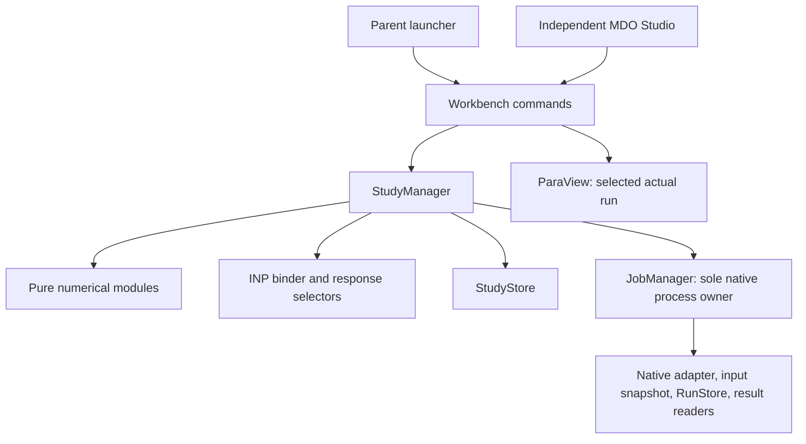

# Clean-slate MDO system: numerical contracts, native studies, and MDO Studio

**Status:** implementation specification; no implementation or solver/GUI acceptance is claimed.  
**Date:** 2026-10-26.  
**Inspected baseline:** `73e50b4`, including remote main `472465045f28ca2494e38ad73ae60399fbf28caf`.  
**Authority:** the latest user instruction to retire the legacy numerical system, subject to the program boundaries in [DESIGN](../../DESIGN.md) and development rules in [AGENTS](../../AGENTS.md).

## 1. Decision and scope

Build a new `caelab/mdo/` package and an independently launched MDO Studio. Retire the **entire** `caelab/numerical/` package, `apps/workbench_qt/optimization_panel.py`, their imports, and obsolete tests in the Phase 1 cutover. Do not rename the old package, copy its engine behind new names, or retain compatibility shims. Git history preserves the retired implementation. Mathematical properties worth testing are reauthored against independent references, not copied as assumptions from the old implementation.

This delivery specifies that replacement. Actual source deletion and replacement belong to the implementation phases below; this documentation change does not leave the application with broken imports. It supersedes the reuse/extension direction in [the previous rearchitecture proposal](spec-mdo-engine-and-gui-rearchitecture.md) and [the stage 4 panel specification](spec-stage4-optimization.md). Commercial feature comparisons are background, not evidence that this implementation works.

The user must be able to select a real native input, declare variables and criteria, generate design points, run CalculiX through JobManager, inspect failures and trade-offs, validate a selected candidate with an actual calculation, set its parameters as current with a recoverable backup, and reopen the study without triggering calculations.

The parent remains a launcher connecting programs. Studio owns study setup and scalar response exploration; FreeCAD owns geometry/meshing and ParaView owns detailed field postprocessing. No required LLM or provider enters the calculation path. Applying a point and running a calculation are separate commands.

### 1.1 MDO versus multi-objective optimization

Multiple objectives alone are not multidisciplinary analysis. A study declares a `DisciplineGraph`: named analyses with typed input/output ports, units, artifact references, dependencies, and explicit transfers. Phases 1–3 support a single CalculiX discipline and acyclic compositions of supported analyses. Topological execution and failure propagation are mandatory; an edge cannot mean only a line on screen.

Cycles are rejected during validation. Coupled multidisciplinary analysis would require a subsequent contract for transfer operators, initial coupling values, scaled residuals, relaxation, iteration history, convergence tolerances and nonconvergence. This specification does not claim that arbitrary coupled solvers, remeshing, or other currently incomplete native adapters become supported through registration. A token change may alter section thickness or load; it does not regenerate geometry or mesh.

### 1.2 Non-negotiable distinctions

| Distinction | Contract |
|---|---|
| Candidate vs attempt | A design point is immutable parameter data; retries produce new attempt IDs and native runs. |
| Actual vs prediction | Actual observations reference native runs; predictions reference a fitted surrogate and training revision. |
| Execution vs readability vs feasibility | Process completion does not establish valid responses or engineering feasibility. |
| Feasible vs qualified | Satisfying declared criteria is not independent engineering approval. |
| Selected vs current | Clicking or brushing changes selection only. An explicit transaction changes the current input. |
| Saved vs resumed | Reopening reads records; Resume is a separate command and never implicitly resubmits uncertain work. |

## 2. Package structure and dependency direction

```text
caelab/mdo/
  __init__.py            # small, explicit public API; no eager optional imports
  variables.py          # typed domains, linked DAG, reversible codecs
  objectives.py         # criteria transformations and scalarization
  constraints.py        # residuals, tolerances, feasibility, penalties
  doe.py                # designs, diagnostics, reproducible generation
  surrogate.py          # GP/RBF/PRS adapters, training and validation artifacts
  optimize.py           # optimizer adapters and evaluation requests
  pareto.py             # sorting, crowding, front selection, hypervolume
  sensitivity.py        # sample/analyze contracts and ranked display data
  study_manager.py      # orchestration, budgets, retries, current-design command
  inp_binder.py         # byte-span token discovery, rendering, apply planning
  contracts.py          # immutable StudySpec, DesignPoint, Attempt, Observation
  study_store.py        # versioned records, locks, checkpoints, queries
  responses.py          # source-aware scalar extraction over native readers
  disciplines.py        # typed DAG, transfer validation, scheduling

apps/workbench_qt/mdo_studio/
  __init__.py
  __main__.py           # independent process: --study / --project / --node
  window.py             # four-area QMainWindow and commands
  controller.py         # Workbench commands, queued event delivery
  study_tree.py
  setup_dock.py
  design_points_model.py
  design_points_view.py
  selection.py          # shared selection by immutable point ID
  views/
    pareto_view.py
    parallel_view.py
    response_surface_view.py
    sensitivity_view.py
    convergence_view.py

tests/mdo/              # new domain, numerical, native and persistence tests
tests/gui/mdo_studio/   # new model/view and workflow tests
```

Dependency direction:



Core modules never import Qt, VTK, `apps`, examples, or tests. Algorithms cannot call a solver executable or mutate an input. They request evaluations through a protocol supplied by StudyManager. Workbench owns user-command entry points; StudyManager owns scheduling; JobManager owns processes, termination and native receipts. Native reader extensions remain in `caelab/native/`, not copied into the new package.

### 2.1 Dependency decisions

Use NumPy and SciPy for arrays, QMC, SLSQP, DE, RBF and linear algebra; scikit-learn for GP; pymoo for NSGA-II and independently checked indicators; SALib for paired Sobol/Morris sampling and analysis. These are local libraries, not paid services. New dependencies belong to an `mdo` optional extra; keep a base launcher usable without it. Retire the `numerical` extra at cutover and update installation documentation and Windows launcher configuration together. `gui` retains the existing PySide6 version guards and VTK/Matplotlib; installing Studio requires `gui,mdo`.

The SciPy adapter API baseline is 1.15 (`rng`, DE integrality). Proposed validation baselines are scikit-learn 1.5+, pymoo 0.6.1.5+, SALib 1.5+; these are selection targets, **not tested compatibility claims**. Phase 1 resolves a compatible Python 3.11/3.12 dependency set and records exact versions; Phase 2 tests the declared minimum and selected current versions before publishing dependency bounds. Isolate version-sensitive imports in adapters. Missing optional libraries disable the relevant action with installation guidance, never silently switch algorithms. Do not deserialize arbitrary pickled models or checkpoints.

## 3. Shared data contracts

All public records are validated, frozen dataclasses with stable string IDs; arrays crossing layers are read-only copies. Persist an explicit `schema_version`, discriminated record types, UTC timestamps and typed values in strict JSON (no NaN/Infinity). Missing numbers use `null` plus a reason. Display precision is independent of stored precision.

| Record | Required content |
|---|---|
| `StudySpec` | revision, variable space, criteria, native template manifest, discipline DAG, response selectors, units, DOE/optimizer configs, seed, budgets |
| `DesignPoint` | ID, creation index, study revision, independent/linked physical values, encoded vector, source (manual/DOE/optimizer), duplicate/replicate relationship |
| `EvaluationAttempt` | ID, point ID, attempt number, execution hash, native run references by discipline, timestamps, state, terminal reason, extraction revision |
| `ResponseObservation` | response ID, nullable finite value, unit, validity, run/artifact hash, field/set/frame/reduction, coverage and warnings |
| `Prediction` | point ID, response ID, mean, nullable variance, variance kind, surrogate ID, training revision, domain warning |
| `ConstraintAssessment` | raw residuals, normalized residuals, violation vector, total violation, nullable feasibility, reason when not assessed |
| `OptimizationResult` | termination reason, actual archive, predicted proposals separately, trace, algorithm/version/seed, budget usage |

Proposed public signatures (interfaces to implement, not current APIs):

```python
VariableSpace.encode(values, purpose="surrogate") -> EncodedPoint
VariableSpace.decode(vector, purpose="optimizer") -> PhysicalPoint
generate_design(space, config, rng) -> DesignBatch
evaluate_criteria(observations, criteria) -> CriteriaEvaluation
fit_surrogate(dataset, config, split) -> SurrogateArtifact
predict(model, points, variance_kind="latent") -> PredictionBatch
optimize(problem, evaluator, config, cancel) -> OptimizationResult
StudyManager.submit(point_ids, expected_revision) -> BatchHandle
StudyManager.cancel(batch_id, mode="stop_all") -> None
StudyManager.prepare_apply(point_id, target) -> ApplyPlan
StudyManager.commit_apply(plan_id, expected_target_hashes) -> ApplyReceipt
```

`evaluator.evaluate_batch()` returns records keyed by request ID, never a positional list that depends on completion order. An optimizer's blocking API may wait in a worker, never the GUI thread. Batches finish deterministically by proposal order for seeded generational algorithms. Every changed study definition creates a new revision; an active campaign retains its frozen revision. Response/criterion edits can reprocess retained artifacts without relabeling the original results.

## 4. `variables.py`: physical domains and encodings

```python
@dataclass(frozen=True, kw_only=True)
class ContinuousVariable:
    id: str
    name: str
    unit: str
    lower: float
    upper: float
    initial: float
    transform: Literal["linear", "log"] = "linear"

@dataclass(frozen=True, kw_only=True)
class DiscreteVariable:
    id: str
    name: str
    unit: str
    values: tuple[float, ...]  # finite, unique, sorted physical levels
    initial: float

@dataclass(frozen=True, kw_only=True)
class CategoricalVariable:
    id: str
    name: str
    choices: tuple[str, ...]  # stable identities; display names are separate
    initial: str

@dataclass(frozen=True, kw_only=True)
class LinkedVariable:
    id: str
    name: str
    unit: str
    expression: str
    dependencies: tuple[str, ...]
    lower: float | None = None
    upper: float | None = None
```

Validate unique IDs, finite bounds, `lower < upper`, and initial membership. A constant is an explicit fixed parameter, not a zero-width independent coordinate. Integer ranges/steps are a convenience constructor for `DiscreteVariable`; reject a nonpositive step or an endpoint not on the declared grid.

For continuous linear scaling, `u=(x-l)/(h-l)` and `z=2u-1`; inverse transforms restore physical values. Log scaling uses `log(x)` with strictly positive bounds and records the transform. Bounds refer to physical values. Invalid user input is rejected, not silently clipped. Numerical repair is limited to an optimizer's explicitly recorded repair policy. Store original suggestions and decoded/repaired values.

Discrete encoding uses physical normalized levels for distance-based numeric models; optimizer integer indices are decoded through the level table. Nearest-level repair has a deterministic lower-index tie rule and records collisions. Nonuniform levels do not become a fake continuous interval. Categorical surrogates use one-hot features with a stable vocabulary; categorical optimizers use choice operators. Integer category codes are serialization IDs, never distances, ordered sensitivity inputs or SLSQP coordinates. Exact one-hot decoding is required; soft scores require an explicit argmax repair policy and tie rule. Unknown categories fail.

Linked expressions are evaluated in topological order over a restricted expression AST (numeric literals, named dependencies, approved arithmetic/functions). No Python `eval`, imports, attributes, file access or arbitrary calls. Detect cycles, missing variables, division by zero, nonfinite results and dimensional incompatibility. Linked variables do not increase DOE dimension or receive independent Sobol indices. Physical values are the source of truth; codec version, feature order and bounds are frozen in a study/surrogate artifact. `decode(encode(x)) == x` holds for legal domains within declared floating tolerance.

Probability distributions for sensitivity are separate from optimization bounds. Phase 1 defaults to independent uniform distributions over continuous bounds; later declared distribution transforms must preserve the same physical domain and explicitly state truncation. Never infer a probability law from an optimizer population.

## 5. `objectives.py`: comparable objectives without hidden scalarization

`ObjectiveSpec(id, response_id, sense, target, target_band, offset, scale, weight)` accepts `MIN`, `MAX`, `TARGET`; all supplied numeric fields must be finite, scale is strictly positive, weight and target band nonnegative, target/band required only when relevant. Values retain physical units.

Convert all objectives into minimization coordinates:

\[
F_m(y)=\begin{cases}
(y-a_m)/s_m & \mathrm{MIN}\\
-(y-a_m)/s_m & \mathrm{MAX}\\
\max(0,|y-T_m|-\delta_m)/s_m & \mathrm{TARGET}.
\end{cases}
\]

`delta=0` is exact target matching. SLSQP may use a declared squared target loss outside a target band only when its smoothness requirements are met; record the loss definition rather than silently changing the objective. Offset/scale come from engineering references or a frozen baseline dataset, not the current population. Automatic calibration requires a saved calibration revision; degenerate scale requests fail.

NSGA-II receives the vector `F`; weights do not change Pareto dominance or remove an objective. For explicitly selected weighted-sum single-objective runs, normalize positive weights to sum to one and compute `sum(w_m F_m)`. At least one must be positive. Explain that one scalar run does not recover an entire nonconvex frontier. Display raw values alongside transformed criteria; missing required responses make criteria unassessed, not zero or a good score.

## 6. `constraints.py`: residuals, tolerances and three-state feasibility

`ConstraintSpec` carries response/expression, kind, physical limit, positive residual scale `s`, acceptance tolerance `t >= 0`, marginal band `b >= 0`, and penalty weight. Upper bounds define `g=y-U`; lower bounds define `g=L-y`; equality defines `h=y-T`. Expressions use the same restricted AST and unit validation as linked variables. Tolerance and band have residual units; neither is a library's convergence tolerance.

All constraint numeric fields must be finite. Constraint aggregation weights are strictly positive so no declared constraint disappears from violation ordering. Disabling a constraint requires an explicit study revision; a zero penalty weight is not a hidden disable switch.

For each constraint define the dimensionless excess:

\[
e_j=\frac{g_j-t_j}{s_j}\quad(\text{inequality}),\qquad
e_j=\frac{|h_j|-t_j}{s_j}\quad(\text{equality}),\qquad
v_j=\max(0,e_j),\quad V=\sum_j w_jv_j.
\]

Thus mathematical `g <= 0`/`h == 0` are explicit nominal requirements; numerical acceptance uses the declared tolerance. For inequalities `t=0` is the default. Equalities require a stated engineering/numerical tolerance, not hidden exact floating comparison. Store nominal and tolerance-adjusted residuals.

| Aggregate tag | Exact rule for all required valid observations |
|---|---|
| `FEASIBLE` | all `e_j <= 0` |
| `MARGINAL` | some `e_j > 0`, and every `e_j <= b_j/s_j` |
| `INFEASIBLE` | at least one `e_j > b_j/s_j` |

No constraints means FEASIBLE for a valid evaluation. Missing, failed, cancelled, unsupported or nonfinite responses mean **feasibility is null, reason NOT_ASSESSED**, outside the three-state enum. Partial data may show individual constraint assessments but never aggregate acceptance with a missing required criterion. MARGINAL is not accepted feasibility and is excluded from the default feasible front.

Native constrained solvers use normalized residuals. NSGA-II uses feasibility-first survival: valid accepted feasible points precede violated points; within violated points prefer smaller `V`, with deterministic tie handling. Invalid evaluations are outside the scientific archive. For adapters requiring penalties, use `P=lambda * sum(w_j v_j**p)` with declared `p=1` or `2`, positive lambda and immutable configuration. Synthetic adapter scores remain transient; never store a failure penalty as a measured response. Penalties cannot convert an invalid point into a recommended design.

## 7. `doe.py`: designs with explicit applicability

`DesignBatch` includes ordered physical points, coded coordinates, generation seed/state, algorithm and version, factor order, design roles (center/axial/factorial), replicates, duplicate groups and diagnostics. Show the projected number of solver attempts before dispatch. Resource budgets reject infeasible run counts before allocating the matrix.

| Design | Generation and required checks |
|---|---|
| Opt-LHS | Start with stratified LHS; optimize seeded multi-start within-column swaps. `maximin` maximizes minimum pairwise distance; `correlation` minimizes off-diagonal squared correlations; `hybrid` uses a saved lexicographic ordering. Save restart/iteration limits, achieved distance/correlation/discrepancy and Latin-stratum checks. This is a finite search, not a proof of global optimality. |
| Sobol QMC | Scrambled sequence with `random_base2(m)`, `n=2**m`; persist scramble seed and sequence position. Do not drop the first row, thin, or pad arbitrary counts while claiming balance. Show requested versus valid block size. This space-filling design is not the paired sensitivity estimator design. |
| Full factorial | Cartesian product of explicit levels; mixed categorical/discrete/continuous levels allowed. Compute `product(level_counts)` first and enforce budget. |
| Box-Behnken | Full pair-block construction for continuous `k>=3`: each pair takes four `(+/-1,+/-1)` combinations, other factors zero, plus `n0>=1` centers; `N=2k(k-1)+n0`. State the construction, check quadratic rank and do not claim all reduced/block designs are supported. |
| CCD | Full `2**k` factorial + `2k` axial + `n0` centers. Face-centered `alpha=1`; circumscribed rotatable `alpha=(2**k)**0.25`; inscribed design scales so axial points meet hard bounds. Circumscribed axial points beyond hard limits are rejected or the user chooses a new design; never clipped. |

SciPy `random-cd` reduces centered discrepancy; it must not be mislabeled as maximin or zero correlation. LHS coordinate swaps preserve strata; Lloyd postprocessing is not used for the strict Latin contract. The library's documented distinction informs this adapter design. [SciPy LHS](https://docs.scipy.org/doc/scipy/reference/generated/scipy.stats.qmc.LatinHypercube.html), [Sobol](https://docs.scipy.org/doc/scipy-1.15.0/reference/generated/scipy.stats.qmc.Sobol.html).

Response-surface designs use coded continuous factors; categorical/discrete factors require separate strata or full factorial selection. Quantizing LHS can create duplicates and destroy the Latin property: report both continuous design diagnostics and decoded-domain diagnostics. Do not silently replenish duplicates and continue calling the design Latin. Replicates intentionally bypass evaluation-cache deduplication. CCD star-point treatment follows the distinction between circumscribed, inscribed and face-centered designs. [NIST CCD](https://www.itl.nist.gov/div898/handbook/pri/section3/pri3361.htm), [NIST Box-Behnken](https://www.itl.nist.gov/div898/handbook/pri/section3/pri3362.htm).

## 8. `surrogate.py`: predictions, uncertainty and qualification

Fit each response independently in v1; correlated multi-output covariance is not implied. A training dataset contains only valid actual observations for that response, with point/run IDs and units. Failed observations are excluded with counts/reasons, not imputed as penalty values. A model spanning only successful runs must expose that domain limitation.

Every artifact stores codec/response definitions, training IDs/hashes, preprocessing, fitted parameters, software versions, random seed, split/CV definitions, metrics and warnings. Persist JSON plus safe numeric arrays (`allow_pickle=False`); rebuild supported estimator state or deterministically refit from recorded data, checking prediction consistency.

### 8.1 Gaussian process / Kriging

Default to constant mean preprocessing and a scaled Matérn 5/2 kernel with automatic relevance determination; offer Matérn 3/2 and squared exponential. Normalize numeric inputs, standardize each response using training statistics, and optimize bounded kernel hyperparameters with seeded L-BFGS-B restarts. Save fitted length scales, log marginal likelihood, bound hits and conditioning diagnostics.

For training covariance `C=K(X,X)+Sigma_noise+epsilon I`, use Cholesky solves, never an explicit inverse:

\[
\hat y(x)=\mu+k_x^TC^{-1}(y-\mu),\qquad
\sigma_f^2(x)=k(x,x)-k_x^TC^{-1}k_x.
\]

Return both `mean[n, responses]` and `variance[n, responses]` in physical units and squared units. The default variance is **latent response uncertainty**. Observation variance additionally includes declared observation noise. Jitter is numerical stabilization, not measured physical noise. Squaring a library `return_std` result is required, with noise semantics verified for the configured kernel. Only tiny roundoff-negative variances may clamp to zero; materially negative values are model errors. [scikit-learn Gaussian processes](https://scikit-learn.org/stable/modules/gaussian_process.html).

Duplicate deterministic inputs are grouped; conflicting replicates require an explicit noise model or rejection. Use bounded jitter escalation and report the chosen value; do not hide singularity. A categorical one-hot kernel requires adequate category coverage and validation; interpolation between category codes is forbidden. Large exact GP fits have cubic time and quadratic storage: estimate cost and require an explicit dataset limit or alternate model, never unannounced subsampling.

`mean +/- 1.96 sigma` is a pointwise Gaussian model interval conditional on its assumptions, not a guaranteed 95% engineering confidence bound. Validate coverage on untouched actual observations. Predicted feasibility is separately labeled and cannot qualify an actual design. Bayesian acquisition, chance constraints and trust-region search are not implicitly implemented because variance exists.

### 8.2 RBF and quadratic PRS

RBF uses SciPy `RBFInterpolator`, with kernel, smoothing, polynomial degree, shape parameter and neighbor policy saved. Support thin-plate spline, linear and multiquadric; enforce kernel-specific degree/shape and rank requirements. Shape/smoothing selection happens inside training CV. Plain RBF has `variance=None`, not zero uncertainty. [SciPy RBFInterpolator](https://docs.scipy.org/doc/scipy-1.15.0/reference/generated/scipy.interpolate.RBFInterpolator.html).

Full quadratic PRS for `d` independent continuous factors is

\[
\hat y=\beta_0+\sum_i\beta_ix_i+\sum_i\beta_{ii}x_i^2+\sum_{i<j}\beta_{ij}x_ix_j,
\quad p=(d+1)(d+2)/2.
\]

Fit coded variables with QR/SVD, never normal equations. Require at least `p` independent rows, full rank, and report singular values and condition number. Default policy: warning above `1e8`, reject above `1e12` or rank deficiency; thresholds are configurable and recorded. These are software qualification thresholds, not universal physical limits. A just-determined fit cannot establish residual variance; validation still needs additional points. Ridge is a separate declared model, not a silent fallback. In v1 restrict full quadratic PRS to continuous independent factors; mixed-factor contrast models require a later explicit basis contract.

### 8.3 Validation and model selection

Group identical decoded designs and repeated native evaluations in the same split to avoid leakage. Fit scaling/hyperparameters on training folds only. A seeded holdout defaults to 20% where sample count supports it; small datasets use declared grouped CV and retain a separate final confirmation set. A chronological holdout is offered for adaptive campaigns. Holdout data used to select a model is validation data, not an untouched final test.

Report RMSE, **mean** absolute error (MAE), maximum absolute error (`MaxAE`), and R² per response. Constant-target R² is undefined and shown as such. Record sample counts and physical units. CV refits all selected preprocessing; LOOCV is available with a budget warning. A surrogate is marked usable for a requested search only after per-response tolerances set in the study are satisfied. Extrapolation/out-of-domain warnings remain visible even when aggregate metrics pass. All proposed optima require actual confirmation before promotion.

## 9. `optimize.py`: adapters and evaluation budgets

`OptimizationProblem` contains independent domains, objective vector, normalized constraints and evaluation mode (`ACTUAL` or `SURROGATE`). Configurations include seed, population/iteration limits, native-attempt budget, wall time, max failures and stop tolerances. The ledger counts cache hits, predictions, launched attempts, retries and confirmation attempts separately; reserve confirmation budget explicitly.

| Adapter | Supported domains and behavior |
|---|---|
| NSGA-II | Multi-objective; pymoo adapter with non-dominated sorting and crowding survival. Continuous SBX/polynomial mutation; discrete level/index-aware mutation and repair; categorical choice crossover/mutation. Deduplicate decoded physical points, retain intentional replicates separately. Configure population, crossover/mutation probabilities, distribution indices and generations. |
| SLSQP | Continuous differentiable scalar objective or explicit scalarization. Bounds and nonlinear constraints; linked expressions must be differentiable for this mode. Use normalized coordinates, analytic/available derivatives or declared finite-difference steps. No rounding categorical/discrete variables inside gradients. Report termination message and residuals; library success alone is not feasibility. |
| Differential Evolution | Scalar or explicit scalarization; bounded continuous and declared discrete numeric levels through an adapter. SciPy integrality handles integer lattices, not arbitrary category meaning. Nonuniform levels require explicit index decoding; categorical domains route to NSGA-II or are rejected. Nonlinear constraints, strategy/population/mutation/recombination and convergence settings are persisted. |

The NSGA-II design uses variable-specific mating with multi-objective rank/crowding survival; `MixedVariableGA` alone is not assumed to be NSGA-II. [pymoo NSGA-II](https://pymoo.org/algorithms/moo/nsga2.html), [mixed-variable customization](https://pymoo.org/customization/mixed.html).

Convert our tolerance-adjusted normalized residuals explicitly for the chosen SciPy interface: legacy SLSQP dictionary inequalities receive `-e=(t-g)/s>=0`. The familiar `-g>=0` applies only to the zero-tolerance unscaled case. A nonzero equality tolerance uses both `(t-h)/s>=0` and `(t+h)/s>=0`, or the equivalent normalized interval `-t/s <= h/s <= t/s`; exact equality at `t=0` may use the equality interface. Thus optimizers and GUI assessments use the same accepted set. DE polishing defaults off for expensive/mixed native studies; if enabled, its evaluations share the same budget and dispatcher. [SciPy minimize](https://docs.scipy.org/doc/scipy-1.15.0/reference/generated/scipy.optimize.minimize.html), [DE](https://docs.scipy.org/doc/scipy-1.15.0/reference/generated/scipy.optimize.differential_evolution.html).

All native evaluations, including finite differences and polishing, pass through StudyManager. Disable library-managed subprocess pools for CAE execution; concurrency is a dispatcher policy. SLSQP stops a failed evaluation with a diagnostic rather than inventing a differentiable failure surface. NSGA-II/DE can reject invalid evaluations and continue within a bounded failure policy. A run with no valid feasible points returns `NO_FEASIBLE_DESIGN`, not the least-bad point as a successful optimum.

Termination reasons include `CONVERGED`, `BUDGET_EXHAUSTED`, `STALLED`, `CANCELLED`, `NO_VALID_EVALUATIONS`, `NO_FEASIBLE_DESIGN`, `FAILED`. Convergence of a surrogate search is not convergence of the CAE design. Checkpoints store proposal order, population/archive, RNG states, budgets and pending request IDs using versioned safe data. If an adapter cannot restore exact internal state, label the action “restart from saved archive”; never promise bitwise continuation across library versions.

## 10. `pareto.py`: dominance and progress indicators

For finite minimization vectors, `a` dominates `b` iff every component is `<=` and at least one is `<`. Use exact stored transformed comparisons in v1; rounding belongs to display. Optional epsilon-dominance would be a separate saved policy. Equal vectors do not dominate each other; retain contributing point IDs even when the plotted marker is grouped.

Implement the Deb fast non-dominated sorting baseline with explicit `O(MN²)` time and worst-case quadratic bookkeeping; never market it as subquadratic. For larger archives use a validated backend adapter, retaining a small brute-force oracle in tests. Crowding distance sums normalized neighbor differences per objective; skip constant objectives, mark boundary points infinite only for nonconstant dimensions, and use stable point IDs to resolve ties. Handle empty, singleton, duplicate and all-constant fronts.

The scientific Pareto frontier contains **actual valid FEASIBLE** points from compatible study/criteria revisions. A predicted front and a marginal/violated candidate layer may be displayed separately. Failed/unknown points cannot enter any measured front. Constraint-dominance during optimizer search is distinct from extracting this accepted frontier.

Hypervolume is the union of rectangles from accepted minimization points to a fixed reference `r`. Freeze coordinate normalization and `r` before comparing generations; `r` must be componentwise worse than every included point. Out-of-reference points are excluded with a reported count or trigger a new, explicitly separate trace revision; never move `r` silently. Empty accepted archive has HV=0. Implement exact 2D and verified exact 3D computation; use a named library backend or seeded Monte Carlo with uncertainty for higher dimensions, clearly labeled approximate. Example oracle: points `(1,3),(2,2)` with `r=(4,4)` have HV=5. HV and all convergence traces retain source population/archive IDs.

## 11. `sensitivity.py`: correct experiments and honest rankings

| Method | Numerical and sampling contract | Returned display data |
|---|---|---|
| Sobol | `S_i=Var(E[Y|X_i])/Var(Y)`; `ST_i=E[Var(Y|X_-i)]/Var(Y)`. Independent inputs and a paired A/B/hybrid sample design from the same sampler/analyzer contract. For first/total without second order, `N(D+2)` rows, base `N=2**m`. | S1, ST, bootstrap intervals, sample counts, output variance, seed and convergence diagnostics |
| Morris | `r` grid trajectories of `D+1` points; elementary effect is output difference divided by coded step. Persist grid levels, delta, trajectory selection and transforms. | signed mu, unsigned mu-star, sigma and intervals; rank by mu-star |
| Spearman | Pairwise ranks with tie handling; declare row mask and sample size per pair. Constant variables/outputs yield undefined correlation. | rho, optional uncertainty, missing counts; rank by abs(rho), retain sign |
| Tornado | Presentation data from a selected method, not a new statistical estimator. Alternatively evaluate low/high one-at-a-time perturbations about a saved baseline. | variable ID, metric, magnitude, optional sign, interval, unit, baseline/method and evidence IDs |

The SALib sample layout and analyze options must match; point IDs preserve exact estimator row order even when jobs finish asynchronously or share cache values. Arbitrary Opt-LHS or optimizer populations cannot be passed to the Sobol estimator. [SALib sampling](https://salib.readthedocs.io/en/latest/api/SALib.sample.html), [SALib analysis](https://salib.readthedocs.io/en/latest/api/SALib.analyze.html).

Do not drop failed rows from a Sobol matrix or splice incomplete Morris trajectories. Retry within budget or mark the analysis incomplete; surrogate-filled sensitivity is a separate surrogate-based analysis with that model's validation limits. Do not filter to feasible samples and claim the original independent-input Sobol experiment. Correlated inputs and unordered categories are unsupported for the v1 Sobol/Morris estimators; reject the request or explicitly choose another analysis. Discrete numeric factors need a declared compatible grid/distribution and estimator validation.

For constant `Y`, sensitivity is undefined. Finite-sample Sobol estimates may be negative or above one; retain them with uncertainty rather than clipping. Total-order indices are unsigned and may sum above one; never normalize them to 100% or invent direction. Spearman correlation is not a variance contribution or causal effect. One-at-a-time tornado direction describes that specified perturbation, not global interaction effects.

## 12. Native input binding and response provenance

### 12.1 `inp_binder.py`: substitution without deck regeneration

Maintain three distinct artifacts: immutable tokenized template closure, immutable rendered attempt input, and mutable current-design input. The original user deck is preserved before template creation. Discover tokens such as `<THICKNESS>` and `<PRESSURE>` through byte spans; suggested names do not infer physical meaning, units, bounds or parameter types.

`BindingSpec` maps variable ID to token name, allowed file/occurrences, scalar representation, unit conversion and optional reviewed categorical literal map. Numeric values use locale-independent finite formatting with saved precision sufficient for round-trip; never emit NaN/Inf or locale commas. Categorical replacements are whitelisted scalar identifiers such as material names, not arbitrary card blocks or paths. Tokens in comments are ignored and preserved. Unsupported file encodings or token positions fail explicitly.

Rendering replaces only approved token byte spans. Preserve BOM/encoding, newline style, comments, whitespace, card order and all other bytes. Repeated approved occurrences receive the same value. Unknown/unbound tokens, malformed token syntax, overlapping spans and replacements containing newline/card delimiters are errors. A no-op render is byte-identical. Changes in token width may shift offsets, so apply spans from the immutable original, not progressively reparsed text.

Discover transitive `*INCLUDE` files using the native snapshot rules; detect cycles, missing files and changed closure membership. Parameterize only explicit approved spans, never INCLUDE paths or restart references in v1. Output-request cards are required by response configuration and reviewed as a template revision; the binder does not silently inject them. The native snapshotter may separately rewrite INCLUDE path tokens for isolation; record this separately from parameter replacement. Preserve both the template bytes and effective solver bytes with hashes.

The inspected snapshotter rejects quoted INCLUDE filenames containing blanks even though the CalculiX manual permits them. Fix and test this native parser gap in Phase 1; do not present it as a solver restriction. Verify nested relative-path interpretation against the installed producer and its actual working directory before claiming support; the current collector resolves relative names from the root solver working directory. Unsupported external dependency forms remain explicit preflight errors.

### 12.2 Scalar responses over FRD/DAT

`ResponseSpec` must declare source (`FRD`, `DAT`, or explicit deterministic derived expression), field, component/invariant, node/element set, spatial location, frame/step/time selector, reduction, expected coverage and unit declaration. Include parser/extractor version in the extraction identity. Resolve frame selection within the requested step; “last” cannot mean a different analysis step after a deck edit.

Use existing native readers first, with explicit extensions where needed. The inspected DAT adapter exposes final-frame displacement/force/totals; it does not already supply general stress histories or mass. Unsupported selectors fail before dispatch when known, otherwise produce a response-specific invalid result. Requested source/field absence is not zero. FRD and DAT values at different frames/locations are not merged automatically.

Require the intended step/loadcase/time endpoint and its completion evidence for optimization-valid observations. End-of-file is not proof that the requested endpoint was reached. An explicit “last available” exploratory selection can inspect intermediate results but cannot silently qualify a truncated run. Adding this endpoint check is implementation work: the current readers' last-frame summaries do not establish it.

Displacement magnitude, signed component, maximum over a set, and reaction resultant are different operations. “Nodal force” is not automatically support reaction. A reaction response requires a constrained support set, the appropriate solver output and documented sign/basis. Stress maxima must state nodal extrapolated versus integration-point data and invariant construction; do not average scalar von Mises and call it the invariant of an averaged tensor. Mass needs an actual supported output or an explicit unit-consistent derived quantity with traceable density/volume inputs. No hardcoded beam formula is a native CAE mass extractor.

CalculiX RF can include applied nodal and equivalent distributed-load contributions as well as reactions. A support set alone is insufficient: a reaction extractor must establish that such contributions are absent at selected supports, or perform an explicitly validated subtraction with matching step, frame and basis. Otherwise retain the external-nodal-force label and mark a requested reaction response unsupported.

A partial result can supply a response only if its complete requested field/set/frame coverage is independently established and warning policy allows it. Default qualification rejects incomplete required coverage. Preserve solver warnings and raw artifacts. Unknown units prevent combining unlike responses or applying limits with declared units; require a user declaration or explicit compatible conversion, never guessing the solver's unit system. CalculiX is unit-consistent, not unit-prescribing.

## 13. `study_manager.py`: dispatch, persistence and recovery

### 13.1 Storage and identities

Keep native run receipts in the existing **flat** project RunStore so existing discovery, selected-run transfer and evidence readers can find them:

```text
<project>.runs/
  <run_id>/                         # existing NativeRun layout; immutable attempt
  mdo/<study_id>/
    study.json                      # schema/current revision and manifest
    revisions/<revision>.json       # immutable StudySpec
    templates/<template_hash>/...   # original/template closure
    study.sqlite                    # point/attempt/observation/association index
    models/<model_id>/...            # safe metadata and arrays
    checkpoints/<campaign_id>/...
    apply/<transaction_id>/...       # plans, journal, backup manifest, receipt
```

StudyStore is a local SQLite repository with transactional writes, foreign keys, indexes by point/attempt/revision/status, and one owning writer. Readers receive immutable snapshots. Native RunStore receipts remain the authority for process outcomes; SQLite references them and can reconcile after interrupted index writes. Do not maintain two independent process status truths. JSON manifests and SQLite commits use explicit revision IDs and recovery markers; atomically replacing one file does not make a multi-file transaction atomic. Store on a local supported filesystem; network-share locking semantics are not assumed.

Use UUIDs for study, point and attempt identity; a human `DP_000123` label is only stable display order. Compute separate hashes:

* `execution_hash`: schema, canonical typed independent/linked values and units, template/INCLUDE closure contents and resolved roles, effective bound input hashes, discipline graph/transfers, native adapter version, executable content/version, command settings, relevant environment/solver threads and reproducibility settings, evaluation seed. Normalize incidental isolated-root path names, not physical input differences. Do not hash secrets or treat paths alone as file identity.
* `extraction_hash`: execution hash + output content hashes + response selector/extractor definitions and unit conversions.
* `assessment_hash`: extraction hash + objective/constraint definitions and fixed scales/tolerances.

Canonical serialization has sorted keys, type tags, normalized negative zero and finite round-trip float representations; no display rounding. File traversal order is deterministic. Cache reuse requires matching execution identity, verified artifacts and successful required extraction. No reuse for failed/interrupted attempts, damaged outputs, changed solver/input/environment, or intentional replicates. Reassessment can reuse physics; changing a requested output that was never written requires a new template/run. Cache hits link to the original actual attempt and retain their own candidate identity.

### 13.2 JobManager integration and concurrency

The current `JobManager.submit_native()` holds `RunStore.lease()` for a whole run. Sending parallel submissions to one existing store is therefore **not** a supported batch implementation.

Phase 1 uses sequential submissions through that API, default `max_parallel=1`; StudyManager owns a study dispatch lock, waits off the GUI thread and reconciles receipts. Each attempt receives its own `run_id` working directory through JobManager. Staged bound inputs are immutable before submission. Study associations are written before submission, then linked to the returned run; recovery reconciles the gap with a persisted request token added to the native receipt.

Phase 2 introduces an explicit JobManager `submit_native_batch` controller contract: acquire the project-store lease once, register one batch owner, allocate isolated child run directories/controls, and release the lease only after all children terminate and receipts are durable. Child submission cannot reacquire the same lease or create independent owners. A batch must not invoke unlocked recovery on another live child. Preserve normal single-run API semantics. Native submission selection side effects must be suppressed for a study batch: incoming rows do not change the user's selected analysis/ParaView result.

Reserve in-flight execution hashes under that same controller so duplicate proposals share a pending attempt unless explicitly marked as replicates. Read-only observers must not perform recovery of active children. Phase 1 also needs the selection-suppression/request-token additions to `submit_native`; sequential dispatch must not repeatedly steal the user's selected run.

Parallel limits account for cores per solver, memory estimate, user cap and total native budget; `parallel_jobs * threads_per_job` cannot silently oversubscribe the declared capacity. Capture the actual environment. No GUI-owned process pools. A single point may contain several discipline runs; downstream analyses start only after their declared upstream responses/artifacts are valid, with hashes of transferred data in the child identity. Shared external native programs are not assumed concurrently writable.

### 13.3 State machine, cancellation and crash policy

```text
point request: PROPOSED -> QUEUED -> PREPARING -> RUNNING -> READING
                         \             \          \          \
                          +------------ terminal outcome ------+
terminal: VALID | INVALID_RESPONSE | FAILED | TIMED_OUT | CANCELLED | INTERRUPTED
```

This study outcome overlays, and never replaces, native `queued/preparing/running/completed/failed/cancelled/interrupted` plus read status. A valid infeasible point remains `VALID` with feasibility `INFEASIBLE`. A zero-exit missing FRD is `INVALID_RESPONSE`. Raw process state, exit code, parser status and assessment stay independently queryable.

Timeouts cover queue waiting (optional), preparation, solver execution, result reading and entire campaign with separate reasons; native wall timeout must not accidentally exclude an unbounded parser. Every terminal path records timestamps and logs. “Stop scheduling” allows owned running jobs to finish; “Cancel batch” requests termination only of owned JobManager children, with escalation and cleanup status. Failed cleanup blocks reusing affected directories and cannot be reported as safely stopped.

On crash/reopen, query locks and durable receipts. An unowned nonterminal run becomes INTERRUPTED; do not kill a saved PID or assume it belongs to this study. Reopening never starts jobs. An explicit Resume reconciles completed records, offers interrupted points for new attempts, and avoids duplicate dispatch using request tokens and execution identity. Default retries are zero; user-configured bounded retries only for identified transient execution/I/O failures, not physical nonconvergence or a broken response definition. Never overwrite a failed attempt.

### 13.4 Project operations

Workbench exposes proposed `create/open_study`, `generate_points`, `run/cancel/resume_study`, `fit_model`, `optimize_study`, `analyze_sensitivity`, `apply_design_point`, and `open_design_point_result` commands. A standalone Studio creates/uses the same project/run services; it does not need an internal StructuralModel or parent process.

Save As must lock the project and study stores in a fixed order, reject active dispatch/training/apply writes, checkpoint/close database writes, copy manifests/assets/checkpoints and flat native runs, then verify hashes and rebase owned references. Current RunStore copying alone does not establish consistent study copying. External user decks remain external references; Save As must not retarget or overwrite them. Record deletion/removal from a study preserves native attempts and user files; explicit artifact cleanup is a separate future command.

## 14. Set as Current Design Point: recoverable feedback

The visible command is **Set as Current Design Point**. Clicking a row never invokes it. Predicted-only, incomplete, cancelled or stale-revision points require actual evaluation first. Eligibility requires a completed native attempt, all required actual responses valid, and an unchanged applicable study/template revision. A valid marginal/infeasible point may be applied only after the user sees its violated criteria and explicitly chooses it; it is never labeled a validated optimum.

1. **Prepare:** freeze selected point, applied values, target root/INCLUDE closure, before hashes and proposed after hashes. Render from the immutable token template, not the already-substituted current deck. Present changed parameters, target file and any constraint warnings. No calculation starts.
2. **Validate:** acquire managed target/project locks; recheck source/template/target hashes, declared units, permissions and disk space. Reject input changed in FreeCAD/an editor since the plan. Parameter substitution cannot overwrite a changed unrelated card. Reject targets with active managed calculations or an incomplete earlier apply journal.
3. **Back up:** preserve exact original bytes of every modified file. Root `model.inp` gets `model.inp.bak`; includes get `<filename>.bak`. If a backup already exists, preserve it under a versioned transaction backup before updating the `.bak`. Record paths, before hashes and verified backup hashes. A backup failure aborts before target writes.
4. **Stage and commit:** write same-filesystem temporary outputs, flush them, create a durable per-file transaction journal, and use atomic replacement per file. A multi-file closure is **not** globally atomic. Managed readers/runners remain blocked until all replacements and parameter/current-point metadata are committed. Append an immutable ApplyReceipt with point/attempt IDs and before/after/backup hashes.
5. **Refresh:** update the current parameter revision, project input fingerprint and affected downstream stale state. Keep the selected historical run labeled as that run. Do not copy its “success” onto the new current analysis state. Enable a separate Run command and open its actual historical result in ParaView only by explicit selection.
6. **Recover/undo:** before any future run, finish or roll back a pending journal by checking each file against before/after hashes. If an external editor changed a file, preserve it and require reconciliation; never blindly restore over it. Undo itself is a hash-checked, backed-up transaction. No process launch occurs during recovery.

Advisory locks cannot stop every external editor. Recheck immediately before each replacement, detect conflicts, journal progress and report remaining external-edit limitations. This is a recoverable managed workflow, not a claim of global filesystem serializability.

Updating an exported INP does not update `.FCStd`. Preserve the originating CAD relation and mark the active deck as parameter-modified relative to that export. Geometry-changing values require a separately implemented native CAD/mesh regeneration adapter and are rejected by the scalar token binder. This prevents claiming CAD feedback that only changed deck text.

## 15. Four-area MDO Studio

Launch with `python -m apps.workbench_qt.mdo_studio --study <study.json>` or project/node arguments. The parent offers a discoverable Open MDO Studio command and a study node/file relationship; it launches/restores the independent process through Workbench. Both legacy parent and auxiliary-window panel entry points are replaced. Studio can open a study directly without an analysis window or expert program.

```text
+--------------------------------------------------------------------------------+
| MDO Studio     File   Study   Run   View   Help       Run selected   Stop        |
+-------------------+-------------------------------------+----------------------+
| 1. Study Tree     | 3. Table of Design Points            | 2. Setup Dock        |
|   Inputs         | Name Status Feasibility Parameters   | contextual editor    |
|   Variables      | Responses Attempts                   | with Apply / Revert  |
|   Criteria       +-------------------------------------+                      |
|   DOE            | 4. Visualization Studio             |                      |
|   Evaluations    | Pareto | Parallel | Surface |        |                      |
|   Surrogates     | Sensitivity | Convergence            |                      |
|   Optimization   |                                     |                      |
|   Sensitivity    | shared selection / view controls    |                      |
+-------------------+-------------------------------------+----------------------+
| 12 / 48 completed     2 failed     running 1     Stop scheduling / Cancel        |
+--------------------------------------------------------------------------------+
```

The four areas are responsibilities, not four permanently visible columns. Use QDockWidget for tree/setup, a central vertical QSplitter for table/visualization, and named layout persistence. At narrow sizes collapse docks into accessible tabs or explicit View toggles; preserve edits, focus and central table access. Avoid automatic rearrangement during editing. The desktop design guidance on panels and selection motivates this behavior: view selection must not apply a design or commit configuration.

Use the common engineering dark palette with light toggle, Segoe UI/Malgun Gothic fallback and tabular numbers; keep units in headers, adequate variable-name width and 28–32 logical-pixel default rows with a compact option. Selection has one consistent accent; feasibility uses text/icon plus color. Do not paint the entire table green or put a button/widget in every cell. Internal hashes/PIDs are stored, not permanent dashboard content. Actual logs and file locations remain accessible when relevant.

### 15.1 Area 1 — Study Tree

Hierarchy: Study → Inputs/Disciplines → Variables → Criteria (Objectives, Constraints) → DOE plans → Evaluation campaigns → Surrogate models → Optimization runs → Sensitivity analyses → Saved selections/current design. Nodes point to immutable revisions or artifact IDs. Show actionable state (needs setup, running, failed, results available), not a fabricated linear “step complete” wizard. Selecting a node changes the contextual editor and relevant result view; expanding/collapsing never runs a task.

### 15.2 Area 2 — Setup Dock

Editors cover domains/linked variables/token discovery, objective sense/target/weights/scales, constraint limits/tolerances/bands, response source/field/set/frame/units, DOE count/seed/diagnostics, surrogate validation, optimizer and resource budgets. Domain-incompatible choices are explained inline before running. Display validation beside the offending entry. Apply creates a new study revision; Revert restores the draft. Running revisions are immutable. An edited variable cannot retroactively change completed row values.

First use: Open native input → create token template → declare variables and responses → validate setup → generate points. Empty states have that next action and no demo numbers. Batch execution and applying to the current design are discoverable menu/toolbar actions, not available only by right-click.

### 15.3 Area 3 — Table of Design Points (TDP)

Use `QTableView + QAbstractTableModel`, with a stable ID row map and typed data roles; **not** QTableWidget or per-cell QWidget allocation. Columns include human point label, evaluation state, feasibility, physical variable values, response values/units, prediction marker, attempts and selection/current indicator. Missing values render as an em dash with a short reason. Read-only completed records cannot be edited; cloning a point creates a new candidate.

For 1,000–10,000 candidates maintain a compact snapshot of scalar columns with O(1) cell lookup and numeric sorting. Larger studies use indexed queries, `canFetchMore/fetchMore`, and ID-based paging; sorting/filtering must apply to the whole dataset, not only fetched pages. Use delegates and fixed/default row heights; avoid scanning every row with `resizeColumnsToContents` on updates. A proxy may filter an in-memory snapshot; paged mode uses store-side sorting/filtering with the same semantics.

Worker updates arrive through queued Qt signals as immutable deltas. Only the GUI thread calls model APIs and begin/end insert/reset methods; coalesce bursts and update changed ranges. No file reads, GP fit, solver waits or response parsing in `data()` or paint events. Qt documents this thread boundary. [QAbstractTableModel](https://doc.qt.io/qt-6/qabstracttablemodel.html), [model/view architecture](https://doc.qt.io/qt-6/model-view-programming.html).

Selection is by point IDs through sorting/filtering, shared with plots and restored after updates. Commands: run selected/new points, stop scheduling/cancel, inspect attempt/log, open actual result, clone, export filtered table and set current. CSV exports physical units, status and actual/predicted identity; formula-like text is escaped for spreadsheet opening. No automatic expensive rerun from editing a cell or selecting a chart marker.

Acceptance performance target on a recorded Windows reference machine: 10,000 rows × 30 scalar columns, first usable table under 1 s after snapshot delivery, p95 scroll/selection event handling under 50 ms, and p95 GUI event delay below 100 ms during 10 result deltas/s. Report hardware, Qt version, row count and memory; targets are not current measurements. Virtual rendering does not by itself make filtering, database queries or plots fast.

### 15.4 Area 4 — five engineering views

| View | Interaction | Truth and rendering rules |
|---|---|---|
| 2D/3D Pareto | Choose 2/3 objectives, pan/zoom/rotate, pick/brush markers, inspect selected point; mark feasible front | Physical axes with min/max/target labels; actual/predicted/marginal layers visibly distinct. Projected 2D dominance does not replace full-objective dominance. No interpolated Pareto surface across disconnected points. |
| Parallel coordinates | Choose/reorder axes; per-axis brushing; linked table filtering | Continuous axes use declared scales, discrete levels labeled, categories occupy labeled bands. No implied category distances. Downsampling is explicit with full-data selection and highlighted selections retained. |
| 3D response surface + sliders | Two continuous axes, one response; sliders/selectors fix all remaining inputs; linked values recompute | A labeled surrogate slice at saved model revision. Actual samples overlay only if slice proximity is stated. Categorical controls are selectors; invalid domains mask the surface. Uncertainty has its own layer; slider movement predicts only and never calls a solver. |
| Sensitivity tornado | Choose response/method; rank, compare intervals and inspect experiment | Metric and units named; ST has no sign or forced percentage sum. Signed rho/mu or OAT effects show direction. Insufficient data is an actionable empty state, not fabricated bars. |
| Convergence trace | Evaluation-count/generation/wall-time axes; best feasible scalar objective, measured HV, feasible count, violation and failures | Actual calls separate from predictions/cache hits; fixed HV reference/normalization. No “best objective” scalar for an unscalarized multi-objective run. Preserve gaps and failed attempts; optional derivative/local traces labeled. |

Reuse existing Matplotlib Qt canvases for 2D plots with collection-based drawing/blitting where supported; reuse VTK's Qt integration for real 3D scatter/surfaces. Do not add a browser/WebEngine chart layer or another plotting dependency without evidence the existing stack fails the stated interaction targets. Surface-grid generation/prediction is cancellable and debounced off-thread; VTK/Qt scene updates remain on their owning GUI thread. Bound grid sizes and rendered point counts, retaining full-resolution scientific records. Stale worker results include revision tokens and are discarded after selection/model changes.

Plot decimation preserves selected points and the complete displayed feasible frontier. Show the rendered/available count and active filter; decimation cannot change computed rankings, statistics or exports.

If VTK is absent or rendering unavailable, expose a labeled 2D slice fallback; it does not pass the 3D-view acceptance criterion. Tooltips/selection use physical values with units, not only normalized coordinates. Keyboard focus, screen-reader labels, non-color state indicators, Korean text/IME, high-DPI scaling, dock restore and long names are required checks. Actual Windows views at normal and narrow sizes are required before GUI delivery; offscreen tests do not substitute for that evidence.

## 16. Concrete implementation and migration: Phases 1–3

The following phases specialize DESIGN's research-generalization work. They do not declare other solver integrations or prior product gates complete. Each phase uses bounded implementation ownership, pre-work discussion and independent review under AGENTS. The parent/service contracts are main-owned and edited by one assigned owner at a time.

### Phase 1 — clean cutover and a real sequential study

**Deliver:** new domain contracts, codecs, criteria, persistence, token binder, response selectors for a documented CalculiX subset, DOE baseline, sequential JobManager integration, and an independently launched Studio shell with tree/setup/TDP. A user can create a small native study, run/cancel it, inspect actual rows and reopen it. Only implemented capabilities are enabled; shell availability is not full Studio completion.

1. Freeze the retirement inventory against the actual candidate SHA. Introduce new package/service interfaces and tests in an isolated integration branch. Do not add a dependency from new MDO to legacy numerical code.
2. Implement and test immutable templates, strict responses, execution/request identity and StudyStore reconciliation. Add a direct headless study path using the same Workbench commands. Implement transactional current-design apply here, before any GUI action can mutate a deck.
3. Implement basic full factorial, plain/optimized LHS and Sobol QMC; implement objective/constraint assessment and exact small-front Pareto operations. Leave advanced modules' actions unavailable until implemented, with no silent placeholder outputs.
4. Add standalone Studio entry point and service-backed TDP. Replace all old imports/menus/docks/theme hooks in one coherent cutover commit; remove the entire retired package and obsolete tests in that commit. The candidate must still launch both parent and auxiliary analysis windows.

| Retirement target observed at baseline | Cutover action |
|---|---|
| `caelab/numerical/` including `__init__`, `core`, `fit`, `analysis`, `variables`, `model_binding`, `events`, `uq`, `sensitivity`, AGENTS and old MERGE_REQUEST notes | Delete from active tree; no forwarding imports. Shared native/model/PDE modules are not part of this deletion. |
| `apps/workbench_qt/optimization_panel.py` | Delete and replace callers with independent Studio launch. |
| `main_window.py` menu, dock creation, `open_optimization_panel`, theme propagation | Remove panel-owned state and route the new action through Workbench. |
| `project_window.py` cached panel, menu, opener and close/cancel coupling | Replace with independent-program launch and explicit study control; closing parent must not dereference a removed panel or silently cancel unrelated work. |
| `tests/test_numerical_engine.py`, `test_numerical_model_binding.py`, `test_numerical_sensitivity.py`, `test_optimization_panel.py` | Retire legacy API/UI tests; reauthor applicable mathematical and failure invariants under `tests/mdo/` and new GUI tests. |
| `tests/test_gui_shell.py` panel assertion; `theme.py` old test-specific comment | Update actual entry-point expectations and remove stale coupling. Preserve unrelated shell assertions. |
| `pyproject.toml`, README, launcher/dependency instructions, DESIGN/ARCHITECTURE/CURRENT_STATE and applicable AGENTS | Remove active legacy install/ownership claims, document new entry point and actual implemented subset. Historical records remain marked historical. |

**Exit evidence:** no executable import of `caelab.numerical` or `optimization_panel`; parent/analysis/Studio import and launch tests; byte preservation with CRLF/BOM/INCLUDE fixtures; root/include change cache invalidation; valid infeasible row versus solver failure; cancellation/timeouts/crash reconciliation; two consecutive current-design applies and rollback faults; one actual user-owned CalculiX deck with several points, native result comparison and save/reopen. New oracle tests cover codec roundtrip, linked cycles, constraint boundaries and known Pareto/HV examples. Run the required product regression once on the integrated candidate, distinguishing pre-existing failures and missing environments.

### Phase 2 — numerical methods and managed parallel evaluation

**Deliver:** all requested DOE variants, GP/RBF/PRS with validation, NSGA-II/SLSQP/DE, Sobol/Morris/Spearman, validated DAG evaluation and JobManager batch leasing. Completion requires genuine responses and failure handling through the same services, not standalone benchmark functions alone.

Core owner implements numerical adapters/tests; execution owner implements the reviewed JobManager batch contract and service/store changes after shared contracts are fixed. No simultaneous edits of those shared files. GUI may expose only completed service capabilities. Train/validation and optimizer models use immutable revisions; final actual confirmations bypass cache when a fresh run is requested.

**Exit evidence:** LHS strata/achieved criteria, CCD axial positions and Box-Behnken rank; exact quadratic PRS recovery and rank-deficient rejection; GP prediction/variance against a small independently solved covariance example; grouped holdout leakage checks; constrained SLSQP known solution and sign checks; DE integral/nonuniform levels; mixed NSGA-II valid decoding and deterministic seeded population behavior; non-dominated fronts/HV against brute force; additive-function Sobol known indices and interaction case; Morris linear effects and Spearman ties/constant data. Include a failed Saltelli row and ensure analysis does not manufacture a result.

For scheduling, inject out-of-order completion, cancellation, parser failure, duplicate requests, interrupted receipt/index writes, exhausted budgets and concurrent controllers. Confirm no overlapping input directories, no other process termination and no unintended selected-run changes. Perform an actual multi-point CalculiX study with isolated concurrent attempts and one deliberate failure, then reopen. A DAG fixture must prove that downstream native inputs contain the actual upstream transferred value/artifact; analytic mocks validate scheduling only and are labeled as such. Cycle rejection is mandatory. Other solvers require their own real adapter acceptance.

### Phase 3 — complete interactive Studio and end-to-end handoff

**Deliver:** all four areas, all five views, linked selection/filtering, performant large tables, clear predicted/actual separation, current-design apply/undo, full-field ParaView transfer, export, Save As and reopen. The application must support the complete real-file workflow without hidden direct solver callbacks or demo fixtures.

**Exit evidence:** a reviewer uses a native input not used to implement the feature: open → parameterize → criteria → DOE → actual runs/failure inspection → surrogate validation → constrained multi-objective search → fresh native confirmation → Pareto/TDP selection → set current with verified backup → separate rerun → ParaView → save/close/reopen. Check source edits while planning apply, damaged/missing outputs, duplicate categories, unresolved linked variables, readonly targets, full disk/write faults, interrupted apply and independent read-only study access.

On Windows record normal/narrow layouts, 100/150/200% DPI, Korean IME, keyboard access, dock restore, selected-row stability, all five views and the 10,000-row performance test. Native solver/ParaView checks, mocked faults, mathematical tests and offscreen renders remain separately reported. Update CURRENT_STATE only with observed results; no general “commercial-grade” or “MDO complete” claim based solely on test counts or a screenshot. Before cutover/phase delivery, resolve each review criticism with its original reviewer; publication/merge remains governed by the user's authorization and AGENTS.

## 17. Design review decisions and source limits

The specification was developed with a bounded CAE adviser and an independent architecture reviewer. The following design objections were accepted because no contrary code evidence justified dismissing them:

| Objection | Resolution specified here |
|---|---|
| Existing whole-store run lock prevents naive parallel dispatch | Sequential Phase 1; explicit JobManager single-owner batch lease in Phase 2; flat native receipts. |
| Nested attempt stores would evade existing discovery/rebasing | Study index references existing flat NativeRuns; Save As gains explicit study locking/index handling. |
| Replacing tokens destroys the source for a second apply | Immutable token templates, separate rendered current deck, per-file backups and durable recovery journal. |
| INP changes do not regenerate CAD or establish solver qualification | Explicit native-deck-only feedback; actual response validity separate from feasibility and CAD lineage. |
| Old reuse/panel rules contradict the new instruction | Update their authoritative wording; retire the complete package and all identified callers in one cutover. |
| Generic MDO wording could imply unsupported coupled analysis | Typed executable DAG only; cycle rejection and explicit coupled-analysis extension requirements. |
| Missing results could be mislabeled infeasible, GP certainty or sensitivity direction overstated | Nullable unassessed feasibility; variance semantics and validation; method-specific sensitivity values and sampling. |

This is design review, not independent execution QA. Current parser/locking observations refer to the inspected baseline. Library/manual links support specific algorithm or API statements; our thresholds, storage choices, phase gates and performance budgets are engineering design decisions. Exact dependency compatibility, native solver behavior for every response selector and real-window usability must be established during implementation.

Primary sources are linked beside the relevant contracts. The CAE adviser consulted the [CalculiX author's manual source](https://github.com/Dhondtguido/CalculiX/blob/7109537497f5bc76160000b990177c7d7368789c/doc/CalculiX.tex), sections Units, Input deck format, `*INCLUDE`, `*NODE FILE`, `*NODE PRINT`, and Forces obtained by selecting RF. That development manual documents consistent user units, comma-separated input, quoted INCLUDE names and RF containing applied forces as well as reactions. The release PDF fetch timed out, so installed-version verification remains required. Consult the [CalculiX documentation portal](https://www.dhondt.de/) for the producer's release manual and output-card details. Do not infer universal output coverage from one producer version or reuse old benchmark success as new-system acceptance.
